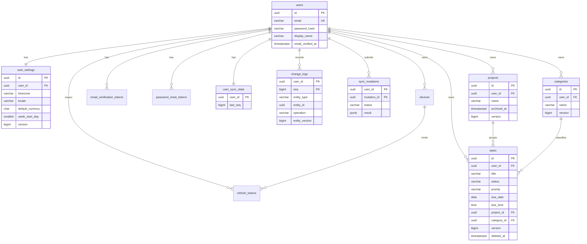

# LifeOS — Database Design (Phase 1)

> **Trạng thái:** v1 — đã duyệt 2026-11-05.
> **Phạm vi:** schema PostgreSQL (server) và SQLite (Flutter) đủ để viết migration và entity cho Phase 1.
> **Ràng buộc:** `DATABASE_RULES.md` (§8), `SYNC_RULES.md` (§9), `PRD.md`, `SYSTEM_ARCHITECTURE.md`. Không đổi quyết định `[CONFIRMED]`; thiết kế thêm gắn `[CONFIRMED]`, gom ở §13.
> DDL trong tài liệu là **thiết kế tham chiếu** để viết Flyway migration; bản migration thật là nguồn cuối cùng sau khi review.

Nhãn: `[CONFIRMED]` đã chốt · `[PROPOSED]` đề xuất mới · `[OPEN]` chưa quyết định.

---

## 1. Quy ước áp dụng

| Chủ đề | Quy ước | Nguồn |
|---|---|---|
| Khóa chính | `UUID`. Entity đồng bộ (`tasks`, `projects`, `categories`) do **client** tạo; `user_settings`, `devices`, `users` và các bảng hạ tầng do **server** sinh (`gen_random_uuid()`) | `[CONFIRMED]` + `[CONFIRMED]` cho phần server-sinh |
| Cột chuẩn entity đồng bộ | `id`, `user_id`, `version` (BIGINT, bắt đầu 1), `deleted_at`, `created_at`, `updated_at` | `[CONFIRMED]` |
| Thời điểm | `TIMESTAMPTZ` lưu UTC; ngày nghiệp vụ `DATE`; giờ `TIME` | `[CONFIRMED]` |
| Tiền | `NUMERIC` (chưa có ở Phase 1) | `[CONFIRMED]` |
| Xóa | Soft delete (`deleted_at`) với entity đồng bộ; xóa vật lý chỉ bởi job dọn tombstone (Phase 5) | `[CONFIRMED]` |
| Unique + soft delete | Partial unique index `WHERE deleted_at IS NULL` | `[CONFIRMED]` |
| Đặt tên | Bảng `snake_case` số nhiều; cột `snake_case`; PK mặc định `pk_<bảng>`; FK `fk_<bảng>_<cột>`; unique `ux_…`; index `ix_…`; check `ck_…` | `[CONFIRMED]` (snake_case) + `[CONFIRMED]` (tiền tố) |
| Enum | Cột `varchar` + `CHECK`, **không** dùng kiểu `ENUM` của PostgreSQL (dễ đổi bằng migration) | `[CONFIRMED]` |
| `updated_at` | Do ứng dụng đặt (JPA auditing + `Clock`), không dùng trigger | `[CONFIRMED]` |
| Migration | Flyway; `ddl-auto = validate`; migration đã áp dụng là bất biến | `[CONFIRMED]` |
| Truy cập | JPA cho bảng domain; `JdbcClient`/`JdbcTemplate` cho bảng hạ tầng sync và outbox (cần SQL chính xác, khóa dòng, `SKIP LOCKED`) | `[CONFIRMED]` |

Đã cân nhắc: FK ghép `(project_id, user_id)` để DB tự bảo đảm Task và Project cùng chủ. Không dùng ở Phase 1 vì D3 chốt FK trên `id` và ownership kiểm tra ở service; có thể thêm sau như một lớp gia cố.

---

## 2. Sơ đồ ERD (Phase 1)



`outbox_events` đứng độc lập (không FK cứng sang bảng nghiệp vụ) để worker xử lý không phụ thuộc vòng đời bản ghi.

---

## 3. Kế hoạch migration (Flyway) `[CONFIRMED]`

| File | Nội dung |
|---|---|
| `V1__identity.sql` | `users`, `user_settings`, `devices`, `refresh_tokens`, `email_verification_tokens`, `password_reset_tokens` |
| `V2__sync_infrastructure.sql` | `user_sync_state`, `change_logs`, `sync_mutations` |
| `V3__task_domain.sql` | `categories`, `projects`, `tasks` |
| `V4__outbox.sql` | `outbox_events` |
| `V9__sync_advanced.sql` | Phase 5: `user_sync_state.min_retained_seq` (D150), `sync_mutations.device_id` (D163), `sync_diagnostics` (D170), chỉ mục `created_at` cho retention và chỉ mục một phần `deleted_at` cho tombstone mọi bảng đồng bộ (đặc tả gọi là V8; bảng `devices` đã có từ V1 nên không tạo lại) |
| `V7__calendar_reminder.sql` | Phase 4: `calendar_events` (giờ địa phương + timezone là nguồn sự thật, `start_at/end_at/recurrence_until` dẫn xuất, `recurrence jsonb` D126), `event_exceptions` (UNIQUE sống theo (sự kiện, lần xuất hiện)), `time_blocks` (≤ 24 giờ), `reminders`; thêm `quiet_start`, `quiet_end`, `show_details_on_lock_screen` vào `user_settings` (§5 #1); chuyển `reminder_time` của habit/routine thành reminder `LOCAL_AT` (D250); nới CHECK `change_logs.entity_type` |
| `V8__notification.sql` | Phase 4: `notifications` (UNIQUE `dedupe_key`), `notification_deliveries`, `notification_preferences`, `device_push_tokens` (UNIQUE token, một token/thiết bị) — không cột đồng bộ, không change_logs |
| `V6__finance.sql` | Phase 3: `financial_accounts`, `financial_categories`, `financial_transactions`, `account_transfers`, `budgets`, `budget_alerts` (ngưỡng 80/100% một lần mỗi tháng, không đồng bộ), `recurring_transactions`, `saving_goals`, `saving_contributions` (DDL theo `PHASE_3_FINANCE.md` §5 — đặc tả gọi là V5, đánh số V6 vì V5 đã dùng); tiền `NUMERIC(19,4)`; UNIQUE `(recurring_transaction_id, recurrence_date)` gồm cả tombstone; nới CHECK `change_logs.entity_type` cho 8 loại mới |
| `V10__knowledge_goals.sql` | Phase 6 (đặc tả gọi là V9): extension `unaccent` + hàm IMMUTABLE `lifeos_unaccent` (§5 #7); `notes` (cột `search_vector` GENERATED `simple` + unaccent, GIN một phần, CHECK ≤ 50 000 ký tự), `tags` (UNIQUE sống `(user_id, lower(name))`), `note_tags`, `note_links` (UNIQUE sống theo cặp/bộ ba), `goals`, `milestones` (UNIQUE sống `(goal_id, position)`); `tasks.goal_id`, `tasks.milestone_id` + FK + CHECK `milestone_id IS NULL OR goal_id IS NOT NULL` (§5 #2); nới CHECK `change_logs.entity_type` cho 6 loại mới |
| `V11__analytics_account.sql` | Phase 7 (đặc tả gọi là V10): `reviews` (UNIQUE sống theo kỳ, chỉ phản tư — không cột số liệu, D190), `data_exports`, `users.deletion_scheduled_at`, `account_deletion_codes` (chỉ băm), `account_deletion_audit` (băm userId, không dữ liệu cá nhân, giữ 365 ngày); chỉ mục `ix_tasks_user_completed` (D207, bằng chứng `AnalyticsQueryPlanIT`); nới CHECK `change_logs.entity_type` cho `review` |
| `V5__habit_routine.sql` | Phase 2: `habits`, `habit_checkins`, `routines`, `routine_steps`, `routine_logs`, `routine_step_logs` (DDL theo `docs/phases/PHASE_2_HABIT_ROUTINE.md` §5, cột chuẩn đồng bộ, partial unique theo ngày/bước); nới CHECK `change_logs.entity_type` cho 6 loại mới |

- Vị trí: `backend/src/main/resources/db/migration`.
- Mỗi migration chạy trong một transaction; không sửa file đã áp dụng. Thay đổi mới → `V5__…`.
- Không có dữ liệu seed trong migration (không có Category mặc định, PRD Q-07). Dữ liệu mẫu chỉ cho test.
- Extension cần: không có ở Phase 1 (`gen_random_uuid()` có sẵn từ PostgreSQL 13); `unaccent` từ V10 (Phase 6, `DATABASE_RULES.md` §8 mục 10). `pgvector` thêm ở Phase 8.

---

## 4. Thiết kế chi tiết từng bảng

### 4.1. `V1__identity.sql`

```sql
CREATE TABLE users (
    id                uuid         NOT NULL DEFAULT gen_random_uuid(),
    email             varchar(254) NOT NULL,           -- đã chuẩn hóa: trim + lowercase
    password_hash     varchar(255) NOT NULL,
    display_name      varchar(100) NOT NULL,
    email_verified_at timestamptz,
    status            varchar(20)  NOT NULL DEFAULT 'ACTIVE',
    created_at        timestamptz  NOT NULL DEFAULT now(),
    updated_at        timestamptz  NOT NULL DEFAULT now(),
    CONSTRAINT pk_users PRIMARY KEY (id),
    CONSTRAINT ck_users_status CHECK (status IN ('ACTIVE', 'DISABLED'))
);
CREATE UNIQUE INDEX ux_users_email_lower ON users (lower(email));

CREATE TABLE user_settings (                -- entity đồng bộ, đúng 1 dòng / user
    id               uuid        NOT NULL DEFAULT gen_random_uuid(),
    user_id          uuid        NOT NULL,
    timezone         varchar(64) NOT NULL,           -- IANA; kiểm tra bằng ZoneId ở service
    locale           varchar(10) NOT NULL DEFAULT 'vi-VN',
    default_currency char(3)     NOT NULL DEFAULT 'VND',
    week_start_day   smallint    NOT NULL DEFAULT 1, -- 1 = Thứ Hai … 7 = Chủ Nhật (ISO-8601)
    version          bigint      NOT NULL DEFAULT 1,
    deleted_at       timestamptz,
    created_at       timestamptz NOT NULL DEFAULT now(),
    updated_at       timestamptz NOT NULL DEFAULT now(),
    CONSTRAINT pk_user_settings PRIMARY KEY (id),
    CONSTRAINT fk_user_settings_user_id FOREIGN KEY (user_id) REFERENCES users (id),
    CONSTRAINT ux_user_settings_user UNIQUE (user_id),
    CONSTRAINT ck_user_settings_week_start CHECK (week_start_day BETWEEN 1 AND 7),
    CONSTRAINT ck_user_settings_currency CHECK (default_currency ~ '^[A-Z]{3}$')
);

CREATE TABLE devices (
    id           uuid        NOT NULL DEFAULT gen_random_uuid(),   -- server cấp, client lưu
    user_id      uuid        NOT NULL,
    name         varchar(100) NOT NULL,
    platform     varchar(10) NOT NULL,
    app_version  varchar(32),
    last_seen_at timestamptz NOT NULL DEFAULT now(),
    revoked_at   timestamptz,
    created_at   timestamptz NOT NULL DEFAULT now(),
    CONSTRAINT pk_devices PRIMARY KEY (id),
    CONSTRAINT fk_devices_user_id FOREIGN KEY (user_id) REFERENCES users (id),
    CONSTRAINT ck_devices_platform CHECK (platform IN ('ANDROID', 'IOS'))
);
CREATE INDEX ix_devices_user_active ON devices (user_id) WHERE revoked_at IS NULL;

CREATE TABLE refresh_tokens (
    id             uuid        NOT NULL DEFAULT gen_random_uuid(),
    user_id        uuid        NOT NULL,
    device_id      uuid        NOT NULL,
    family_id      uuid        NOT NULL,            -- một chuỗi xoay vòng = một family
    token_hash     char(64)    NOT NULL,            -- SHA-256 hex của token ngẫu nhiên
    family_started_at timestamptz NOT NULL,         -- thời điểm tạo family (đăng nhập); giữ nguyên khi xoay vòng
    issued_at      timestamptz NOT NULL DEFAULT now(),
    expires_at     timestamptz NOT NULL,            -- min(issued_at + 30 ngày, family_started_at + 90 ngày) (D71)
    used_at        timestamptz,                     -- đã xoay vòng (đã đổi lấy token mới)
    revoked_at     timestamptz,
    replaced_by_id uuid,
    CONSTRAINT pk_refresh_tokens PRIMARY KEY (id),
    CONSTRAINT fk_refresh_tokens_user_id FOREIGN KEY (user_id) REFERENCES users (id),
    CONSTRAINT fk_refresh_tokens_device_id FOREIGN KEY (device_id) REFERENCES devices (id),
    CONSTRAINT ux_refresh_tokens_hash UNIQUE (token_hash)
);
CREATE INDEX ix_refresh_tokens_user ON refresh_tokens (user_id);
CREATE INDEX ix_refresh_tokens_device ON refresh_tokens (device_id);
CREATE INDEX ix_refresh_tokens_family ON refresh_tokens (family_id);
CREATE INDEX ix_refresh_tokens_expires ON refresh_tokens (expires_at);

CREATE TABLE email_verification_tokens (
    id         uuid        NOT NULL DEFAULT gen_random_uuid(),
    user_id    uuid        NOT NULL,
    token_hash char(64)    NOT NULL,
    expires_at timestamptz NOT NULL,               -- +24 giờ
    used_at    timestamptz,
    created_at timestamptz NOT NULL DEFAULT now(),
    CONSTRAINT pk_email_verification_tokens PRIMARY KEY (id),
    CONSTRAINT fk_email_verification_tokens_user_id FOREIGN KEY (user_id) REFERENCES users (id),
    CONSTRAINT ux_email_verification_tokens_hash UNIQUE (token_hash)
);
CREATE INDEX ix_email_verification_tokens_user ON email_verification_tokens (user_id);
CREATE INDEX ix_email_verification_tokens_expires ON email_verification_tokens (expires_at);

CREATE TABLE password_reset_tokens (
    id         uuid        NOT NULL DEFAULT gen_random_uuid(),
    user_id    uuid        NOT NULL,
    token_hash char(64)    NOT NULL,
    expires_at timestamptz NOT NULL,               -- +1 giờ
    used_at    timestamptz,
    created_at timestamptz NOT NULL DEFAULT now(),
    CONSTRAINT pk_password_reset_tokens PRIMARY KEY (id),
    CONSTRAINT fk_password_reset_tokens_user_id FOREIGN KEY (user_id) REFERENCES users (id),
    CONSTRAINT ux_password_reset_tokens_hash UNIQUE (token_hash)
);
CREATE INDEX ix_password_reset_tokens_user ON password_reset_tokens (user_id);
CREATE INDEX ix_password_reset_tokens_expires ON password_reset_tokens (expires_at);
```

Ghi chú nghiệp vụ:
- **Refresh token hợp lệ** khi `used_at IS NULL AND revoked_at IS NULL AND expires_at > now()` và thiết bị chưa `revoked_at`.
- **Xoay vòng nguyên tử `[CONFIRMED]` D72:** `UPDATE refresh_tokens SET used_at = now() WHERE token_hash = :h AND used_at IS NULL AND revoked_at IS NULL AND expires_at > now() RETURNING …`; chỉ khi có đúng một dòng bị cập nhật mới chèn token mới (cùng transaction). Chi tiết `SECURITY_RULES.md` §4.2.
- **Xoay vòng:** token cũ đặt `used_at`, `replaced_by_id` trỏ token mới (cùng `family_id`). Token đã `used_at` bị trình lại → đặt `revoked_at` cho **cả family** (phát hiện bị đánh cắp) và buộc đăng nhập lại.
- **Thu hồi thiết bị:** `devices.revoked_at` + `revoked_at` cho mọi refresh token của thiết bị.
- **Đặt lại/đổi mật khẩu:** vô hiệu refresh token theo PRD (reset: tất cả; đổi: thiết bị khác).
- Cấp token xác minh/reset mới → đặt `used_at` cho token còn hiệu lực cũ của cùng user (chỉ token mới dùng được).
- `users.email` lưu đã chuẩn hóa; chỉ mục `lower(email)` là lớp bảo vệ thứ hai.
- Khóa tài khoản do đăng nhập sai nằm trong bộ nhớ (Caffeine), không có bảng ở Phase 1 `[CONFIRMED]`.
- Một thiết bị đăng nhập: server sinh `devices.id` mới; client gửi lại `deviceId` đã lưu ở lần đăng nhập sau; nếu `deviceId` không thuộc user hoặc đã bị thu hồi → tạo thiết bị mới `[CONFIRMED]`.

### 4.2. `V2__sync_infrastructure.sql`

```sql
CREATE TABLE user_sync_state (
    user_id    uuid        NOT NULL,
    last_seq   bigint      NOT NULL DEFAULT 0,
    updated_at timestamptz NOT NULL DEFAULT now(),
    CONSTRAINT pk_user_sync_state PRIMARY KEY (user_id),
    CONSTRAINT fk_user_sync_state_user_id FOREIGN KEY (user_id) REFERENCES users (id),
    CONSTRAINT ck_user_sync_state_seq CHECK (last_seq >= 0)
);

CREATE TABLE change_logs (
    user_id        uuid        NOT NULL,
    seq            bigint      NOT NULL,
    entity_type    varchar(30) NOT NULL,
    entity_id      uuid        NOT NULL,
    operation      varchar(10) NOT NULL,
    entity_version bigint      NOT NULL,
    mutation_id    uuid,                               -- NULL nếu thay đổi đến từ REST hoặc cascade
    created_at     timestamptz NOT NULL DEFAULT now(),
    CONSTRAINT pk_change_logs PRIMARY KEY (user_id, seq),
    CONSTRAINT fk_change_logs_user_id FOREIGN KEY (user_id) REFERENCES users (id),
    CONSTRAINT ck_change_logs_operation CHECK (operation IN ('CREATE', 'UPDATE', 'DELETE')),
    CONSTRAINT ck_change_logs_entity_type CHECK (entity_type IN ('task', 'project', 'category', 'user_settings'))
);
CREATE INDEX ix_change_logs_entity ON change_logs (user_id, entity_type, entity_id);

CREATE TABLE sync_mutations (
    user_id        uuid        NOT NULL,
    mutation_id    uuid        NOT NULL,
    entity_type    varchar(30) NOT NULL,
    entity_id      uuid        NOT NULL,
    operation      varchar(10) NOT NULL,
    base_version   bigint      NOT NULL,
    status         varchar(10) NOT NULL,
    result_version bigint,
    error_code     varchar(60),
    result         jsonb       NOT NULL,              -- phản hồi đã trả, để phát lại khi DUPLICATE
    created_at     timestamptz NOT NULL DEFAULT now(),
    CONSTRAINT pk_sync_mutations PRIMARY KEY (user_id, mutation_id),
    CONSTRAINT fk_sync_mutations_user_id FOREIGN KEY (user_id) REFERENCES users (id),
    CONSTRAINT ck_sync_mutations_status CHECK (status IN ('APPLIED', 'CONFLICT', 'REJECTED')),
    CONSTRAINT ck_sync_mutations_operation CHECK (operation IN ('CREATE', 'UPDATE', 'DELETE'))
);
CREATE INDEX ix_sync_mutations_entity ON sync_mutations (user_id, entity_type, entity_id);
```

Ghi chú:
- Khóa chính `(user_id, seq)` / `(user_id, mutation_id)` đồng thời là **bảo đảm idempotency** và là chỉ mục cho truy vấn pull.
- `seq` không dùng `IDENTITY/SEQUENCE`; do `user_sync_state` cấp (SYSTEM_ARCHITECTURE §3.6) `[CONFIRMED]`.
- Chỉ ghi `change_logs` khi áp dụng thật; `sync_mutations` ghi cả `CONFLICT/REJECTED` (transaction riêng) để phát lại đúng kết quả. Trạng thái `DUPLICATE` chỉ là phản hồi, **không** lưu `[CONFIRMED]`.
- `entity_type` được `CHECK` giới hạn; thêm entity ở phase sau bằng migration sửa ràng buộc.
- Retention của `change_logs`, `sync_mutations`: `[OPEN]` chốt trước Phase 5; Phase 1 chưa xóa.

### 4.3. `V3__task_domain.sql`

```sql
CREATE TABLE categories (
    id         uuid         NOT NULL,                  -- client tạo
    user_id    uuid         NOT NULL,
    name       varchar(50)  NOT NULL,
    version    bigint       NOT NULL DEFAULT 1,
    deleted_at timestamptz,
    created_at timestamptz  NOT NULL DEFAULT now(),
    updated_at timestamptz  NOT NULL DEFAULT now(),
    CONSTRAINT pk_categories PRIMARY KEY (id),
    CONSTRAINT fk_categories_user_id FOREIGN KEY (user_id) REFERENCES users (id),
    CONSTRAINT ck_categories_name CHECK (length(btrim(name)) > 0)
);
CREATE UNIQUE INDEX ux_categories_user_name ON categories (user_id, lower(name)) WHERE deleted_at IS NULL;

CREATE TABLE projects (
    id          uuid         NOT NULL,                 -- client tạo
    user_id     uuid         NOT NULL,
    name        varchar(100) NOT NULL,
    description text,
    archived_at timestamptz,
    version     bigint       NOT NULL DEFAULT 1,
    deleted_at  timestamptz,
    created_at  timestamptz  NOT NULL DEFAULT now(),
    updated_at  timestamptz  NOT NULL DEFAULT now(),
    CONSTRAINT pk_projects PRIMARY KEY (id),
    CONSTRAINT fk_projects_user_id FOREIGN KEY (user_id) REFERENCES users (id),
    CONSTRAINT ck_projects_name CHECK (length(btrim(name)) > 0),
    CONSTRAINT ck_projects_description CHECK (description IS NULL OR char_length(description) <= 10000)
);
CREATE INDEX ix_projects_user_active ON projects (user_id) WHERE deleted_at IS NULL;

CREATE TABLE tasks (
    id           uuid         NOT NULL,                -- client tạo
    user_id      uuid         NOT NULL,
    title        varchar(200) NOT NULL,
    description  text,
    status       varchar(10)  NOT NULL DEFAULT 'OPEN',
    priority     varchar(10)  NOT NULL DEFAULT 'NONE',
    due_date     date,
    due_time     time,                                 -- giờ địa phương theo timezone user, không có múi giờ
    completed_at timestamptz,
    project_id   uuid,
    category_id  uuid,
    version      bigint       NOT NULL DEFAULT 1,
    deleted_at   timestamptz,
    created_at   timestamptz  NOT NULL DEFAULT now(),
    updated_at   timestamptz  NOT NULL DEFAULT now(),
    CONSTRAINT pk_tasks PRIMARY KEY (id),
    CONSTRAINT fk_tasks_user_id FOREIGN KEY (user_id) REFERENCES users (id),
    CONSTRAINT fk_tasks_project_id FOREIGN KEY (project_id) REFERENCES projects (id),
    CONSTRAINT fk_tasks_category_id FOREIGN KEY (category_id) REFERENCES categories (id),
    CONSTRAINT ck_tasks_title CHECK (length(btrim(title)) > 0),
    CONSTRAINT ck_tasks_description CHECK (description IS NULL OR char_length(description) <= 10000),
    CONSTRAINT ck_tasks_status CHECK (status IN ('OPEN', 'DONE')),
    CONSTRAINT ck_tasks_priority CHECK (priority IN ('NONE', 'LOW', 'MEDIUM', 'HIGH')),
    CONSTRAINT ck_tasks_done_completed CHECK ((status = 'DONE') = (completed_at IS NOT NULL)),
    CONSTRAINT ck_tasks_due_time_needs_date CHECK (due_time IS NULL OR due_date IS NOT NULL)
);
CREATE INDEX ix_tasks_user_list ON tasks (user_id, status, due_date) WHERE deleted_at IS NULL;
CREATE INDEX ix_tasks_project ON tasks (project_id) WHERE deleted_at IS NULL AND project_id IS NOT NULL;
CREATE INDEX ix_tasks_category ON tasks (category_id) WHERE deleted_at IS NULL AND category_id IS NOT NULL;
```

Ghi chú:
- **`id` không có `DEFAULT`**: client luôn gửi UUID. Server từ chối nếu `id` đã tồn tại thuộc user khác (xem rủi ro bên dưới).
- **Entity UUID do client tạo — chống chiếm ID:** `CREATE` với `id` đã tồn tại → nếu thuộc cùng user: coi là lỗi `REJECTED (ENTITY_ALREADY_EXISTS)` (idempotency của `mutationId` đã xử lý gửi lại thật); nếu thuộc user khác: trả `REJECTED` giống hệt (không lộ sự tồn tại) `[CONFIRMED]`. Xác suất trùng UUID v4 ngẫu nhiên là không đáng kể; ràng buộc này chỉ để chống client cố ý.
- `ck_tasks_done_completed` bảo đảm `completed_at` luôn khớp `status`; service đặt `completed_at = now()` khi chuyển `DONE` và `NULL` khi mở lại.
- `due_time` là giờ địa phương; ngày/giờ hiệu lực = `due_date + due_time` theo `user_settings.timezone` tại thời điểm tính `[CONFIRMED]` (DATABASE_RULES §8.1).
- Tìm kiếm tiêu đề/mô tả chạy ở **client (SQLite)**; server chưa cần chỉ mục tìm kiếm ở Phase 1 `[CONFIRMED]`. Nếu sau này cần: `pg_trgm`/full-text.
- Không có `FOREIGN KEY ... ON DELETE`: vì soft delete, tham chiếu được gỡ bởi cascade ở service (SYSTEM_ARCHITECTURE §3.8) trước khi tombstone bị dọn vật lý.
- Partial index loại bản ghi đã xóa nên nhỏ và nhanh cho truy vấn thường.

### 4.4. `V4__outbox.sql`

```sql
CREATE TABLE outbox_events (
    id             uuid        NOT NULL DEFAULT gen_random_uuid(),
    event_type     varchar(50) NOT NULL,              -- EMAIL_VERIFICATION | PASSWORD_RESET
    aggregate_type varchar(30),
    aggregate_id   uuid,
    payload        jsonb       NOT NULL,
    status         varchar(12) NOT NULL DEFAULT 'PENDING',
    attempts       integer     NOT NULL DEFAULT 0,
    next_attempt_at timestamptz NOT NULL DEFAULT now(),
    locked_until   timestamptz,
    last_error     text,
    created_at     timestamptz NOT NULL DEFAULT now(),
    processed_at   timestamptz,
    CONSTRAINT pk_outbox_events PRIMARY KEY (id),
    CONSTRAINT ck_outbox_events_status CHECK (status IN ('PENDING', 'PROCESSING', 'SENT', 'FAILED')),
    CONSTRAINT ck_outbox_events_attempts CHECK (attempts >= 0)
);
CREATE INDEX ix_outbox_due ON outbox_events (next_attempt_at) WHERE status = 'PENDING';
CREATE INDEX ix_outbox_processing ON outbox_events (locked_until) WHERE status = 'PROCESSING';
CREATE INDEX ix_outbox_cleanup ON outbox_events (processed_at) WHERE status IN ('SENT', 'FAILED');
```

Ghi chú:
- Worker lấy việc bằng: `WHERE status = 'PENDING' AND next_attempt_at <= now() ORDER BY created_at LIMIT :n FOR UPDATE SKIP LOCKED` (SYSTEM_ARCHITECTURE §3.11).
- **Vấn đề token thô:** email cần liên kết chứa token **thô**, trong khi DB chỉ nên giữ hash. Giải pháp `[CONFIRMED]`: `payload` giữ token thô **tạm thời**; ngay khi `SENT` (hoặc `FAILED`) payload bị ghi đè bằng `{}`; dòng bị dọn sau 7 ngày. Giảm thiểu thêm: token thô chỉ có hạn 1–24 giờ và dùng một lần. Đánh đổi được chấp nhận ở Phase 1; nếu muốn mạnh hơn, mã hóa `payload` bằng khóa ứng dụng.
- Phase 4: bảng này tiếp tục dùng cho event của module `notification`.

---

### 4.5. V5–V11 (Phase 2–7, BACKEND_MASTER_PLAN WP2–WP7)

DDL đầy đủ là chính các file migration (nguồn sự thật) và đặc tả `docs/phases/PHASE_*.md` §5; bảng dưới tóm tắt bảng,
quan hệ chính và ràng buộc quan trọng. Mọi bảng đồng bộ có cột chuẩn §8.2 `DATABASE_RULES.md` (`id uuid`, `user_id`,
`version`, `deleted_at`, `created_at`, `updated_at`), chỉ mục một phần `deleted_at IS NOT NULL` cho dọn tombstone (V9) và
nằm trong `UserDataCatalog` (thứ tự xóa con trước cha).

| Migration | Bảng (→ cha) | Ràng buộc / chỉ mục đáng chú ý |
|---|---|---|
| V5 | `habits`; `habit_checkins` → habits; `routines`; `routine_steps` → routines; `routine_logs` → routines; `routine_step_logs` → routine_logs, routine_steps | UNIQUE sống `(habit_id, local_date)`, `(routine_id, local_date)`, `(routine_log_id, step_id)`, `(routine_id, position)` |
| V6 | `financial_accounts`, `financial_categories`; `financial_transactions` → accounts, categories, recurring; `account_transfers` → accounts ×2; `budgets` → categories; `budget_alerts` → budgets (không đồng bộ); `recurring_transactions` → accounts, categories; `saving_goals`; `saving_contributions` → saving_goals | Tiền `NUMERIC(19,4)` + `currency char(3)`, CHECK `> 0 AND < 10^13`; UNIQUE `(recurring_transaction_id, recurrence_date)` gồm cả tombstone |
| V7 | `calendar_events`; `event_exceptions` → calendar_events; `time_blocks` → tasks; `reminders` (mục tiêu đa hình, kiểm ở service); `user_settings` + `quiet_start`, `quiet_end`, `show_details_on_lock_screen` | Giờ địa phương + `timezone` là nguồn sự thật, `start_at/end_at` dẫn xuất; UNIQUE sống `(event_id, original_start_local)`; time block ≤ 24 giờ |
| V8 | `notifications`, `notification_deliveries` → notifications, `notification_preferences` (PK `user_id, category, channel`), `device_push_tokens` → devices | Không đồng bộ; UNIQUE `dedupe_key`, token push duy nhất |
| V9 | `sync_diagnostics`; `user_sync_state.min_retained_seq`; `sync_mutations.device_id` | Chỉ mục `created_at` cho retention |
| V10 | `notes` (`search_vector` GENERATED, GIN), `tags`, `note_tags` → notes, tags; `note_links` → notes; `goals`; `milestones` → goals; `tasks.goal_id` → goals, `tasks.milestone_id` → milestones | Extension `unaccent` + `lifeos_unaccent` IMMUTABLE; UNIQUE sống `(user_id, lower(name))` thẻ, `(note_id, tag_id)`, `(note_id, target_type, target_id)`, `(goal_id, position)`; CHECK `milestone_id IS NULL OR goal_id IS NOT NULL` |
| V11 | `reviews`; `data_exports`; `account_deletion_codes`; `account_deletion_audit` (không `user_id`, băm); `users.deletion_scheduled_at` | UNIQUE sống `(user_id, period_type, period_key)`; chỉ mục `ix_tasks_user_completed` (D207) |

ERD tóm tắt (bảng cha ← bảng con, chỉ quan hệ chính):

```text
users ─┬─ user_settings, devices ─ device_push_tokens, refresh_tokens, …(V1–V4)
       ├─ projects, categories ← tasks ← time_blocks          tasks → goals ← milestones (tasks.milestone_id)
       ├─ habits ← habit_checkins          routines ← routine_steps / routine_logs ← routine_step_logs
       ├─ financial_accounts / financial_categories ← financial_transactions, account_transfers, budgets ← budget_alerts,
       │  recurring_transactions ← financial_transactions;  saving_goals ← saving_contributions
       ├─ calendar_events ← event_exceptions;  reminders;  notifications ← notification_deliveries
       ├─ notes ← note_tags → tags;  notes ← note_links (→ tasks | goals, kiểm ở service)
       └─ reviews, data_exports, account_deletion_codes, sync_* (user_sync_state, change_logs, sync_mutations, sync_diagnostics)
```

## 5. Ràng buộc ở DB và ràng buộc ở ứng dụng

| Quy tắc | Nơi bảo đảm |
|---|---|
| Email duy nhất không phân biệt hoa thường | DB (`ux_users_email_lower`) |
| Mỗi user đúng một `user_settings` | DB (`ux_user_settings_user`) |
| Tên Category duy nhất theo user (bỏ qua đã xóa) | DB (`ux_categories_user_name`) |
| `status`, `priority`, `platform`, `operation` thuộc tập cố định | DB (`CHECK`) |
| `DONE` ⇔ có `completed_at` | DB (`ck_tasks_done_completed`) + service |
| `due_time` chỉ khi có `due_date` | DB + service |
| Độ dài `title`, `description`, `name` | DB (`varchar`/`CHECK`) + Bean Validation |
| Idempotency theo `mutationId` | DB (PK `(user_id, mutation_id)`) + service |
| `timezone` hợp lệ IANA | Service (`ZoneId.of`) |
| Task/Project/Category thuộc đúng user | Service (`findByIdAndUserId`) — DB chỉ bảo đảm tồn tại FK |
| `baseVersion` khớp `version` | Service (kiểm tra tường minh) + JPA `@Version` |
| Cascade khi xóa Project/Category | Service, cùng transaction, ghi `change_logs` cho từng Task |
| Mật khẩu đủ mạnh (≥ 8 ký tự) | Service |
| Token đúng hạn, dùng một lần | Service + cột `expires_at`/`used_at` |

---

## 6. Mẫu truy vấn và chỉ mục

| # | Truy vấn | Chỉ mục |
|---|---|---|
| Q1 | Pull: `SELECT … FROM change_logs WHERE user_id=? AND seq>? ORDER BY seq LIMIT N+1` | PK `(user_id, seq)` |
| Q2 | Cấp seq: upsert `user_sync_state` theo `user_id` | PK `user_id` |
| Q3 | Tìm mutation đã xử lý: `WHERE user_id=? AND mutation_id=?` | PK |
| Q4 | Tải snapshot theo lô: `WHERE user_id=? AND id = ANY(?)` | PK `id` (+ lọc `user_id`) |
| Q5 | Danh sách Task của user theo trạng thái/hạn (REST) | `ix_tasks_user_list` |
| Q6 | Tiến độ Project: đếm Task `WHERE project_id=? AND deleted_at IS NULL` (FILTER `status='DONE'`) | `ix_tasks_project` |
| Q7 | Cascade xóa Project/Category: Task còn sống theo `project_id`/`category_id` | `ix_tasks_project`, `ix_tasks_category` |
| Q8 | Đăng nhập: tìm user theo `lower(email)` | `ux_users_email_lower` |
| Q9 | Refresh: tìm theo `token_hash` | `ux_refresh_tokens_hash` |
| Q10 | Thiết bị đang hoạt động của user | `ix_devices_user_active` |
| Q11 | Outbox worker: việc đến hạn | `ix_outbox_due` |
| Q12 | Dọn token/outbox hết hạn | `ix_*_expires`, `ix_outbox_cleanup` |

Kiểm chứng bằng `EXPLAIN` trên dữ liệu mẫu trước khi phát hành; mục tiêu p95 < 300 ms là định hướng cần benchmark `[CONFIRMED]`.

---

## 7. Vòng đời dữ liệu và dọn dẹp

| Dữ liệu | Quy tắc Phase 1 |
|---|---|
| Token hết hạn (`refresh`, `verification`, `reset`) | Job hằng ngày xóa bản ghi hết hạn quá 7 ngày `[CONFIRMED]` |
| `outbox_events` đã `SENT/FAILED` | Xóa sau 7 ngày `[CONFIRMED]`; payload bị ghi đè ngay khi hoàn tất |
| Tombstone (`deleted_at`) | **Giữ nguyên** ở Phase 1; chính sách retention + dọn vật lý chốt trước Phase 5 `[OPEN]`. Ràng buộc khi chốt: thời hạn phải dài hơn thời gian một thiết bị có thể offline mà vẫn kéo thay đổi bình thường; thiết bị có cursor cũ hơn mốc dọn phải full resync |
| `change_logs`, `sync_mutations` | **Giữ nguyên** ở Phase 1; retention `[OPEN]` trước Phase 5 |
| Thiết bị đã thu hồi | Giữ để hiển thị lịch sử; dọn khi xóa tài khoản (ngoài Phase 1) |
| Xóa tài khoản | Ngoài Phase 1 (PRD Q-11) |

---

## 8. Ví dụ minh họa luồng dữ liệu

**Kịch bản:** người dùng U tạo Project P trên điện thoại, tạo Task T trong P, sau đó xóa P. Giả sử `user_sync_state.last_seq = 10`.

| Bước | Hành động server | `tasks` | `projects` | `change_logs` mới | `last_seq` |
|---|---|---|---|---|---|
| 1 | push CREATE project P | — | P: v1 | seq 11: project/P/CREATE/v1 | 11 |
| 2 | push CREATE task T (project_id = P) | T: v1, project=P | — | seq 12: task/T/CREATE/v1 | 12 |
| 3 | push DELETE project P (baseVersion = 1) | T: `project_id = NULL`, **v2** | P: `deleted_at` đặt, **v2** | seq 13: task/T/UPDATE/v2; seq 14: project/P/DELETE/v2 | 14 |

Điện thoại thứ hai kéo với cursor 10: nhận thay đổi seq 11–14, gom theo entity → `project P` = tombstone (v2), `task T` = trạng thái hiện tại (v2, không còn project). Mỗi bước trên là một transaction riêng của một mutation; `sync_mutations` có ba dòng `APPLIED`.

---

## 9. Cơ sở dữ liệu cục bộ — SQLite (Drift)

`[CONFIRMED]` UI đọc từ SQLite; ghi + outbox cùng một local transaction. Thiết kế bảng `[CONFIRMED]`.

**Quy ước lưu trữ:** thời điểm lưu `INTEGER` (epoch mili-giây UTC); `due_date` lưu `TEXT 'yyyy-MM-dd'`, `due_time` lưu `TEXT 'HH:mm'`; ID `TEXT` (UUID); JSON lưu `TEXT`. `version` mặc định `0` cho bản ghi chưa từng lên server.

```sql
-- Bản sao entity đồng bộ (tasks; projects/categories/user_settings tương tự, bỏ cột riêng của task)
CREATE TABLE tasks (
    id                TEXT PRIMARY KEY,
    title             TEXT NOT NULL,
    description       TEXT,
    status            TEXT NOT NULL DEFAULT 'OPEN',      -- OPEN | DONE
    priority          TEXT NOT NULL DEFAULT 'NONE',
    due_date          TEXT,
    due_time          TEXT,
    completed_at      INTEGER,
    project_id        TEXT,
    category_id       TEXT,
    version           INTEGER NOT NULL DEFAULT 0,
    deleted_at        INTEGER,
    created_at        INTEGER NOT NULL,
    updated_at        INTEGER NOT NULL,
    sync_state        TEXT NOT NULL DEFAULT 'pending',   -- synced | pending | conflict   (chỉ có ở client)
    conflict_snapshot TEXT                               -- JSON snapshot server khi conflict
);
CREATE INDEX ix_tasks_list ON tasks (deleted_at, status, due_date);
CREATE INDEX ix_tasks_project ON tasks (project_id);
CREATE INDEX ix_tasks_category ON tasks (category_id);

CREATE TABLE projects   (/* id, name, description, archived_at + cột đồng bộ chuẩn + sync_state, conflict_snapshot */);
CREATE TABLE categories (/* id, name + cột đồng bộ chuẩn + sync_state, conflict_snapshot */);
CREATE TABLE user_settings (/* id, timezone, locale, default_currency, week_start_day + cột chuẩn + sync_state */);

CREATE TABLE outbox (
    local_seq       INTEGER PRIMARY KEY AUTOINCREMENT,   -- thứ tự FIFO toàn cục
    mutation_id     TEXT NOT NULL UNIQUE,
    entity_type     TEXT NOT NULL,
    entity_id       TEXT NOT NULL,
    operation       TEXT NOT NULL,                       -- CREATE | UPDATE | DELETE
    base_version    INTEGER NOT NULL,
    payload         TEXT,                                -- JSON; NULL với DELETE
    status          TEXT NOT NULL DEFAULT 'PENDING',     -- PENDING | INFLIGHT | FAILED
    attempts        INTEGER NOT NULL DEFAULT 0,
    last_error_code TEXT,
    created_at      INTEGER NOT NULL
);
CREATE INDEX ix_outbox_queue ON outbox (status, local_seq);
CREATE INDEX ix_outbox_entity ON outbox (entity_type, entity_id);

CREATE TABLE sync_meta (
    key   TEXT PRIMARY KEY,                              -- 'cursor', 'last_pull_at', 'user_id'
    value TEXT
);

CREATE TABLE scheduled_notifications (
    task_id            TEXT PRIMARY KEY,
    fire_at            INTEGER NOT NULL,
    os_notification_id INTEGER NOT NULL
);
```

Quy tắc local:
- **Xóa local:** đặt `deleted_at`; mọi truy vấn UI lọc `deleted_at IS NULL`. Hàng bị xóa vật lý khỏi SQLite khi server xác nhận `APPLIED` cho DELETE, hoặc ngay khi CREATE+DELETE được gộp trước lúc gửi (SYSTEM_ARCHITECTURE §5.3).
- **Pull không ghi đè** entity có mutation `PENDING/INFLIGHT` hoặc `sync_state = conflict` (SYSTEM_ARCHITECTURE §5.4).
- Áp dụng một trang pull và ghi `sync_meta.cursor` trong **cùng** local transaction.
- Cascade cục bộ khi xóa Project/Category: client cập nhật Task liên quan trong local transaction nhưng **không** thêm mutation (server tự cascade, xem SYSTEM_ARCHITECTURE §3.8); các Task đó giữ `sync_state = synced` và nhận version mới qua pull.
- **Tìm kiếm** Task: `LIKE` trên `title`/`description` ở Phase 1; chuyển FTS5 nếu chậm `[CONFIRMED]`.
- **Một file DB cho mỗi user** (tên gắn `user_id`) để tài khoản khác không đọc/ghi lẫn dữ liệu; chốt ở D26 trong `SYSTEM_ARCHITECTURE.md` `[CONFIRMED]`.
- **Migration** Drift có `schemaVersion`; mọi thay đổi bảng qua bước nâng cấp có test.
- Mã hóa SQLite at rest: `[OPEN]` (baseline §16), ngoài Phase 1 (PRD §1.3).

---

## 10. Ánh xạ thực thể ↔ bảng (backend)

| Module | Entity (JPA) | Bảng | Ghi chú |
|---|---|---|---|
| identity | `User`, `UserSettings`, `Device`, `RefreshToken`, `EmailVerificationToken`, `PasswordResetToken` | cùng tên bảng | `UserSettings` là entity đồng bộ |
| project | `Project` | `projects` | |
| task | `Task`, `Category` | `tasks`, `categories` | `projectId`, `categoryId` là cột UUID, **không** quan hệ JPA xuyên module `[CONFIRMED]` |
| sync | (không dùng JPA) | `user_sync_state`, `change_logs`, `sync_mutations` | `JdbcClient`, SQL tường minh |
| common | (không dùng JPA) | `outbox_events` | `JdbcClient`, `FOR UPDATE SKIP LOCKED` |

Quy ước entity: `@Id UUID`, `@Version` trên cột `version`, `equals/hashCode` theo `id`, không `@Data` `[CONFIRMED]`; `updatedAt` đặt bởi auditing với `Clock` `[CONFIRMED]`.

---

## 11. Quy mô dự kiến (để định kích thước, không phải cam kết) `[CONFIRMED]`

Giả định một người dùng tích cực: ~10 Task mới/ngày, mỗi Task trung bình ~6 lần thay đổi trong đời → ~60 dòng `change_logs` và ~60 dòng `sync_mutations` mỗi ngày, ~22.000 dòng/năm/mỗi bảng. Với vài nghìn người dùng, các bảng sync ở mức chục triệu dòng sau vài năm — vẫn nằm trong khả năng của một PostgreSQL đơn nhờ khóa chính `(user_id, …)`, nhưng **retention** (Phase 5) là cần thiết. Hiệu năng chốt bằng benchmark thật.

---

## 12. Kiểm thử cơ sở dữ liệu

- Migration V1–V4 chạy sạch trên PostgreSQL mới và trên bản đã có dữ liệu mẫu (Testcontainers).
- Test ràng buộc: từng `CHECK`/`UNIQUE` bị vi phạm đúng như thiết kế (vd `DONE` không có `completed_at`, trùng tên Category sau khi xóa mềm vẫn được tạo lại).
- Test `seq`: hai transaction đồng thời của cùng user không tạo `seq` trùng/hổng; rollback không để lại hổng.
- Test idempotency: cùng `(user_id, mutation_id)` gửi hai lần đồng thời → một kết quả.
- Test cô lập: truy vấn của user A không trả dòng của user B.
- Kiểm tra `EXPLAIN` cho Q1, Q5–Q7 không có Seq Scan trên dữ liệu lớn.

---

## 13. Quyết định (đã duyệt 2026-11-05) (đề xuất mới trong tài liệu này)

| # | Đề xuất | Tham chiếu |
|---|---|---|
| D29 | Tiền tố tên ràng buộc/chỉ mục (`pk_`, `fk_`, `ux_`, `ix_`, `ck_`); enum bằng `varchar` + `CHECK`; `updated_at` do ứng dụng đặt | §1 |
| D30 | JPA cho bảng domain; `JdbcClient` cho `user_sync_state`, `change_logs`, `sync_mutations`, `outbox_events` | §1, §10 |
| D31 | `devices.id` và `user_settings.id` do server sinh; thiết bị lạ/bị thu hồi → tạo thiết bị mới | §4.1 |
| D32 | Refresh token xoay vòng theo `family_id`, dùng lại token đã xoay → thu hồi cả family | §4.1 |
| D33 | `sync_mutations` lưu cả `APPLIED/CONFLICT/REJECTED` và `result` JSON; `DUPLICATE` chỉ là phản hồi | §4.2 |
| D34 | `change_logs.entity_type` giới hạn bằng `CHECK`, thêm khi có entity mới | §4.2 |
| D35 | Độ dài `categories.name` ≤ 50, `projects.name` ≤ 100 | §4.3 |
| D36 | Chống chiếm ID: `CREATE` với `id` đã tồn tại → `REJECTED` giống nhau cho mọi trường hợp | §4.3 |
| D37 | Token thô tạm thời trong `outbox_events.payload`, ghi đè `{}` sau khi gửi | §4.4 |
| D38 | Retention token/outbox 7 ngày; tombstone, `change_logs`, `sync_mutations` giữ nguyên ở Phase 1 | §7 |
| D39 | SQLite: thời điểm epoch ms UTC, ngày/giờ dạng TEXT, `version` mặc định 0, một file DB mỗi user | §9 |
| D40 | Tìm kiếm Task ở client bằng `LIKE`; server chưa có chỉ mục tìm kiếm | §4.3, §9 |
| D77 | Ngoại lệ D30: `refresh_tokens` dùng `JdbcClient` (không dùng JPA) vì xoay vòng nguyên tử cần `UPDATE … WHERE used_at IS NULL … RETURNING` (D72) | SECURITY_RULES §4.2 |

Đã duyệt toàn bộ ngày 2026-11-05; các mục `[OPEN]` còn lại đều có lịch chốt riêng.
