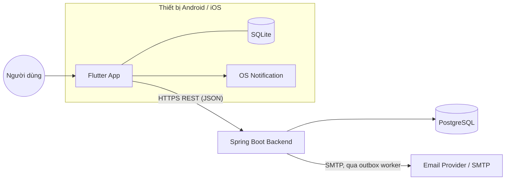
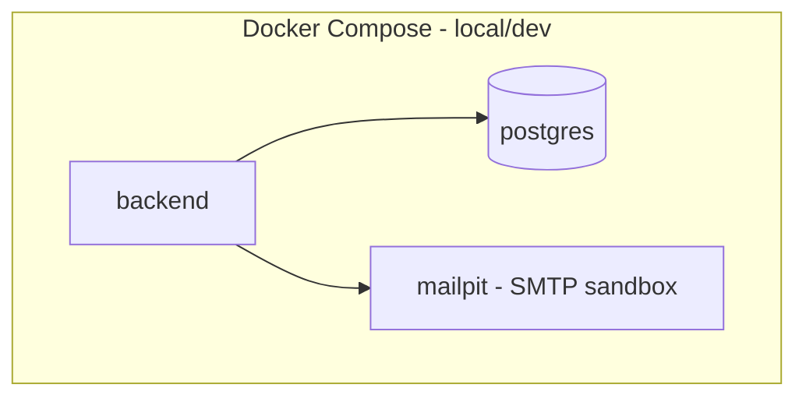
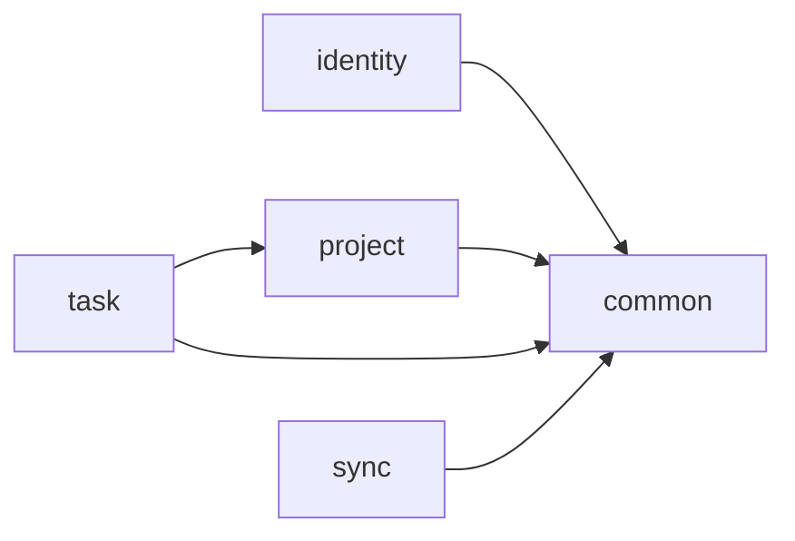
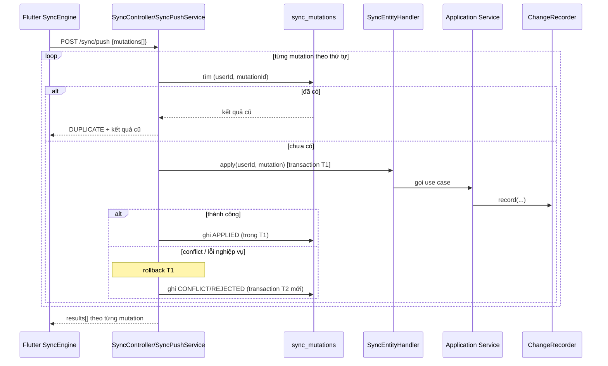

# LifeOS — System Architecture (Phase 1)

> **Trạng thái:** v1 — đã duyệt 2026-11-05.
> **Phạm vi:** kiến trúc đủ để triển khai code Phase 1 (Foundation & Task Management), kèm hướng mở rộng cho các phase sau.
> **Nguồn ràng buộc:** `PRODUCT_CONTEXT.md`, `PRD.md`, `USE_CASES.md`, `docs/engineering/*`. Tài liệu này **không đổi** quyết định đã `[CONFIRMED]`; chỗ nào thiết kế thêm đều gắn `[CONFIRMED]` và gom ở §13 để duyệt.
> Cơ sở dữ liệu chi tiết: `DATABASE_DESIGN.md`.

Nhãn: `[CONFIRMED]` đã chốt · `[PROPOSED]` đề xuất mới, chưa duyệt · `[OPEN]` chưa quyết định.

---

## 1. Bối cảnh hệ thống



- Phase 1 có **một** hệ thống ngoài thật sự: Email Provider (xác minh email, đặt lại mật khẩu). FCM, AI Provider, Redis, RabbitMQ chưa xuất hiện `[CONFIRMED]`.
- Client không bao giờ nói chuyện trực tiếp với PostgreSQL hay Email Provider.

## 2. Các thành phần triển khai (container view)

| Thành phần | Công nghệ | Trách nhiệm | Phase 1 |
|---|---|---|---|
| Flutter App | Flutter, Riverpod, Drift, Dio | UI, dữ liệu local, sync engine, local notification | Có |
| Backend | Java + Spring Boot (một process) | REST API, business rules, sync, outbox worker, job dọn dẹp | Có |
| PostgreSQL | PostgreSQL | Nguồn dữ liệu trung tâm | Có |
| Email Provider | SMTP | Gửi email xác minh/reset | Có (sandbox ở dev) |
| Prometheus/Grafana | | Giám sát | Để sau Phase 1 `[CONFIRMED]` (Actuator vẫn bật) |

Backend là **một deployable duy nhất** (Modular Monolith). Outbox worker và job dọn dẹp chạy **trong cùng process** dưới dạng scheduled task `[CONFIRMED]`; tách process khi có nhu cầu.



---

## 3. Kiến trúc Backend

### 3.1. Module Phase 1 và phụ thuộc `[CONFIRMED]` (theo `JAVA_SPRING_RULES.md` §4.4)



- `task → project` một chiều. Tiến độ project do module `task` tính.
- **`sync` không phụ thuộc compile-time vào `task`/`project`/`identity`**, và các module nghiệp vụ **không** phụ thuộc `sync`. Hai bên chỉ gặp nhau qua các interface nằm trong `common` (xem §3.3). `[CONFIRMED]`
- Mọi chiều phụ thuộc khác bị ArchUnit từ chối (§3.9).
- Phụ thuộc module đã duyệt đến WP6 (ArchUnit A6, chỉ qua gói `api/`): `task → project`; `calendar → task`; `notification → identity, task, calendar, habit, routine`; `goal → task` (gỡ liên kết, tiến độ D185/D186); `note → task, goal` (`note_link` D189); `analytics → task, habit, finance, calendar, goal` chỉ qua các API thống kê đọc (`TaskStatsApi`, `HabitStatsApi`, `FinanceStatsApi`, `CalendarStatsApi`, `GoalStatsApi` — D197, INT-19). Chiều ngược `task → goal` đi qua interface `common.goal.GoalLinks` (đảo phụ thuộc, module `goal` cài đặt) để không tạo vòng.

### 3.2. Cấu trúc package `[CONFIRMED]` nền / `[CONFIRMED]` chi tiết

```text
com.lifeos
├── LifeOsApplication
├── common
│   ├── config/           # cấu hình Spring, Clock (UTC), Jackson, OpenAPI
│   ├── security/         # JwtService, JwtAuthFilter, CurrentUser, SecurityConfig, PasswordHasher
│   ├── exception/        # BusinessException + nhánh, GlobalExceptionHandler (RFC 9457)
│   ├── response/         # PageResponse, ProblemDetail helper
│   ├── util/
│   ├── sync/             # ChangeRecorder, SyncEntityHandler, Mutation, EntitySnapshot (interface + record)
│   ├── outbox/           # OutboxEvent, OutboxRepository, OutboxWriter, OutboxEventHandler (interface), OutboxWorker
│   ├── mail/             # EmailSender (port) + SmtpEmailSender
│   └── web/              # CorrelationIdFilter, request logging
├── identity
│   ├── api/              # IdentityApi? (hiện chưa cần module nào gọi identity)
│   ├── controller/       # AuthController, MeController, DeviceController
│   ├── service/          # RegistrationService, AuthService, TokenService, PasswordService, DeviceService, SettingsService
│   ├── repository/  entity/  dto/  mapper/
│   └── sync/             # UserSettingsSyncHandler (implements SyncEntityHandler)
├── project
│   ├── api/              # ProjectApi (requireOwned…)
│   ├── controller/  service/  repository/  entity/  dto/  mapper/
│   └── sync/             # ProjectSyncHandler
├── task
│   ├── api/              # TaskQueryApi (thống kê tiến độ theo project)
│   ├── controller/       # TaskController, CategoryController, ProjectProgressController
│   ├── service/          # TaskCommandService, TaskQueryService, CategoryCommandService
│   ├── repository/  entity/  dto/  mapper/
│   └── sync/             # TaskSyncHandler, CategorySyncHandler
└── sync
    ├── controller/       # SyncController (push, pull)
    ├── service/          # SyncPushService, SyncPullService, ChangeRecorderImpl
    ├── repository/       # SyncMutationRepository, ChangeLogRepository, UserSyncStateRepository
    └── entity/  dto/
```

- Quy ước: `controller → service → (entity/repository)`; chỉ `api/` được import chéo module; lớp còn lại package-private khi có thể `[CONFIRMED]`.
- `category` nằm trong module `task` ở Phase 1 (cùng ranh giới dữ liệu, chỉ dùng cho Task) `[CONFIRMED]`. Chuyển ra module riêng khi có module khác dùng Category.
- `*SyncHandler` nằm trong package `sync/` của từng module nghiệp vụ nhưng chỉ phụ thuộc vào interface của `common.sync`; các lớp này là **adapter** gọi vào Application Service cùng module.

### 3.3. Hợp đồng giữa module nghiệp vụ và `sync` (đặt trong `common.sync`) `[CONFIRMED]`

Mục đích: giữ nguyên quy tắc "module nghiệp vụ không phụ thuộc `sync`" mà vẫn thỏa "mọi thay đổi entity đồng bộ đi qua một thành phần duy nhất" (`SYNC_RULES.md` §9.3).

```java
// common.sync — chỉ là interface/record, không có logic
public interface ChangeRecorder {
    /** Gọi trong CÙNG transaction với thay đổi nghiệp vụ. Trả về seq vừa cấp. */
    long record(UUID userId, String entityType, UUID entityId,
                ChangeOperation op, long entityVersion, UUID mutationIdOrNull);
}

public enum ChangeOperation { CREATE, UPDATE, DELETE }

public interface SyncEntityHandler {
    String entityType();                                        // "task","project","category","user_settings"
    MutationOutcome apply(UUID userId, Mutation mutation);      // gọi Application Service của module
    List<EntitySnapshot> loadSnapshots(UUID userId, Collection<UUID> entityIds); // phục vụ pull
}
```

- `ChangeRecorderImpl` (module `sync`) ghi `change_logs` và cấp `seq` bằng một câu upsert trên `user_sync_state` (§3.6).
- Mỗi `*CommandService` **luôn** gọi `ChangeRecorder.record(...)` ở cuối mỗi thao tác ghi, dù thao tác đến từ REST hay từ sync. ArchUnit kiểm tra: mọi class `*CommandService` có phụ thuộc vào `ChangeRecorder` (§3.9).
- `SyncPushService` thu thập `List<SyncEntityHandler>` từ Spring context và định tuyến theo `entityType`.
- Handler chỉ dịch `Mutation` → lệnh của Application Service; **không** chứa business rule `[CONFIRMED]` (rule nằm ở service).

### 3.4. Luồng một request ghi điển hình (REST hoặc sync)

```text
Controller / SyncEntityHandler
   └─► Application Service  (@Transactional)
         1. CurrentUser/userId đã được xác thực
         2. Tải entity theo (id, userId)  → không có: NotFound (404)
         3. Kiểm tra expectedVersion/baseVersion  → lệch: VersionConflict (409 / CONFLICT)
         4. Validate business rule, gọi domain method (task.complete()…)
         5. saveAndFlush  → entity.version đã tăng
         6. ChangeRecorder.record(userId, type, id, op, entity.version, mutationId)
         7. (nếu cần) OutboxWriter.write(...)  — cùng transaction
   ◄── trả DTO / MutationOutcome
```

- Một use case = một transaction; không gọi HTTP/SMTP trong transaction `[CONFIRMED]`.
- `version` do Hibernate `@Version` quản lý, bắt đầu từ 1; bước 3 là kiểm tra tường minh để trả lỗi nghiệp vụ rõ ràng, `@Version` là lớp bảo vệ khi hai transaction chạy đồng thời `[CONFIRMED]`.

### 3.5. Sync Push



Quy tắc `[CONFIRMED]` từ `SYNC_RULES.md`: xử lý từng mutation, mỗi mutation một transaction; mutation lỗi không làm mất mutation hợp lệ; chỉ ghi `change_logs` khi áp dụng.

Chi tiết triển khai `[CONFIRMED]`:
- **Ghi kết quả thất bại cần transaction riêng** (T2) vì T1 đã rollback. Gặp `UNIQUE (user_id, mutation_id)` bị vi phạm do hai request đồng thời cùng `mutationId` → đọc lại và trả `DUPLICATE`.
- Lô tối đa **50** mutation mỗi request; vượt quá → 400 `[CONFIRMED]`.
- Kết quả `CONFLICT` kèm snapshot hiện tại của entity trên server; `REJECTED` kèm `errorCode`.
- Mutation phụ thuộc: server xử lý theo đúng thứ tự mảng; nếu mutation cha không `APPLIED`, server **vẫn** xử lý mutation con và con sẽ tự `REJECTED` do tham chiếu không tồn tại. Client chịu trách nhiệm dừng gửi mutation con trước khi gặp lỗi (FR-SY-09).

### 3.6. Cấp `seq` và `change_logs`

Một câu SQL duy nhất cho mỗi thay đổi, chạy trong transaction nghiệp vụ `[CONFIRMED]` về nguyên lý, `[CONFIRMED]` về cách viết:

```sql
INSERT INTO user_sync_state (user_id, last_seq, updated_at)
VALUES (:userId, 1, now())
ON CONFLICT (user_id)
DO UPDATE SET last_seq = user_sync_state.last_seq + 1, updated_at = now()
RETURNING last_seq;
```

- Câu upsert vừa **tạo dòng khi chưa có** (không cần bước khởi tạo lúc đăng ký) vừa khóa dòng đến khi commit, nên ghi của một user tuần tự và `seq` liên tục, đúng thứ tự commit. Đây là chỉnh nhỏ so với câu "tạo dòng khi đăng ký" ở `SYNC_RULES.md` §9.3: kết quả như nhau, bớt một điểm phải nhớ.
- Sau đó `INSERT INTO change_logs (user_id, seq, ...)`.
- Giữ transaction ghi ngắn: không gọi hệ thống ngoài, không tải dữ liệu lớn. `ChangeRecorder.record` được gọi **ở cuối** use case (bước 6, §3.4) để row lock `user_sync_state` được giữ ngắn nhất có thể.
- Hai thiết bị của cùng một user push đồng thời sẽ xếp hàng trên row lock đó (khác user thì không ảnh hưởng nhau). Đặt `lock_timeout` ngắn (đề xuất 5 giây) cho các câu ghi sync; hết thời gian chờ → trả `503` kèm `Retry-After`, **không** coi là `REJECTED`; client gửi lại cùng `mutationId` an toàn nhờ idempotency. Theo dõi metric thời gian chờ lock `[CONFIRMED]` D42.
- Không đổi sang sequence toàn cục: sequence cấp số lúc insert chứ không lúc commit nên có thể làm client bỏ sót thay đổi (lý do chọn `seq` theo user, D8).
- Một use case đổi nhiều entity (ví dụ xóa Project làm Task về Inbox) gọi `record` nhiều lần; mỗi lần một `seq` liên tiếp.

### 3.7. Sync Pull (state-based) `[CONFIRMED]`

1. Đọc tối đa `N + 1` dòng `change_logs` với `seq > cursor` của user, sắp theo `seq` (`N` = 200 mặc định, cấu hình được qua `SYNC_PULL_PAGE_SIZE`; tối đa 500 `[CONFIRMED]`; giá trị tối ưu xem lại ở Phase 5 sau khi có số đo).
2. `hasMore = (đọc được N + 1 dòng)`; bỏ dòng thứ `N + 1`. `nextCursor` = `seq` lớn nhất trong trang.
3. Gom theo `(entity_type, entity_id)`, chỉ giữ thay đổi **cuối cùng** của mỗi entity trong trang.
4. Với mỗi `entity_type`, gọi `SyncEntityHandler.loadSnapshots(userId, ids)` (một truy vấn theo lô) để lấy trạng thái hiện tại.
5. Entity có `deleted_at` hoặc không còn → trả `operation = DELETE` (tombstone) kèm `entityVersion`; ngược lại trả `UPSERT` kèm snapshot đầy đủ.
6. Trả `changes[]` theo thứ tự `seq` của thay đổi cuối mỗi entity.

Lý do chọn state-based: không cần lưu payload trong `change_logs` (nhẹ, không phải versioning schema của payload), phù hợp "một nguồn sự thật"; đánh đổi là mỗi trang cần thêm truy vấn đọc theo lô.

Cursor là chuỗi mờ với client (mã hóa `seq`); cursor ban đầu là chuỗi rỗng/`0` `[CONFIRMED]`.

### 3.8. Ràng buộc server-side khi xóa Project / Category `[CONFIRMED]`

- Xóa **Project**: trong cùng transaction, server đặt `project_id = NULL` cho mọi Task còn sống thuộc Project, tăng `version` các Task đó và `record(...)` UPDATE cho từng Task; sau đó soft delete Project và `record(DELETE)`.
- Xóa **Category**: tương tự với `category_id`.
- **Client không gửi mutation riêng cho các Task bị ảnh hưởng.** Client cập nhật local để UI nhất quán và nhận version mới của các Task đó qua pull. Hệ quả: nếu người dùng sửa một Task bị ảnh hưởng trong khoảng giữa, mutation đó mang `baseVersion` cũ và sẽ ra `CONFLICT` — chấp nhận ở Phase 1 (bản local được giữ, đúng FR-SY-08).
- Cách này thay cho đề xuất "Task cập nhật trước hoặc cùng lúc với Project bị xóa" ở `USE_CASES.md` UC-PJ-04 (đã chỉnh).

### 3.9. Kiểm tra kiến trúc tự động (ArchUnit) `[CONFIRMED]` công cụ / `[CONFIRMED]` bộ luật

| Luật | Nội dung |
|---|---|
| A1 | `controller` không phụ thuộc `repository`/`entity`; chỉ phụ thuộc `service` và `dto` |
| A2 | `service` không phụ thuộc `controller`; không dùng `HttpServletRequest`/`ResponseEntity` |
| A3 | `repository` chỉ được dùng bởi `service` cùng module |
| A4 | Module A chỉ import `com.lifeos.B.api..` và `com.lifeos.common..` của module khác |
| A5 | Không có vòng phụ thuộc giữa module |
| A6 | Ma trận phụ thuộc: `task → project` là cặp module nghiệp vụ duy nhất |
| A7 | Module nghiệp vụ không import `com.lifeos.sync..` |
| A8 | Controller không trả về class trong `..entity..` |
| A9 | Class `*CommandService` của entity đồng bộ phụ thuộc `ChangeRecorder` |
| A10 | `@Transactional` chỉ xuất hiện ở `..service..` |
| A11 | Không dùng `FetchType.EAGER` mặc định, không dùng `double/float` cho tiền (Phase 3) |
| A12 | `com.lifeos.common..` không phụ thuộc bất kỳ module nghiệp vụ nào (`identity`, `project`, `task`, `sync`…) `[CONFIRMED]` D41 |
| A13 | Package `com.lifeos.{task,project,identity}.sync..` chỉ phụ thuộc `common..`, `..service..` và `..dto..` cùng module, Spring và Jackson `[CONFIRMED]` D95 |

### 3.10. Bảo mật `[CONFIRMED]` nguyên tắc / `[CONFIRMED]` cơ chế

- **Stateless JWT.** Access token 15 phút; claim: `sub` = userId, `did` = deviceId, `jti`, `iat`, `exp`. `JwtAuthFilter` xác thực chữ ký + hạn, **không** truy vấn DB mỗi request. Đánh đổi: thiết bị bị thu hồi vẫn dùng được access token còn hạn (tối đa 15 phút); việc thu hồi có hiệu lực tại lần refresh tiếp theo.
- **Ký token:** HS256 với secret lấy từ biến môi trường (một backend duy nhất). Chuyển RS256 khi có nhiều bên xác thực. `[CONFIRMED]` D15.
- **Refresh token:** chuỗi ngẫu nhiên 256 bit, chỉ lưu **SHA-256 hash**; xoay vòng theo `family_id`; dùng lại token đã xoay vòng → vô hiệu cả family và buộc đăng nhập lại.
- **Băm mật khẩu:** Argon2id (hoặc bcrypt nếu thư viện/hiệu năng không phù hợp), qua interface `PasswordHasher`. `[CONFIRMED]` D16.
- **Chống dò tài khoản:** đăng ký/quên mật khẩu trả phản hồi không phân biệt email tồn tại hay không; đăng nhập sai không nêu rõ sai email hay mật khẩu.
- **Rate limit các endpoint công khai khác** `[CONFIRMED]` D43: đăng ký, gửi lại email xác minh, quên mật khẩu, đặt lại mật khẩu giới hạn theo IP và theo email (đề xuất 5 yêu cầu/giờ/email, 20/giờ/IP) để chống gửi email hàng loạt và dò tài khoản. IP lấy đúng từ `X-Forwarded-For` chỉ khi đi qua reverse proxy tin cậy.
- **Rate limit đăng nhập** (5 lần sai/15 phút theo tài khoản + IP, `[CONFIRMED]` ở PRD Q-01): bộ đếm trong bộ nhớ (Caffeine) ở Phase 1 vì chạy một instance; chuyển Redis khi scale `[CONFIRMED]`. Hệ quả: khởi động lại backend xóa bộ đếm — chấp nhận.
- **Ownership:** `userId` chỉ lấy từ `CurrentUser`; repository dùng `findByIdAndUserId`; dữ liệu user khác → 404 `[CONFIRMED]`.
- **Dữ liệu nhạy cảm:** không log token/mật khẩu/nội dung; secret chỉ từ biến môi trường `[CONFIRMED]`.
- **CORS** tắt (client là app native); **HTTPS** bắt buộc ở môi trường thật (kết thúc TLS tại reverse proxy).

### 3.11. Outbox và worker `[CONFIRMED]` nguyên tắc / `[CONFIRMED]` thiết kế

- Application Service ghi `outbox_events` (`EMAIL_VERIFICATION`, `PASSWORD_RESET`, `PASSWORD_CHANGED` — D76; cột `event_type` không có CHECK nên không cần migration, comment trong V4 giữ nguyên vì migration bất biến) **trong transaction nghiệp vụ**.
- `OutboxWorker`: scheduled task, chu kỳ ~2 giây:
  1. Transaction ngắn: `SELECT ... WHERE status = 'PENDING' AND next_attempt_at <= now() ORDER BY created_at LIMIT n FOR UPDATE SKIP LOCKED`, đặt `status = 'PROCESSING'`, `locked_until = now() + lease`; commit.
  2. **Ngoài transaction:** gọi `OutboxEventHandler` tương ứng (dựng email, gọi `EmailSender`).
  3. Transaction ngắn: đặt `SENT` (kèm `processed_at`) hoặc `PENDING` với `attempts + 1` và `next_attempt_at` theo exponential backoff; quá số lần tối đa → `FAILED`.
  4. Dòng `PROCESSING` quá `locked_until` (worker chết giữa chừng) được trả về `PENDING` ở vòng sau.
- Giao **ít nhất một lần** → email có thể gửi trùng trong ca hiếm; chấp nhận cho email xác minh/reset (token trước đó bị vô hiệu khi cấp token mới). `OutboxEventHandler` phải idempotent theo `event_id` ở mức có thể `[CONFIRMED]` (§10 JAVA_SPRING_RULES).
- Handler đăng ký theo `event_type` (interface `OutboxEventHandler` trong `common.outbox`). Từ WP4 (BACKEND_MASTER_PLAN §5 #5, PHASE_4 D120): module `notification` sở hữu mọi handler — email bảo mật `EMAIL_VERIFICATION`, `PASSWORD_RESET`, `PASSWORD_CHANGED` (`notification.outbox.*EmailHandler`, hành vi D76 không đổi) và sự kiện từ module khác theo schema D149 (`BUDGET_THRESHOLD` → `NotificationOrchestrator`). `identity` chỉ ghi sự kiện.
- **Module `notification` (WP4):** `NotificationOrchestrator` (thông báo in-app + delivery mỗi kênh/thiết bị trong một transaction, idempotent theo `dedupe_key`), `DeliveryWorker` (chọn việc FOR UPDATE SKIP LOCKED → IN_FLIGHT → gọi FCM/SMTP **ngoài** transaction → ghi kết quả; backoff 30s/2m/10m/1h/6h), `ReminderRunService` (reminder đến hạn, bù ≤ 1 lần trong 24 giờ), FCM HTTP v1 (`lifeos.fcm.*`, tắt mặc định). Phụ thuộc chỉ qua `api/` của identity, task, calendar, habit, routine (ArchUnit A4, A6); identity gọi ngược qua interface ở `common.device` (đảo phụ thuộc).
- **Module `calendar` (WP4):** sự kiện + quy tắc lặp D126 (mở rộng khi đọc), ngoại lệ, time block (phụ thuộc `task.api`). Cascade liên module bằng sự kiện miền đồng bộ trong transaction (`TaskDeletionStarted`, `EventDeletionStarted`, `HabitDeletionStarted`, `RoutineDeletionStarted`, `*ScheduleChanged`, `UserTimezoneChanged`); khi nhiều module cùng nghe một sự kiện, listener chỉ ghi dữ liệu và gom change_logs vào `common.sync.PendingChanges`, module phát ghi tất cả sau cùng (D86).

### 3.12. Job định kỳ `[CONFIRMED]`

| Job | Tần suất | Việc |
|---|---|---|
| Outbox worker | ~2 giây | §3.11 |
| Dọn token | Hằng ngày | Xóa `refresh_tokens`, `email_verification_tokens`, `password_reset_tokens` đã hết hạn quá 7 ngày |
| Dọn outbox | Hằng ngày | Xóa `outbox_events` đã `SENT` quá 7 ngày |
| Retention đồng bộ (WP5) | Hằng ngày 03:30 UTC (`lifeos.sync.retention-cron`) | `sync_mutations` > 35 ngày; `change_logs` > 180 ngày và ngoài 1000 seq gần nhất (nâng `min_retained_seq`); tombstone > 180 ngày đã bị quên và không còn tham chiếu (con trước cha); `sync_diagnostics` > 30 ngày — theo lô 5000, transaction ngắn |
| Kiểm tra nhất quán (WP5) | Hằng tuần CN 04:00 UTC | Chỉ đọc (D172): `last_seq` ≥ seq lớn nhất, version entity khớp change_logs, mutation_id mồ côi → gauge `lifeos.sync.consistency.violations` |
| Reminder / delivery (WP4) | 30 giây / 5 giây | `ReminderRunService`, `DeliveryWorker` (§3.11) |
| Giao dịch định kỳ (WP3) | Mỗi giờ :05 UTC | `RecurringRunService` |
| Dọn thông báo, token push (WP4) | Hằng ngày | Thông báo hết hạn 90 ngày (theo lô), token push > 60 ngày |
| Xuất dữ liệu (WP7) | 30 giây (`lifeos.export.poll-interval`) | Giành yêu cầu `PENDING` bằng `SKIP LOCKED`, tạo zip ngoài transaction nghiệp vụ, `READY` + thông báo SYSTEM qua outbox; `RUNNING` > 2 giờ → `FAILED STALE` |
| Hết hạn tệp xuất (WP7) | Mỗi giờ :05 UTC | Xóa tệp quá 24 giờ, đánh dấu `EXPIRED` |
| Xóa cứng tài khoản (WP7) | Mỗi giờ :20 UTC (`lifeos.account.purge-cron`) | Tài khoản quá hạn cooldown: `UserDataPurger` theo `UserDataCatalog` (con trước cha, lô 1000), outbox của user, `users`; ghi `account_deletion_audit`; dọn audit > 365 ngày |

Scheduler dùng pool 4 luồng (`spring.task.scheduling.pool.size`, WP8) để job dài (xuất dữ liệu, retention, xóa tài khoản) không chặn outbox worker và reminder; một job không chạy chồng chính nó. Mọi job idempotent và chịu được chạy lặp/chạy trễ `[CONFIRMED]`. Một instance ở Phase 1 nên chưa cần khóa phân tán; khi scale dùng `SKIP LOCKED`/advisory lock.

### 3.13. Lỗi, validation, quan sát `[CONFIRMED]` nguyên tắc

- Lỗi theo RFC 9457: `type`, `title`, `status`, `detail`, `errorCode`, `fieldErrors[]`, `correlationId`. `GlobalExceptionHandler` duy nhất ở `common.exception`.
- Validation hai lớp (Bean Validation ở DTO; nghiệp vụ ở service).
- Log JSON có `correlationId` (header `X-Correlation-Id` nếu client gửi, nếu không sinh mới) và `userId`; không log PII/nội dung `[CONFIRMED]`.
- Actuator: `health` (liveness/readiness, DB), `metrics`, `prometheus`. Metric nên có từ Phase 1: số push theo kết quả (`APPLIED/DUPLICATE/CONFLICT/REJECTED`), độ trễ push/pull, kích thước hàng đợi outbox, số email lỗi.
- Thời gian: bean `Clock` UTC được tiêm vào mọi nơi cần "bây giờ" để test được `[CONFIRMED]`.

### 3.14. Cấu hình `[CONFIRMED]`

- Profile: `dev`, `test`, `prod`. Cấu hình qua `application.yml` + biến môi trường; **secret chỉ từ biến môi trường**.
- Biến chính: `DB_URL`, `DB_USER`, `DB_PASSWORD`, `JWT_SECRET`, `SMTP_HOST/PORT/USER/PASSWORD`, `MAIL_FROM`, `APP_BASE_URL` (dựng liên kết trong email), `SYNC_PULL_PAGE_SIZE`, `SYNC_PUSH_MAX_BATCH`.
- Flyway chạy khi khởi động; `spring.jpa.hibernate.ddl-auto=validate` `[CONFIRMED]`.

---

## 4. Hợp đồng API đồng bộ (đủ để code client và server)

> Quy ước chung (versioning, phân trang…) chốt ở `API_CONVENTIONS.md`. Tiền tố `/api/v1` là `[CONFIRMED]` ở PRD. Mọi endpoint (trừ auth công khai) cần `Authorization: Bearer <accessToken>`.

### 4.1. `POST /api/v1/sync/push`

Request:

```json
{
  "mutations": [
    {
      "mutationId": "0b6e...-uuid",
      "entityType": "task",
      "entityId": "5c1a...-uuid",
      "operation": "CREATE",
      "baseVersion": 0,
      "payload": {
        "title": "Mua sữa",
        "description": null,
        "status": "OPEN",
        "priority": "NONE",
        "dueDate": "2026-11-06",
        "dueTime": null,
        "projectId": null,
        "categoryId": null
      }
    }
  ]
}
```

- `entityType` ∈ `task | project | category | user_settings`; `operation` ∈ `CREATE | UPDATE | DELETE`.
- `baseVersion`: `0` cho `CREATE`; với `UPDATE/DELETE` là `version` server đã biết gần nhất `[CONFIRMED]`.
- `payload`: **toàn bộ trường chỉnh sửa được** của entity (state đầy đủ, không phải patch) `[CONFIRMED]`; client chuẩn gửi đủ khóa, riêng ở `UPDATE` khóa vắng mặt được hiểu là giữ nguyên (lưới an toàn tương thích tiến hóa, D82); `DELETE` không cần payload. Lý do: đơn giản, idempotent, conflict phát hiện ở mức entity.
- `completed_at` do server đặt khi `status` chuyển sang `DONE`/về `OPEN`; client không gửi `[CONFIRMED]`.

Response `200` (luôn 200 nếu request hợp lệ; trạng thái nằm ở từng mutation):

```json
{
  "results": [
    { "mutationId": "0b6e...", "status": "APPLIED", "entityVersion": 1 },
    { "mutationId": "71aa...", "status": "DUPLICATE", "entityVersion": 4 },
    { "mutationId": "9d02...", "status": "CONFLICT",
      "serverSnapshot": { "entityType": "task", "entityId": "…", "version": 5, "data": { } } },
    { "mutationId": "c3f8...", "status": "REJECTED",
      "errorCode": "PROJECT_NOT_FOUND", "message": "…" }
  ]
}
```

- Lỗi toàn request (401, 400 sai định dạng, quá 50 mutation) theo RFC 9457.
- `results` đúng thứ tự `mutations`.

### 4.2. `GET /api/v1/sync/pull?cursor=<opaque>&limit=<n>`

```json
{
  "changes": [
    { "entityType": "task", "entityId": "5c1a…", "operation": "UPSERT",
      "version": 3, "data": { "title": "…", "status": "DONE", "completedAt": "2026-11-05T10:20:00Z" } },
    { "entityType": "project", "entityId": "aa90…", "operation": "DELETE", "version": 4 }
  ],
  "nextCursor": "MTIz",
  "hasMore": false
}
```

- `limit` mặc định 200, tối đa 500 `[CONFIRMED]`.
- Client lưu `nextCursor` **sau khi** áp dụng thành công cả trang (cùng local transaction).

### 4.3. Biểu diễn dữ liệu

- Thời điểm: ISO-8601 UTC (`...Z`). Ngày nghiệp vụ: `yyyy-MM-dd`. Giờ: `HH:mm` `[CONFIRMED]` (xem `DATABASE_RULES.md` §8.1).
- ID: UUID chuỗi chữ thường.
- Enum viết hoa như trong PRD (`OPEN/DONE`, `NONE/LOW/MEDIUM/HIGH`).

---

## 5. Kiến trúc Flutter

### 5.1. Tổ chức thư mục `[CONFIRMED]`

```text
mobile/lib
├── main.dart
├── app/                    # MaterialApp, router, theme, ProviderScope
├── core/
│   ├── db/                 # Drift: AppDatabase, bảng, DAO, migration
│   ├── network/            # Dio client, AuthInterceptor (refresh single-flight), ApiException
│   ├── auth/               # TokenStore (secure storage), SessionController
│   ├── sync/               # SyncEngine, OutboxDao, SyncStatusNotifier, ConnectivityService, MutationCoalescer
│   ├── notifications/      # NotificationScheduler (flutter_local_notifications), permission
│   ├── time/               # ClockProvider, timezone helpers
│   ├── l10n/               # chuỗi tiếng Việt (ARB)
│   └── error/              # lỗi chung, hiển thị lỗi
└── features/
    ├── auth/               # đăng ký, xác minh, đăng nhập, quên mật khẩu
    ├── tasks/              # data/ domain/ presentation/
    ├── projects/
    ├── categories/
    ├── settings/           # hồ sơ, user settings, thiết bị
    └── sync_status/
```

Mỗi feature: `data/` (Repository impl, DAO, mapper), `domain/` (model thuần Dart, Repository interface, use case nếu cần), `presentation/` (Widget + Riverpod Notifier).

Quy tắc (theo `FLUTTER_RULES.md`) `[CONFIRMED]`: **UI chỉ đọc từ SQLite** (stream của Drift); ghi = một local transaction cập nhật bảng chính **và** thêm mutation vào `outbox`; UI/Notifier không gọi Dio; `RemoteDataSource` chỉ do `SyncEngine` và luồng online-only (auth, thiết bị, đổi mật khẩu) dùng.

### 5.2. Ghi dữ liệu local (mẫu cho mọi entity đồng bộ)

```text
Notifier.updateTask(cmd)
  └─► TaskRepository.update(cmd)
        └─► db.transaction {
              1. đọc bản ghi (id) → lấy version (baseVersion)
              2. UPDATE tasks SET ..., sync_state = 'pending'
              3. MutationCoalescer.enqueue(outbox, mutation)
            }
        └─► NotificationScheduler.reschedule(taskId)   // ngoài transaction DB
        └─► SyncEngine.requestSync(debounce 2s)
```

### 5.3. Hàng đợi (outbox) và gộp mutation `[CONFIRMED]`

- Outbox là hàng đợi **FIFO toàn cục** theo `local_seq` tăng dần.
- `MutationCoalescer` chỉ gộp các mutation **chưa gửi** (`status = PENDING`, không phải `INFLIGHT`) cho cùng một entity:

| Đang chờ | Thao tác mới | Kết quả |
|---|---|---|
| CREATE | UPDATE | một CREATE với payload mới nhất |
| CREATE | DELETE | **xóa cả hai khỏi outbox**; xóa hẳn bản ghi local (chưa từng lên server) |
| UPDATE | UPDATE | một UPDATE: giữ `baseVersion` cũ nhất, payload mới nhất |
| UPDATE | DELETE | một DELETE (giữ `baseVersion` cũ nhất) |
| (không có) | bất kỳ | thêm mutation mới |

- Mutation `INFLIGHT` không bị gộp; thao tác mới tạo mutation mới sau nó.

### 5.4. SyncEngine `[CONFIRMED]`

- **Một chu trình tại một thời điểm** (mutex/single-flight). Mỗi chu trình: **push → pull**.
- **Kích hoạt:** mở app/resume, khôi phục kết nối, sau thao tác ghi (debounce 2 giây), đồng bộ thủ công, định kỳ 15 phút khi app ở foreground. **Phase 1 chỉ đồng bộ ở foreground** (không dùng background execution của OS); chốt lại ở Phase 5 `[OPEN]`.
- **Push:** lấy tối đa 50 mutation `PENDING` theo `local_seq`, đánh dấu `INFLIGHT`, gửi; áp kết quả: `APPLIED/DUPLICATE` → cập nhật `version` và `sync_state = synced`, xóa mutation; `CONFLICT` → `sync_state = conflict`, lưu `serverSnapshot` vào cột `conflict_snapshot`, giữ bản local, **không gửi tiếp** mutation của entity đó (UC-SY-04); `REJECTED` → đánh dấu `FAILED` kèm `errorCode`, hiển thị lỗi, giữ bản local. Mutation phụ thuộc mutation cha lỗi được giữ `PENDING` nhưng bị bỏ qua cho đến khi cha được xử lý (FR-SY-09).
- **Pull:** lặp gửi cursor đến khi `hasMore = false`. Mỗi trang áp dụng trong **một** local transaction cùng việc lưu cursor. Với entity đang có mutation `PENDING/INFLIGHT/conflict` trong outbox: **không ghi đè** bản local; vẫn tiến cursor. (Bản server của entity conflict đã được lưu ở `conflict_snapshot`.)
- **Lỗi:** lỗi mạng/5xx → backoff 2s, 4s, 8s… tối đa 5 phút, có jitter; `401` → refresh token một lần (single-flight) rồi thử lại, refresh thất bại → phiên hết hạn, giữ nguyên dữ liệu local và yêu cầu đăng nhập; `4xx` theo từng mutation không retry.
- **Trạng thái cho UI** (`SyncStatusNotifier`): `synced`, `pending(n)`, `syncing`, `error`, `conflict(n)`, `offline`.

### 5.5. Xác thực phía client `[CONFIRMED]`

- Token lưu trong secure storage (Keychain/Keystore) `[CONFIRMED]`.
- `AuthInterceptor`: gắn access token; gặp `401` thì gọi refresh **một lần dùng chung** (các request song song chờ cùng một kết quả); không loop.
- Đăng xuất / thu hồi: theo PRD Q-09 — cảnh báo nếu còn thay đổi chưa sync, không tự xóa dữ liệu local chưa sync.
- Dữ liệu local gắn với `user_id`; đăng nhập tài khoản khác trên cùng thiết bị phải **dùng cơ sở dữ liệu local riêng theo user** `[CONFIRMED]` D26; không tự xóa dữ liệu chưa sync khi đăng xuất.

### 5.6. Local notification `[CONFIRMED]` yêu cầu / `[CONFIRMED]` thiết kế

- `NotificationScheduler` là service duy nhất đặt/hủy thông báo OS. API chính: `reschedule(taskId)`, `cancel(taskId)`, `rescheduleAll()`.
- Thời điểm nhắc: `due_time` nếu có; chỉ có `due_date` thì 08:00 sáng ngày đó; tính theo **timezone của user** (từ `user_settings`) bằng gói timezone; chỉ cho Task `OPEN`, chưa xóa, hạn trong tương lai (PRD Q-05).
- **Giới hạn nền tảng:** iOS cho tối đa 64 thông báo local đang chờ → chỉ đặt 64 thông báo gần nhất và đặt lại khi mở app/sau mỗi chu trình sync; Android 12+ cần quyền báo thức chính xác (`SCHEDULE_EXACT_ALARM`) và nhận sự kiện khởi động lại máy để đặt lại lịch. Hệ điều hành có thể trì hoãn thông báo khi tiết kiệm pin (Doze).
- Bảng local `scheduled_notifications (task_id, fire_at, os_notification_id)` để đối chiếu và hủy chính xác `[CONFIRMED]`.
- Kích hoạt đặt lại: sửa Task, hoàn thành/mở lại, xóa, áp dụng pull, đổi timezone (đặt lại tất cả), mở app.

### 5.7. Dependency injection và test `[CONFIRMED]` công cụ

- Riverpod: `ProviderScope` ở gốc; các provider cho `AppDatabase`, `Dio`, `SyncEngine`, `Clock`, `NotificationScheduler` có thể override khi test.
- Test: repository và SyncEngine với Drift in-memory; mô phỏng server bằng fake `RemoteDataSource`; widget test cho luồng tạo/sửa Task.

---

## 6. Dữ liệu và nhất quán — các bất biến cần giữ

| # | Bất biến | Cơ chế |
|---|---|---|
| I1 | Mọi thay đổi entity đồng bộ có đúng một dòng `change_logs` | `ChangeRecorder` + luật A9 + test tích hợp |
| I2 | `seq` của một user tăng liên tục, không đảo thứ tự commit | Upsert `user_sync_state` khóa dòng đến commit (§3.6) |
| I3 | Mutation không áp dụng hai lần | `UNIQUE (user_id, mutation_id)` + kiểm tra trước khi thực thi |
| I4 | Không ghi đè khi `baseVersion` lệch | Kiểm tra tường minh + `@Version` |
| I5 | Dữ liệu user này không thấy bởi user khác | `findByIdAndUserId`, test bảo mật, 404 |
| I6 | Xóa luôn là tombstone với entity đồng bộ | `deleted_at`; không `DELETE` vật lý trong luồng thường |
| I7 | Không có hệ thống ngoài trong transaction nghiệp vụ | Outbox + worker; review + test |
| I8 | Client không mất thay đổi chưa sync | Outbox cùng local transaction với bản ghi; không xóa dữ liệu local chưa sync |
| I9 | Client không dùng timestamp để quyết định bản mới hơn | So sánh `version` |

---

## 7. Triển khai và vận hành `[CONFIRMED]`

- **Docker Compose (dev/local):** `postgres`, `backend`, `mailpit` (SMTP sandbox, UI xem email). Có healthcheck cho `postgres` và `backend` (`/actuator/health`).
- **Image backend:** multi-stage build; chạy bằng user không phải root; không chứa secret.
- **Cơ sở dữ liệu:** Flyway tự migrate khi khởi động; backup bằng `pg_dump` theo lịch và quy trình restore được diễn tập trước khi phát hành thật (chốt tần suất ở `[OPEN]` baseline §16).
- **CI** (chốt chi tiết ở `GIT_WORKFLOW.md`): build, unit test, integration test (Testcontainers), ArchUnit, `flutter analyze`, `flutter test`.
- **Phiên bản công cụ:** Java LTS mới nhất được Spring Boot hỗ trợ, Spring Boot dòng ổn định mới nhất, **Maven** `[CONFIRMED]` D14 (phiên bản cụ thể chốt khi khởi tạo project).

---

## 8. Thuộc tính chất lượng và cách kiến trúc đáp ứng

| Thuộc tính | Mục tiêu | Cách đáp ứng |
|---|---|---|
| Offline | CRUD cốt lõi không cần Internet | UI đọc SQLite, outbox, SyncEngine |
| Độ tin cậy | Không mất dữ liệu đã server xác nhận | Transaction đơn, idempotency, tombstone, outbox |
| Nhất quán | Một nguồn sự thật | PostgreSQL, server giữ `version`/`seq`, client không tự quyết |
| Hiệu năng | p95 < 300 ms CRUD (định hướng) | Index theo query pattern, phân trang, pull theo lô |
| Bảo mật | Cô lập user, bảo vệ token | JWT ngắn hạn, refresh xoay vòng + hash, ownership, rate limit |
| Bảo trì | Một developer quản lý được | Modular monolith, ArchUnit, quy ước rõ |
| Quan sát | Biết hệ thống đang làm gì | Log có correlation ID, Actuator, metric sync/outbox |
| Mở rộng | Thêm module không viết lại | Interface trong `common`, ma trận phụ thuộc, `api/` |

---

## 9. Hướng mở rộng theo phase

| Phase | Tác động kiến trúc |
|---|---|
| 2 Habit/Routine | Thêm module `habit`, `routine` (+ Daily Dashboard đọc qua query interface). Thêm `SyncEntityHandler` cho `habit`, `habit_checkin`, `routine`…; **không đổi** `sync` |
| 3 Finance | Thêm module `finance`; xử lý conflict riêng (không ghi đè); tiền `NUMERIC` |
| 4 Calendar & Notification | Thêm `calendar`, `notification` (sở hữu `reminders`, `device_push_tokens`); `OutboxEventHandler` email chuyển sang `notification`; thêm kênh FCM |
| 5 Sync nâng cao | UI conflict, đa thiết bị, full resync, retention tombstone/cursor/`sync_mutations`, đồng bộ nền |
| 6–7 | `note`, `goal`, `dashboard`, `lifereview`; thêm Redis cho cache; Prometheus/Grafana |
| 8 AI | Module `ai` đọc qua query interface; thực thi qua Application Service sau khi người dùng duyệt |

Điểm mở rộng đã chừa: `SyncEntityHandler`, `OutboxEventHandler`, `api/` của từng module, ma trận phụ thuộc trong ArchUnit.

---

## 10. Rủi ro kiến trúc và giảm thiểu

| Rủi ro | Giảm thiểu |
|---|---|
| Hàng đợi/gộp mutation sai gây mất hoặc nhân đôi thay đổi | Test thuộc tính (property-based) cho `MutationCoalescer`; test sync bắt buộc theo `CODE_GUIDELINES.md` §13 |
| Row lock `user_sync_state` kéo dài làm chậm ghi | Transaction ngắn, không I/O ngoài; theo dõi metric độ trễ ghi |
| State-based pull đọc nhiều khi trang lớn | Truy vấn theo lô, giới hạn `limit`; đo ở benchmark |
| Thu hồi thiết bị chậm hiệu lực đến 15 phút | Chấp nhận có chủ đích; ghi rõ trong tài liệu bảo mật |
| Giới hạn thông báo local của iOS/Android | Đặt 64 thông báo gần nhất, đặt lại khi mở app; thông báo đúng là best-effort ở Phase 1 |
| Xung đột do cascade phía server (§3.8) | Chấp nhận ở Phase 1; xử lý bằng UI ở Phase 5 |
| Trùng tên Category giữa hai thiết bị | `REJECTED` (`CATEGORY_NAME_TAKEN`); UI thông báo |

---

## 11. Các ADR nên viết khi bắt đầu code

1. ADR-001 Modular Monolith và ma trận phụ thuộc.
2. ADR-002 Sync: cursor `seq` theo user, state-based pull, payload đầy đủ.
3. ADR-003 `ChangeRecorder`/`SyncEntityHandler` đặt trong `common` (đảo phụ thuộc).
4. ADR-004 JWT stateless + refresh xoay vòng.
5. ADR-005 Outbox bằng PostgreSQL polling (chưa RabbitMQ).

---

## 12. Tiêu chí hoàn thành kiến trúc Phase 1

- [x] Skeleton backend đúng cấu trúc §3.2; ArchUnit chạy trong `mvn verify` và xanh — bộ luật mở rộng tới A1–A14 (A14: không float/double trong finance), 11 module + `common` (2026-11-07). Pipeline CI (`ci/`, `.github/`) do người dùng quản lý.
- [x] Migration V1–V4 (`DATABASE_DESIGN.md`) chạy sạch trên PostgreSQL mới. (`FlywayMigrationIT`, Testcontainers PostgreSQL 17)
- [x] Push/pull theo §4 qua test tích hợp: idempotency, conflict, tombstone, nhiều trang. (Giai đoạn 3 backend, 2026-11-07: SYN-01..48)
- [x] Email xác minh đi qua outbox, worker gửi được sang mailpit. (Giai đoạn 4 backend, 2026-11-07: `MailpitDeliveryIT`, kèm đặt lại/đổi mật khẩu)
- [ ] Skeleton Flutter đúng §5.1; một luồng "tạo Task offline → online → xuất hiện trên server" chạy end-to-end.
- [x] `docker compose up` dựng được backend + PostgreSQL + mailpit. (Giai đoạn 4 backend, 2026-11-07: chạy thử trên máy dev, ba dịch vụ healthy)

**Mở rộng Phase 2–7 phía server (BACKEND_MASTER_PLAN WP2–WP8, 2026-11-07)** — chi tiết `docs/review/BACKEND_FINAL_REPORT.md`:

- [x] Migration V5–V11 chạy sạch từ DB rỗng và từ DB có dữ liệu cũ (`FlywayMigrationIT`, `MigrationUpgradeIT`).
- [x] Module `habit`, `routine` (Phase 2), `finance` (Phase 3), `calendar`, `notification` (Phase 4), `goal`, `note` (Phase 6), `analytics` (Phase 7); retention/snapshot/chẩn đoán đồng bộ (Phase 5); xuất dữ liệu và xóa tài khoản (`identity`, `common.privacy`).
- [x] 29 `entityType` đồng bộ có handler, mục `SYNC_PROTOCOL.md` và test SYN-tương-đương; IDOR tự quét mọi route có biến đường dẫn.
- [x] Danh mục bảng có `user_id` (`UserDataCatalog`) phủ kín, dùng cho xuất/xóa tài khoản (INT-14, INT-15).
- [x] Benchmark D173/D207 trong ngưỡng (không cần Redis) — số đo ở báo cáo cuối.
- [ ] Phần client Flutter của Phase 2–7 (lập lịch local, FTS5, hợp nhất 3 chiều, tính offline) — ngoài phạm vi backend.

---

## 13. Quyết định (đã duyệt 2026-11-05) (đề xuất mới trong tài liệu này)

| # | Đề xuất | Ghi chú |
|---|---|---|
| D14 | Công cụ build: Maven; phiên bản Java LTS và Spring Boot ổn định mới nhất, chốt cụ thể khi khởi tạo project | §9 |
| D15 | JWT ký HS256, secret từ env | Chuyển RS256 khi có nhiều bên xác thực |
| D16 | Argon2id cho băm mật khẩu (bcrypt nếu cần) | Qua interface `PasswordHasher` |
| D17 | `ChangeRecorder`, `SyncEntityHandler`, `OutboxEventHandler` là interface trong `common`; `sync` cài đặt/thu thập | §3.3 |
| D18 | Pull theo state (không lưu payload trong `change_logs`) | §3.7 |
| D19 | Payload push là state đầy đủ; `completed_at` do server đặt | §4.1 |
| D20 | Server xử lý cascade khi xóa Project/Category; client không gửi mutation riêng | §3.8, đã chỉnh UC-PJ-04, UC-CT-01 |
| D21 | Câu upsert tạo `user_sync_state` lười, thay cho tạo khi đăng ký | §3.6; chỉnh nhỏ `SYNC_RULES.md` §9.3 |
| D22 | Ghi kết quả `CONFLICT/REJECTED` bằng transaction riêng; lô tối đa 50 | §3.5 |
| D23 | Outbox có lease (`locked_until`), backoff mũ, `FAILED` sau số lần tối đa | §3.11 |
| D24 | Rate limit trong bộ nhớ (Caffeine) ở Phase 1 | §3.10 |
| D25 | Category nằm trong module `task` ở Phase 1 | §3.2 |
| D26 | DB local riêng theo user trên thiết bị; đăng xuất không tự xóa dữ liệu chưa sync | §5.5 |
| D27 | Sync chỉ ở foreground trong Phase 1; gộp mutation theo bảng §5.3 | §5.4 |
| D28 | Outbox worker và job dọn chạy cùng process backend | §2, §3.12 |
| D41 | Luật ArchUnit A12: `common` không phụ thuộc module nghiệp vụ | §3.9 (từ review ngoài) |
| D42 | `lock_timeout` cho câu ghi sync; hết hạn trả 503 + `Retry-After`; metric chờ lock | §3.6 |
| D43 | Rate limit cho đăng ký / gửi lại xác minh / quên & đặt lại mật khẩu; xử lý `X-Forwarded-For` | §3.10 |
| D44 | Viết `SECURITY_RULES.md` (rate limit, thu hồi thiết bị, token family, secrets) trước khi code Identity | — |
| D80 | Cascade xóa Project xuyên module bằng sự kiện miền đồng bộ `ProjectDeletionStarted` (đặt trong `project.api`), listener trong `task.service` chạy `MANDATORY` cùng transaction; khóa chống Task mồ côi: xóa dùng `FOR UPDATE`, kiểm tham chiếu dùng `FOR SHARE`, luôn khóa Project trước Category; `TaskQueryApi` chưa tạo cho đến khi có module dùng; `common.persistence.SyncedEntity`/`VersionedWrites` là hạ tầng dùng chung | §3.2, §3.8 |

Đã duyệt toàn bộ ngày 2026-11-05; các mục `[OPEN]` còn lại đều có lịch chốt riêng.
