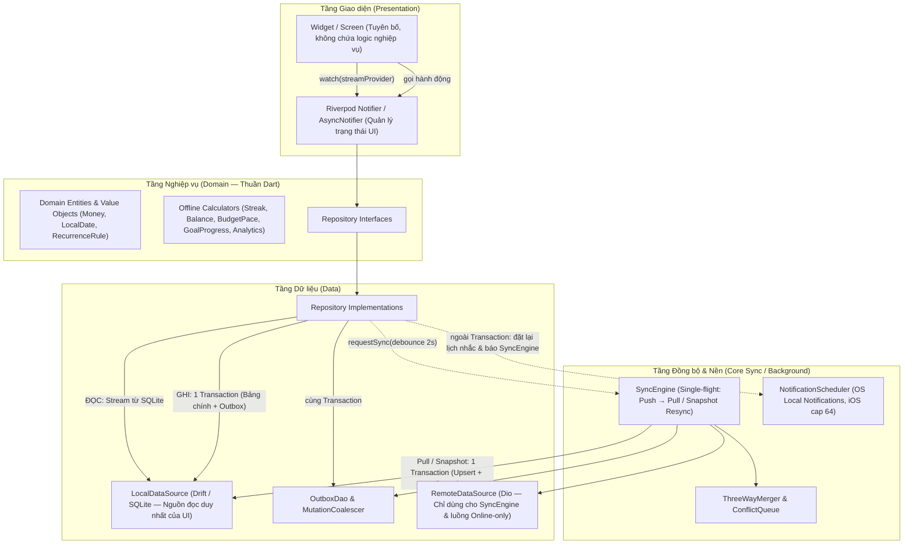

# LifeOS — Kế hoạch tổng thể phát triển ứng dụng Flutter (`MOBILE_MASTER_PLAN.md`)

> **Trạng thái:** v1 — **ĐÃ DUYỆT 2026-11-08** (Người dùng duyệt toàn bộ khuyến nghị §11: Hướng A *Calm Botanical*, phạm vi toàn bộ Phase 1–7 `PWP1 → PWP15`, tên/icon *LifeOS*, cài Flutter SDK stable tại `C:\src\flutter`, `sqlite3_flutter_libs` theo D13, khóa sinh trắc học/PIN tùy chọn, biểu đồ `CustomPainter`, thẻ hướng dẫn tác vụ nền không ép buộc).
> **Phạm vi:** Thiết kế hệ thống giao diện (UI/UX Design System), kiến trúc offline-first (Flutter + Riverpod + Drift/SQLite + Dio), đồng bộ 29 `entityType`, tính toán offline khớp server, kiểm thử toàn diện (Unit, Widget, Golden, Contract, E2E với backend thật) cho Android + iOS.
> **Nguồn sự thật:** `AGENTS.md`, `FLUTTER_RULES.md`, `SYSTEM_ARCHITECTURE.md` §4–§5, `DATABASE_DESIGN.md` §9, `SYNC_RULES.md`, `SYNC_PROTOCOL.md`, `API_CONVENTIONS.md`, `SECURITY_RULES.md`, `TESTING_RULES.md`, `docs/product/*`, `docs/phases/PHASE_2..7`, `docs/review/BACKEND_FINAL_REPORT.md`, `docs/api/openapi.yaml` và `docs/api/fixtures/*`.
> **Màn hình mẫu chạy được (Mục 5):** đặt tại thư mục tạm `mobile/_design_prototypes/` (gồm ứng dụng Flutter độc lập `main_prototypes.dart` và bản xem nhanh tương tác trực tiếp `interactive_preview.html`).

---

## 0. Kết quả kiểm tra Bước 0

1. **Xác nhận tài liệu trên đĩa:**
   - `AGENTS.md`, `docs/review/BACKEND_FINAL_REPORT.md` (12 module, 29 `entityType`, 847/847 test đạt), `docs/engineering/BACKEND_MASTER_PLAN.md` đều tồn tại và nhất quán.
   - Đã đọc toàn bộ hợp đồng server (`docs/api/openapi.yaml`, 18 tệp trong `docs/api/fixtures/` gồm cả 3 bộ vector `habit-vectors.json`, `recurrence-vectors.json`, `analytics-vectors.json`), bộ quy tắc kỹ thuật (`API_CONVENTIONS.md`, `SYNC_PROTOCOL.md`, `SYNC_RULES.md`, `SECURITY_RULES.md`, `FLUTTER_RULES.md`, `SYSTEM_ARCHITECTURE.md`, `DATABASE_DESIGN.md`, `TESTING_RULES.md`), tài liệu sản phẩm (`PRODUCT_CONTEXT.md`, `PRD.md`, `USE_CASES.md`) và đặc tả `PHASE_2` đến `PHASE_7`.
2. **Kiểm tra hợp đồng AI (`docs/api/openapi.yaml`):**
   - Hiện tại `openapi.yaml` có đầy đủ endpoint của Phase 1–7, **chưa có** endpoint `/api/v1/ai/*`. Đúng theo quy tắc mục 2, gói `PWP-AI` được đặt ở cuối kế hoạch với trạng thái **"chờ hợp đồng"**.
3. **Ràng buộc môi trường phát triển (Windows):**
   - Máy phát triển chạy Windows 11, đã cài `Dart SDK 3.10.8` (`C:\tools\dart-sdk\bin`) và cấu hình sẵn `C:\src\flutter\bin` trong `PATH` (xem Mục 9 về hoàn tất giải nén Flutter SDK khi chạy Phần B).
   - Không thể build/ký iOS (`.ipa`) trực tiếp trên Windows: cấu hình iOS (`Runner.xcodeproj`, `Podfile`, `Info.plist`, entitlements, lệnh `flutter build ipa`) được chuẩn bị đầy đủ để CI macOS của agent deploy thực thi.

---

## 1. Các gói công việc (`PWP1…PWP15` + `PWP-AI`)

Thứ tự gói được giữ theo luồng phụ thuộc dữ liệu và trải nghiệm người dùng: dựng khung & CI → chốt hệ thống giao diện & bộ component → xác thực & cô lập DB theo user → lõi Drift + Outbox + SyncEngine (gồm cả Phase 5 nâng cao để mọi module nghiệp vụ viết sau đều thừa hưởng hợp nhất 3 chiều, hàng đợi xung đột và full resync ngay từ đầu) → các miền nghiệp vụ từ MVP (Task, My Day, Habit/Routine) đến nâng cao (Finance, Calendar/Reminder, Notes/Goals, Analytics/Review, Notification, Settings/Account) → trung tâm đồng bộ & hoàn thiện chất lượng.

| Gói | Tên gói công việc | Nội dung chính | Tiêu chí hoàn thành đo được (DoD) |
|---|---|---|---|
| **PWP1** | Khung dự án, Flavor, Lint & CI | Khởi tạo `mobile/` đúng cấu trúc `SYSTEM_ARCHITECTURE.md` §5.1; cấu hình 3 flavor (`dev`, `staging`, `prod`); `analysis_options.yaml` nghiêm ngặt (cấm `print`, cấm `double` trong gói `finance`); cấu hình i18n tiếng Việt (`app_vi.arb`); viết `ci/mobile-ci.yml`. | `flutter analyze` 0 cảnh báo; chạy được `main_dev.dart`; test khởi tạo xanh; `ci/mobile-ci.yml` hợp lệ. |
| **PWP2** | Hệ thống giao diện (Design System) & Component | Hiện thực hóa hướng thị giác người dùng duyệt từ Mục 5: Design Tokens (màu sáng/tối, chữ, khoảng cách, bo góc, độ cao, chuyển động), bộ 28+ component dùng chung, khung điều hướng thích ứng (Bottom Bar trên Phone / Navigation Rail + Master-Detail trên Tablet), màn chắn riêng tư khi chuyển ứng dụng. | Catalog widget chạy được; **Golden test** sáng/tối trên kích thước Phone (390×844) & Tablet (1024×768) cho toàn bộ component đạt 100%; kiểm tra tương phản WCAG AA ≥ 4.5:1. |
| **PWP3** | Xác thực, Phiên, Secure Storage & Cô lập DB | Luồng Đăng ký, Xác minh email (nhập mã/deep link), Gửi lại xác minh, Đăng nhập (gửi kèm `deviceId` + thông tin thiết bị), Quên/Đặt lại mật khẩu; `TokenStore` (`flutter_secure_storage`), `AuthInterceptor` single-flight refresh (ghi token mới trước khi xóa token cũ — MSY-09); quản lý tệp SQLite riêng theo `user_id` (`lifeos_<userId>.sqlite`), loại trừ khỏi cloud backup (D52). | Unit/Widget test đầy đủ cho Auth & single-flight refresh; E2E **(a) đăng ký → xác minh email qua Mailpit → đăng nhập** xanh với backend thật. |
| **PWP4** | Lõi SQLite (Drift), Outbox & SyncEngine (Phase 1 + Phase 5) | Toàn bộ bảng SQLite cho 29 `entityType` + `outbox`, `sync_meta`, `entity_base_snapshots`, `conflict_resolutions`, `sync_log`, `resync_staging_*`, `scheduled_notifications`, `delivered_notifications`; `MutationCoalescer`; `SyncEngine` (single-flight push → pull, áp trang pull nguyên tử cùng `cursor`, backoff + jitter, tôn trọng `Retry-After`, xử lý `426`, `401`, `410 SYNC_FULL_RESYNC_REQUIRED` → snapshot giữ outbox, hợp nhất 3 chiều `resolve()`, đồ thị phụ thuộc `BLOCKED`, giới hạn 30 ngày, kiểm tra toàn vẹn `PRAGMA quick_check`). Tạo `docs/api/fixtures/merge-vectors.json`. | Đạt toàn bộ **MSY-01..11**, **SYN-A02..A04**, **SYN-A09**, **SYN-A11..A13**, **SYN-A15**; parse khớp toàn bộ fixture JSON hiện có trong `docs/api/fixtures/*`. |
| **PWP5** | Task, Project & Category (Phase 1) | CRUD offline-first cho Task, Project (kèm tiến độ local `completionRatio`), Category; bộ lọc đa chiều (Trạng thái, Hạn, Project, Category, Ưu tiên, Inbox), tìm kiếm local tức thì, sắp xếp đúng quy ước D79; xử lý cascade xóa Project/Category phía local không sinh mutation thừa (D80); form Quick Capture Task một chạm. | Unit/Widget/Golden test cho danh sách & chi tiết Task/Project; E2E **(b) tạo Task offline → online → xuất hiện trên server** xanh. |
| **PWP6** | My Day (Trung tâm điều phối ngày) | Màn hình chính **Hôm nay (My Day)** tính thuần từ SQLite theo `user_settings.timezone`: khối tiêu điểm (3 việc ưu tiên nhất), dòng thời gian trong ngày (Time Block + Sự kiện), danh sách Task đến hạn/quá hạn, Habit đến lịch hôm nay (check-in/skip 1 chạm), Routine đến lịch hôm nay (bắt đầu/tiếp tục lượt chạy), nút Quick Capture nổi. | Widget/Golden test sáng/tối Phone & Tablet; cuộn mượt 60fps; thay đổi ở Task/Habit/Routine phản ánh tức thì trên stream My Day (< 16ms). |
| **PWP7** | Habit & Routine (Phase 2 — Hoàn tất MVP) | CRUD Habit (4 loại lịch: `DAILY`, `WEEKDAYS`, `TIMES_PER_WEEK`, `EVERY_N_DAYS`), check-in/undo/skip kèm ghi chú, tính chuỗi (`currentStreak`, `longestStreak`) và thống kê local khớp tuyệt đối server; CRUD Routine (`DAILY`/`WEEKLY`), quản lý bước (kéo thả `position` bước 1000), màn hình trình chạy Routine (Routine Player) có đồng hồ đếm thời lượng bước, lịch sử lượt chạy; xử lý xung đột `ALREADY_EXISTS` (D235). | Test vector **`habit-vectors.json`** (HAB-05) chạy trên Dart xanh 100%; Widget/Golden test cho lịch chuỗi Habit và Routine Player. **Mốc kết thúc MVP (Phase 1–2).** |
| **PWP8** | Personal Finance (Phase 3) | Lớp `Money` thuần số nguyên ×10⁴ (cấm `double`), định dạng theo `currency`; CRUD Tài khoản (kèm tính số dư local D102 & công cụ Đối soát D112), Danh mục thu/chi (nhận 15 danh mục mặc định từ pull), Giao dịch thu/chi (nhập nhanh bằng bàn phím số tùy chỉnh < 3 giây), Chuyển khoản, Ngân sách tháng (thanh nhịp chi tiêu `pace`), Giao dịch định kỳ (chỉ đọc lần sinh từ pull, tạo/tạm dừng quy tắc), Mục tiêu tiết kiệm & Khoản góp, Báo cáo tháng & Dòng tiền tách theo tiền tệ; nút ẩn nhanh số tiền `••••••`. | Unit test `Money` (FIN-01, FIN-02 phía Dart), test tính số dư & ngân sách khớp server; kiểm tĩnh 0 `double` trong `features/finance/`; Golden test màn hình My Finance & bàn phím nhập số tiền. |
| **PWP9** | Calendar, Time Block, Reminder & Local Notification (Phase 4) | Lịch Ngày / Tuần / Tháng hợp nhất (Event mở rộng lặp + Time Block + Task có hạn), tạo/sửa/xóa sự kiện lặp với 3 phạm vi ("Chỉ lần này" qua `event_exception`, "Từ lần này" qua cắt chuỗi + tạo chuỗi mới, "Tất cả"); kéo thả Time Block cho Task (cảnh báo trùng giờ không chặn); CRUD Reminder gắn mục tiêu hoặc độc lập; `NotificationScheduler` giới hạn **64 thông báo gần nhất cho iOS** (D133), khử trùng local/push qua `delivered_notifications(dedupe_key)` (D132). | Test vector **`recurrence-vectors.json`** (CAL-01) trên Dart xanh 100%; đạt **NTF-14** (khử trùng `dedupeKey`, giới hạn 64 mốc iOS, đổi múi giờ đặt lại lịch); E2E **(f)** và **(i)** xanh. |
| **PWP10** | Notes, Tags & Tìm kiếm FTS5 (Phase 6a) | CRUD Ghi chú văn bản thuần (chuẩn hóa NFC, ≤ 50.000 code point, payload sync ≤ 192 KB), Quick Capture ghi chú tự lưu (debounce 1s), ghim (≤ 10), lưu trữ; quản lý Tag có màu (`note_tag` đồng bộ riêng ở mức liên kết D184); bảng ảo SQLite **FTS5** (`unicode61 remove_diacritics 2`) tìm kiếm có dấu/không dấu kèm đoạn trích tô sáng từ khóa; gắn liên kết `note_link` tới Task/Goal. | Đạt **KNW-05** (bộ truy vấn chuẩn đối chiếu FTS5 và PostgreSQL), KNW-07, KNW-08 (xung đột văn bản hiển thị 2 bản cạnh nhau); tìm kiếm local trên 20.000 ghi chú < 30ms. |
| **PWP11** | Goals & Milestones (Phase 6b) | CRUD Goal (vòng đời `ACTIVE/PAUSED/ACHIEVED/ABANDONED` đúng bảng chuyển D188), quản lý Milestone (≤ 20, kéo thả `position` bước 1000), gắn Task vào Goal/Milestone (tự suy `goalId` từ `milestoneId`), tính tiến độ tự động (D185) và nhãn nguy cơ (`AT_RISK`, `OVERDUE` theo D200), gợi ý hoàn thành khi xong hết milestone (không tự đổi trạng thái). | Unit test tiến độ Goal & nguy cơ trễ khớp mô hình tham chiếu; Widget/Golden test chi tiết Goal + Milestone. |
| **PWP12** | Dashboard, Life Review & Analytics (Phase 7) | Màn hình Tổng quan (Dashboard) 5 thẻ độc lập (lỗi 1 thẻ không hỏng màn hình, chạy được cả offline từ SQLite với nhãn "Ước tính cục bộ" khi `pending > 0` và online từ `GET /dashboard`); Daily / Weekly / Monthly Review (tổng hợp số liệu + so sánh kỳ trước + viết phản tư/mood đồng bộ qua `review`); biểu đồ xu hướng Task, Habit, Finance (tách tiền tệ), Thời gian, Goal. | Test vector **`analytics-vectors.json`** (INT-10) trên Dart xanh 100%; Widget/Golden test cho Daily/Monthly Review và biểu đồ sáng/tối. |
| **PWP13** | Hộp thông báo (In-app Inbox), FCM & Giờ yên tĩnh | Hộp thông báo in-app (`GET /notifications`, đánh dấu đã đọc, xóa, huy hiệu chưa đọc), màn hình Tùy chọn thông báo ma trận 6 loại × 3 kênh (khóa `SECURITY × (IN_APP, EMAIL)` theo D136), cài đặt Giờ yên tĩnh (`quietStart`, `quietEnd`) và `showDetailsOnLockScreen` (đồng bộ qua `user_settings`); tích hợp nhận FCM (chế độ thật + chế độ giả lập khi chưa có `google-services.json`), tự đăng ký `PUT /devices/{id}/push-token`. | Unit/Widget test ma trận tùy chọn, quiet hours và khử trùng thông báo; xử lý deep link `lifeos://...` mở đúng màn hình đích. |
| **PWP14** | Cài đặt, Thiết bị, Xuất dữ liệu & Xóa tài khoản | Hồ sơ (`displayName`), đổi mật khẩu, cài đặt `user_settings` (múi giờ IANA có tìm kiếm, tiền tệ mặc định, ngày đầu tuần); quản lý Thiết bị đã đăng nhập (`GET /devices`, thu hồi từ xa `DELETE /devices/{id}`); Xuất dữ liệu cá nhân (`POST /account/export`, theo dõi trạng thái, tải tệp zip); Xóa tài khoản (`POST /account/deletion/code` → nhập mật khẩu + mã 6 số → màn hình chờ xóa cooldown 7 ngày + nút Hủy xóa `DELETE /account/deletion`). | E2E **(g) xuất dữ liệu**, **(h) xóa tài khoản (cooldown/hủy)**, **(i) đổi múi giờ** xanh với backend thật. |
| **PWP15** | Trung tâm Đồng bộ, Giải quyết xung đột & Hoàn thiện (A11y, Hiệu năng) | Màn hình Trạng thái đồng bộ & Chẩn đoán (nhật ký 500 dòng, tạm dừng sync, gửi báo cáo chẩn đoán không PII, xuất outbox khi DB hỏng, kích hoạt full resync); Hàng đợi xung đột & Màn hình Giải quyết xung đột chuyên biệt (theo trường cho Task/Calendar/Reminder/Goal; cạnh nhau cho Note/Review; chọn bản toàn diện kèm chênh lệch số tiền cho Finance; khôi phục bản đã xóa với UUID mới D157); tối ưu hiệu năng & Accessibility. | E2E **(c) xung đột 2 thiết bị → giải quyết**, **(d) mất mạng giữa push**, **(e) 410 → full resync giữ outbox** xanh; đạt mọi ngưỡng hiệu năng ở Mục 7.4. |
| **PWP-AI** | Trợ lý AI (Ask LifeOS & Duyệt hành động) | **Trạng thái: CHỜ HỢP ĐỒNG** (chỉ thực hiện sau khi `docs/api/openapi.yaml` công bố các endpoint AI). Gồm: giao diện hội thoại Ask LifeOS, quản lý quyền ngữ cảnh (riêng Finance cần cấp quyền riêng), thẻ đề xuất hành động có cấu trúc để người dùng **Xem xét & Phê duyệt** trước khi thực thi. | Chờ hợp đồng OpenAPI từ agent backend. |

---

## 2. Kiến trúc Client

### 2.1. Phân tầng & Luồng dữ liệu bất biến (`FLUTTER_RULES.md` §12.1)



**Bất biến kiến trúc:**
1. **UI chỉ đọc từ SQLite** qua các `Stream` của Drift. Mọi phản hồi từ mạng (kể cả khi tạo/sửa) đều đi vào SQLite trước, rồi `Stream` tự đẩy trạng thái mới lên UI.
2. **UI và Notifier không bao giờ import hoặc gọi `Dio`** cho dữ liệu đồng bộ. Chỉ `SyncEngine` và các dịch vụ online-only (`AuthRemoteService`, `DeviceRemoteService`, `AccountExportService`, `AccountDeletionService`, `NotificationInboxService`, `DashboardRemoteOverlay`) được phép gọi `Dio`.
3. **Mỗi thao tác ghi dữ liệu đồng bộ = đúng 1 transaction SQLite** gồm: (a) nếu entity đang ở `sync_state = synced`, chụp bản gốc vào `entity_base_snapshots` (phục vụ hợp nhất 3 chiều D159); (b) cập nhật bảng chính với `sync_state = 'pending'`; (c) đưa mutation vào `outbox` qua `MutationCoalescer`.

### 2.2. Tổ chức thư mục (`mobile/`)

```text
mobile/
├── lib/
│   ├── main_dev.dart                 # Entrypoint flavor dev
│   ├── main_staging.dart             # Entrypoint flavor staging
│   ├── main_prod.dart                # Entrypoint flavor prod
│   ├── app/
│   │   ├── app.dart                  # LifeOsApp (MaterialApp.router, PrivacyGate)
│   │   ├── config/                   # AppEnvironment, FlavorConfig
│   │   ├── router/                   # AppRouter (go_router, StatefulShellRoute, DeepLinkGuard)
│   │   └── theme/                    # DesignTokens, LifeOsTheme (Light/Dark), Typography, Motion
│   ├── core/
│   │   ├── db/                       # AppDatabase (Drift), UserDatabaseManager, IntegrityChecker, FTS5
│   │   ├── money/                    # Money (int64 × 10^4), CurrencySpec, MoneyFormatter
│   │   ├── time/                     # Clock, UserTimezoneService, LocalDate, LocalTime, PeriodBounds
│   │   ├── network/                  # DioFactory, AuthInterceptor (single-flight), ProblemDetail, ErrorCodeMapper
│   │   ├── auth/                     # TokenStore (SecureStorage), SessionNotifier, PrivacyShield
│   │   ├── sync/                     # SyncEngine, OutboxDao, MutationCoalescer, ThreeWayMerger,
│   │   │                             # DependencyGraph, SnapshotResyncService, DiagnosticsReporter
│   │   ├── notifications/            # NotificationScheduler (iOS cap 64), DedupeStore, FcmBridge
│   │   ├── l10n/                     # app_vi.arb + generated AppLocalizations
│   │   └── widgets/                  # 28+ thành phần giao diện dùng chung (Design System)
│   └── features/
│       ├── auth/                     # data / domain / presentation
│       ├── my_day/                   # Màn hình Hôm nay & Quick Capture đa năng
│       ├── tasks/                    # Tasks, Projects, Categories
│       ├── habits/                   # Habits, Check-ins, Streak & Routine Player
│       ├── finance/                  # Accounts, Transactions, Transfers, Budgets, Recurring, SavingGoals, Reports
│       ├── calendar/                 # Unified Calendar, Events, Exceptions, RecurrenceExpander, TimeBlocks, Reminders
│       ├── notes/                    # Notes, Tags, FTS5 Search, NoteLinks
│       ├── goals/                    # Goals, Milestones, Progress & Risk Calculator
│       ├── intelligence/             # Cross-domain Dashboard, Daily/Weekly/Monthly Reviews, Analytics
│       ├── notifications_inbox/      # In-app Notifications, Preferences Matrix, Quiet Hours
│       ├── settings/                 # Profile, Settings, Devices, Data Export, Account Deletion
│       ├── sync_center/              # Sync Status, Conflict Queue, 3-Way / Side-by-Side / Finance Resolver
│       └── ai_assistant/             # [PWP-AI] Chờ hợp đồng OpenAPI
└── _design_prototypes/               # Thư mục tạm chứa 3 hướng thị giác mẫu chạy được (Mục 5)
```

### 2.3. Ánh xạ đầy đủ 29 `entityType` đồng bộ ↔ Bảng SQLite (Drift)

Mọi bảng đồng bộ trên SQLite đều có các cột chuẩn:
- `id TEXT PRIMARY KEY` (UUID v4 chữ thường)
- `version INTEGER NOT NULL DEFAULT 0` (`0` khi mới tạo ở local, `≥ 1` sau khi server xác nhận)
- `deleted_at INTEGER NULL` (epoch ms UTC; `NULL` = đang sống)
- `created_at INTEGER NOT NULL`, `updated_at INTEGER NOT NULL` (epoch ms UTC)
- `sync_state TEXT NOT NULL DEFAULT 'pending'` (`'synced' | 'pending' | 'conflict' | 'failed'`)
- `conflict_snapshot TEXT NULL` (JSON `serverSnapshot` khi `CONFLICT`), `conflict_reason TEXT NULL` (`'ALREADY_EXISTS' | 'DELETED' | NULL`)

| # | `entityType` | Bảng SQLite | Phép toán cho phép | Phụ thuộc cha (`DependencyGraph` D161) | Chiến lược xung đột (`SYNC_RULES.md` §9.5) |
|---|---|---|---|---|---|
| 1 | `user_settings` | `user_settings` | Chỉ `UPDATE` | — | Hợp nhất theo khóa; cùng khóa đổi → bản `updatedAt` mới hơn thắng + thông báo |
| 2 | `project` | `projects` | `CREATE, UPDATE, DELETE` | — | 3 chiều theo trường; xóa cascade local `tasks.project_id = NULL` (không sinh mutation con) |
| 3 | `category` | `categories` | `CREATE, UPDATE, DELETE` | — | 3 chiều theo trường; xóa cascade local `tasks.category_id = NULL` |
| 4 | `task` | `tasks` | `CREATE, UPDATE, DELETE` | `projectId?`, `categoryId?`, `goalId?`, `milestoneId?` | 3 chiều theo trường; riêng `status` đổi khác nhau → luôn hỏi người dùng |
| 5 | `habit` | `habits` | `CREATE, UPDATE, DELETE` | — | 3 chiều theo trường; nhóm `schedule*` luôn hỏi cả bộ (D254) |
| 6 | `habit_checkin` | `habit_checkins` | `CREATE, UPDATE, DELETE` | `habitId` | `CREATE` trùng `(habitId, localDate)` → `ALREADY_EXISTS`: tự nhận bản server nếu cùng `status`, khác `status` → hỏi `DONE/SKIPPED` (D235) |
| 7 | `routine` | `routines` | `CREATE, UPDATE, DELETE` | — | 3 chiều theo trường; nhóm `kind/weekdays` hỏi cả bộ |
| 8 | `routine_step` | `routine_steps` | `CREATE, UPDATE, DELETE` | `routineId` | 3 chiều theo trường |
| 9 | `routine_log` | `routine_logs` | `CREATE, DELETE` (`UPDATE` bị cấm vì các khóa bất biến) | `routineId` | `CREATE` trùng `(routineId, localDate)` → `ALREADY_EXISTS`: nhận bản server (D235) |
| 10 | `routine_step_log` | `routine_step_logs` | `CREATE, UPDATE, DELETE` | `routineLogId`, `stepId` | `CREATE` trùng `(routineLogId, stepId)` → `ALREADY_EXISTS`: nhận bản server |
| 11 | `financial_account` | `financial_accounts` | `CREATE, UPDATE, DELETE` | — | **Luôn hỏi người dùng** (D105); tiền lưu `INTEGER` (×10⁴) |
| 12 | `financial_category` | `financial_categories` | `CREATE, UPDATE, DELETE` | — | **Luôn hỏi người dùng** (D105) |
| 13 | `financial_transaction` | `financial_transactions` | `CREATE, UPDATE, DELETE` | `accountId`, `categoryId?` | **Luôn hỏi người dùng** (D105); hiển thị rõ độ lệch số tiền |
| 14 | `account_transfer` | `account_transfers` | `CREATE, UPDATE, DELETE` | `fromAccountId`, `toAccountId` | **Luôn hỏi người dùng** (D105) |
| 15 | `budget` | `budgets` | `CREATE, UPDATE, DELETE` | `categoryId?` | **Luôn hỏi người dùng** (D105) |
| 16 | `recurring_transaction` | `recurring_transactions` | `CREATE, UPDATE, DELETE` | `accountId`, `categoryId?` | **Luôn hỏi người dùng** (D105) |
| 17 | `saving_goal` | `saving_goals` | `CREATE, UPDATE, DELETE` | — | **Luôn hỏi người dùng** (D105) |
| 18 | `saving_contribution` | `saving_contributions` | `CREATE, UPDATE, DELETE` | `goalId` | **Luôn hỏi người dùng** (D105) |
| 19 | `calendar_event` | `calendar_events` | `CREATE, UPDATE, DELETE` | — | 3 chiều; nhóm trường thời gian (`allDay, timezone, start*, end*, recurrence`) luôn hỏi cả bộ (D158) |
| 20 | `event_exception` | `event_exceptions` | `CREATE, UPDATE, DELETE` | `eventId` | `CREATE` trùng `(eventId, originalStartLocal)` → `ALREADY_EXISTS`; sửa → hỏi cả bộ thời gian |
| 21 | `time_block` | `time_blocks` | `CREATE, UPDATE, DELETE` | `taskId` | 3 chiều; nhóm `startAt/endAt` hỏi cả bộ |
| 22 | `reminder` | `reminders` | `CREATE, UPDATE, DELETE` | `targetId?` (theo `targetType`) | 3 chiều; nhóm `mode/offsetMinutes/localTime/localDate/repeatRule` hỏi cả bộ (D158) |
| 23 | `note` | `notes` | `CREATE, UPDATE, DELETE` | — | 3 chiều cho `title/pinned/archived`; riêng `content` cùng đổi → **luôn hỏi cạnh nhau** (D183) |
| 24 | `tag` | `tags` | `CREATE, UPDATE, DELETE` | — | `CREATE` trùng tên → `ALREADY_EXISTS`: client tự gộp ID thẻ cũ vào `note_tags` chờ gửi và nhận bản server (D184) |
| 25 | `note_tag` | `note_tags` | Chỉ `CREATE, DELETE` | `noteId`, `tagId` | Hợp nhất ở mức liên kết; `CREATE` trùng cặp → `APPLIED` idempotent (D184) |
| 26 | `note_link` | `note_links` | Chỉ `CREATE, DELETE` | `noteId`, `targetId` (`TASK`/`GOAL`) | Hợp nhất ở mức liên kết như `note_tag` (D189) |
| 27 | `goal` | `goals` | `CREATE, UPDATE, DELETE` | — | 3 chiều theo trường; `status` đổi khác nhau → hỏi |
| 28 | `milestone` | `milestones` | `CREATE, UPDATE, DELETE` | `goalId` | 3 chiều theo trường |
| 29 | `review` | `reviews` | `CREATE, UPDATE, DELETE` | — | `CREATE` trùng `(periodType, periodKey)` → `ALREADY_EXISTS`; `reflection` cùng sửa → hỏi cạnh nhau như `note` (D202) |

### 2.4. Ánh xạ `errorCode` → Thông điệp tiếng Việt & Hành động UI

Client **chỉ rẽ nhánh theo `errorCode`** và `fieldErrors[].code` (tuyệt đối không parse chuỗi `detail`/`title` từ server theo `API_CONVENTIONS.md` §5):

- **Nhóm Xác thực & Phiên:**
  - `AUTH_INVALID_CREDENTIALS` → *"Email hoặc mật khẩu chưa đúng. Bạn kiểm tra lại nhé."*
  - `AUTH_EMAIL_NOT_VERIFIED` → Mở hộp thoại *"Tài khoản chưa xác minh email"* kèm nút **"Gửi lại mã xác minh"**.
  - `AUTH_TOKEN_EXPIRED` / `AUTH_TOKEN_INVALID` → `AuthInterceptor` tự động gọi `/auth/refresh` (single-flight).
  - `AUTH_REFRESH_TOKEN_INVALID` → Phiên hết hạn/thiết bị bị thu hồi: hiện thông báo *"Phiên đăng nhập đã kết thúc. Dữ liệu trên máy của bạn vẫn được giữ an toàn, vui lòng đăng nhập lại."*
  - `AUTH_PASSWORD_TOO_WEAK` / `AUTH_CURRENT_PASSWORD_WRONG` / `AUTH_VERIFICATION_TOKEN_INVALID` / `AUTH_RESET_TOKEN_INVALID` → Tô đỏ đúng ô nhập và hiển thị hướng dẫn cụ thể.
- **Nhóm Giao thức & Hệ thống:**
  - `CLIENT_UPGRADE_REQUIRED` (426) → Tạm dừng `SyncEngine`, hiện biểu ngữ cố định *"Phiên bản ứng dụng đã cũ. Vui lòng cập nhật để tiếp tục đồng bộ (mọi dữ liệu trên máy vẫn dùng bình thường)."*
  - `RATE_LIMITED` (429) / `SERVICE_UNAVAILABLE` (503) → Đọc header `Retry-After` (giây), hiển thị đếm ngược nhẹ nhàng nếu là thao tác trực tiếp, hoặc đặt hẹn giờ tự chạy lại cho `SyncEngine`.
  - `ACCOUNT_DELETION_PENDING` (403) → Điều hướng sang màn hình **Tài khoản đang chờ xóa** (hiện thời điểm xóa cứng `deletionScheduledAt` và nút **"Hủy yêu cầu xóa"**).
  - `SYNC_FULL_RESYNC_REQUIRED` (410) / `SYNC_SNAPSHOT_EXPIRED` (410) → Tự động chuyển `SyncEngine` sang luồng `SnapshotResyncService` (giữ nguyên `outbox`).
- **Nhóm Nghiệp vụ (`REJECTED` trong sync hoặc 409/422 ở REST):**
  - `CATEGORY_NAME_TAKEN`, `FINANCE_NAME_TAKEN`, `TAG_NAME_TAKEN`, `FINANCE_BUDGET_EXISTS`, `REVIEW_EXISTS` → Thông báo trùng tên/kỳ và mở nhanh form đổi tên hoặc gộp.
  - `FINANCE_ACCOUNT_ARCHIVED`, `FINANCE_ACCOUNT_HAS_TRANSACTIONS`, `FINANCE_CATEGORY_IN_USE`, `FINANCE_CURRENCY_MISMATCH`, `FINANCE_CURRENCY_LOCKED` → Giải thích rõ quy tắc bảo vệ dữ liệu tài chính và gợi ý thao tác thay thế (ví dụ: *"Tài khoản này đã có giao dịch nên không thể xóa. Bạn có muốn Lưu trữ tài khoản để ẩn khỏi danh sách chọn không?"*).
  - `LIMIT_EXCEEDED`, `NOTE_TAG_LIMIT_EXCEEDED`, `MILESTONE_LIMIT_EXCEEDED`, `PAYLOAD_TOO_LARGE` → Nêu rõ con số giới hạn (ví dụ: tối đa 10 ghi chú ghim, 20 thẻ/ghi chú, 30 bước/routine).
  - `*_NOT_FOUND` khi là tham chiếu cha (ví dụ `PROJECT_NOT_FOUND`, `GOAL_NOT_FOUND`) → Đánh dấu mutation `FAILED`, thông báo mục cha đã bị xóa trên thiết bị khác và cho phép người dùng chọn mục cha mới hoặc đưa về Inbox.

---

## 3. Đồng bộ phía Client (Chi tiết kỹ thuật)

1. **Quản lý `baseVersion` và `entity_base_snapshots`:**
   - Khi một bản ghi ở trạng thái `sync_state = 'synced'` (version $v \ge 1$) bắt đầu được sửa ở local lần đầu tiên, trong cùng transaction sửa bảng chính, client lưu bản JSON hiện tại của bản ghi vào bảng `entity_base_snapshots(entity_type, entity_id, base_version, base_json)` với `INSERT OR IGNORE`.
   - Các lần sửa tiếp theo khi bản ghi vẫn đang `pending` sẽ gộp mutation trong `outbox` qua `MutationCoalescer` (giữ `baseVersion` = $v$ cũ nhất) và **không** ghi đè `entity_base_snapshots`.
   - Khi push nhận `APPLIED` (hoặc sau khi giải quyết xong `CONFLICT`), dòng tương ứng trong `entity_base_snapshots` được xóa.
2. **Giới hạn tuổi mutation 30 ngày (D154):**
   - Trước mỗi lô push, `SyncEngine` kiểm tra `created_at` của các mutation `PENDING`. Nếu `now - created_at > 30 ngày` (nhỏ hơn mốc dọn 35 ngày của `sync_mutations` trên server), mutation đó không tự động gửi nữa mà chuyển sang trạng thái `NEEDS_REVIEW` ("Cần xem lại") để người dùng xác nhận gửi như thay đổi mới hoặc hủy bỏ.
3. **Xử lý `CREATE` lặp sau khi server dọn lịch sử (D155):**
   - Nếu một mutation `CREATE` nhận kết quả `REJECTED` với `errorCode = ENTITY_ALREADY_EXISTS`, `SyncEngine` gọi `GET /api/v1/sync/entities/{type}/{id}`:
     - Nếu lấy được bản server (thuộc chính user) và mọi trường dữ liệu nghiệp vụ khớp với bản local → coi như `DUPLICATE` thành công: cập nhật `version` theo server, `sync_state = 'synced'`, xóa mutation khỏi `outbox`.
     - Nếu dữ liệu khác nhau → chuyển vào hàng đợi xung đột để người dùng chọn.
4. **Full Resync nguyên tử qua `POST /sync/snapshot` (D150–D152, SYN-A02/A03):**
   - Khi `GET /sync/pull` trả `410 SYNC_FULL_RESYNC_REQUIRED`:
     1. Tạm dừng đẩy `outbox`.
     2. Xóa dữ liệu cũ trong các bảng tạm `resync_staging_<table_name>`.
     3. Lặp `POST /api/v1/sync/snapshot` (lưu `snapshotToken`, `snapshotSeq`, `next` vào `sync_meta` để nếu mất mạng/tắt app giữa chừng thì tiếp tục từ trang dở; nếu nhận `410 SYNC_SNAPSHOT_EXPIRED` thì bắt đầu lại từ trang đầu). Mọi dữ liệu tải về chỉ ghi vào `resync_staging_*` — **dữ liệu đang hiển thị trên UI hoàn toàn không bị đụng chạm trong lúc tải**.
     4. Khi `next == null` (đã tải hết): mở **một transaction SQLite duy nhất**:
        - Xóa các bảng đồng bộ chính và chèn toàn bộ dữ liệu từ `resync_staging_*` sang bảng chính với `sync_state = 'synced'`.
        - Đặt `sync_meta.cursor = snapshotSeq`.
        - Duyệt toàn bộ mutation còn trong `outbox` theo `local_seq`:
          - Với `CREATE`: nếu entity chưa có trong bảng mới tải → áp lại bản ghi vào bảng chính (`sync_state = 'pending'`); nếu đã có → đối chiếu theo D155.
          - Với `UPDATE` / `DELETE`: nếu entity còn tồn tại trong bảng mới tải → cập nhật lại `baseVersion = version_mới_tải` và áp thay đổi local lên bảng chính; nếu không còn tồn tại → gọi `GET /sync/entities/{type}/{id}` (sau transaction) hoặc đánh dấu `CONFLICT (deleted)` để không mất thay đổi của người dùng.
     5. Tiếp tục chạy `GET /sync/pull?cursor=<snapshotSeq>` và mở lại push.
5. **Đăng xuất an toàn (D167, SYN-A13) & Tạm dừng đồng bộ (D166):**
   - Khi bấm **Đăng xuất**, nếu `outbox` còn $N > 0$ thay đổi chưa đồng bộ (hoặc có xung đột chưa giải quyết), ứng dụng chặn đăng xuất ngay và hiển thị hộp thoại 3 lựa chọn rõ ràng:
     1. **"Đồng bộ ngay rồi đăng xuất"** *(Mặc định, khuyến nghị)* — chạy `SyncEngine.syncNow()`, nếu sạch `outbox` thì gọi `/auth/logout` và đóng phiên.
     2. **"Xuất tệp sao lưu thay đổi chờ rồi đăng xuất"** — kết xuất các mutation chưa gửi ra tệp JSON trong thư mục riêng và cho phép lưu/chia sẻ.
     3. **"Đăng xuất và giữ nguyên trên máy"** / **"Bỏ thay đổi chưa gửi"** (cần xác nhận kép). Lưu ý: theo D26 và PRD Q-09, tệp SQLite `lifeos_<userId>.sqlite` vẫn giữ trên máy để khi chính user đó đăng nhập lại thì thay đổi chưa gửi vẫn còn nguyên.

---

## 4. Tính toán Offline khớp tuyệt đối với Server

Để ứng dụng hoạt động offline 100% mà không nhảy số khi có mạng trở lại, tầng `Domain` cài đặt các bộ tính toán thuần (pure calculators) không phụ thuộc UI, được kiểm chứng bằng **cùng bộ tệp vector JSON với backend Java**:

| Miền | Công thức & Quy tắc tại Client (Dart) | Bộ Vector / Kiểm chứng |
|---|---|---|
| **Múi giờ & Kỳ (D192, D244)** | Dùng gói `timezone` (cơ sở dữ liệu IANA đầy đủ) đọc từ `user_settings.timezone`. "Hôm nay" = ngày địa phương hiện tại; tuần bắt đầu từ `weekStartDay` (1 = Thứ Hai … 7 = Chủ Nhật); tháng = tháng lịch; ranh giới kỳ `[00:00, 24:00)` giờ địa phương đổi sang epoch UTC kể cả ngày DST 23h/25h. | `docs/api/fixtures/analytics-vectors.json` (`periods`) |
| **Habit Streak & Stats (D230–D234)** | Xét các bản ghi `habit_checkins` chưa xóa mềm trong `[startOn, min(today, endOn)]`. Ngày `SKIPPED` giữ nguyên chuỗi và trừ khỏi mẫu số `scheduled - skipped`. Với `TIMES_PER_WEEK`, tính theo từng tuần `required = max(n - skipped, 0)`; tuần hiện tại chưa đạt không làm đứt nếu `done + remainingDaysInWeek >= required`. `completionRate` làm tròn `HALF_UP` 4 chữ số thập phân. | `docs/api/fixtures/habit-vectors.json` (8 kịch bản biên, chạy trong `habit_vectors_test.dart`) |
| **Routine Stats (D242–D245)** | `scheduled` = số ngày đến lịch đã qua; `completed` = số lượt có `completed_at != null`; `partial` = lượt có $\ge 1$ bước `DONE` nhưng chưa hoàn tất; `completionRate = completed / scheduled` (`null` khi `scheduled == 0`). Khi mọi bước trong lượt đều `DONE` hoặc `SKIPPED` bằng `total_steps`, local đặt tạm `completed_at` để hiển thị ngay (khi push server sẽ đặt chính thức). | Unit test đối chiếu các ca biên `RTN-01..05` |
| **Finance Money, Số dư & Ngân sách (D100–D109, D199)** | Lớp `Money` bọc `int` (64-bit, đơn vị $= 10^{-4}$). Chuyển đổi `"125000"` ↔ `1250000000` và `"19.99"` ↔ `199900` bằng xử lý chuỗi thập phân thuần túy (**0 `double`**). Số dư tài khoản tính đến `asOf` (mặc định `today`): `openingBalance + Σ INCOME - Σ EXPENSE + Σ transferIn - Σ transferOut` (loại trừ `deleted_at != null` và `occurredOn > asOf`). Ngân sách tháng và báo cáo thu/chi loại trừ `transfer` và danh mục có `systemKey == 'ADJUSTMENT'` (D119). Tốc độ chi `pace = spent / (limit * (elapsedDays / daysInMonth))`. | `docs/api/fixtures/analytics-vectors.json` (`finance`) + property test 500 thao tác ngẫu nhiên |
| **Mở rộng Sự kiện lặp (D125–D126, D134)** | Mở rộng `DAILY`, `WEEKLY` (`byWeekday`), `MONTHLY` (kẹp ngày 31 về cuối tháng 28/29/30), `YEARLY` (29/2 → 28/2 năm thường), giới hạn bởi `until` (bao gồm cả ngày địa phương) hoặc `count` (≤ 1000). Khi đổi sang UTC: giờ địa phương rơi vào khoảng trống DST nhảy tiến được dời tới mốc hợp lệ kế tiếp; giờ lặp khi DST lùi lấy lần xuất hiện đầu tiên. Áp `event_exceptions` (`CANCELLED` ẩn, `MODIFIED` thay thế). | `docs/api/fixtures/recurrence-vectors.json` (10 kịch bản gồm cả DST New York, chạy trong `recurrence_vectors_test.dart`) |
| **Tiến độ & Nguy cơ Goal (D185, D200)** | Nếu Goal có milestone còn sống: `progress = mean(m.completed ? 1.0 : doneTasks(m)/totalTasks(m))`; nếu không có milestone nhưng có Task: `doneTasks/totalTasks`; nếu không có cả hai: `null`. Nguy cơ: nếu `status == ACTIVE` và `today > targetOn` (mà chưa hoàn tất) → `OVERDUE`; nếu `startOn < targetOn` và `progress < (today - startOn)/(targetOn - startOn) - 0.15` → `AT_RISK`. | `docs/api/fixtures/analytics-vectors.json` (`goals`) |
| **Chỉ số Task (D198)** | `completed` trong kỳ; `onTimeRate = completedOnTime / completedWithDue` (`due_end` = `dueDate + dueTime` hoặc `23:59:59.999999` ngày `dueDate` theo timezone user); `medianCycleSeconds` = trung vị của `completedAt - createdAt` (trả `null` nếu số mẫu $< 5$). | `docs/api/fixtures/analytics-vectors.json` (`tasks`) |
| **Hợp nhất 3 chiều (D158–D159)** | Hàm thuần `ThreeWayMerger.merge(entityType, base, local, server)` xử lý từng nhóm trường theo quy tắc bảng 2.3. | `docs/api/fixtures/merge-vectors.json` (vector mới phía client cho SYN-A09) |

---

## 5. Hệ thống Giao diện (Design System — Trọng tâm)

### 5.1. Đề xuất 3 hướng thị giác khác biệt rõ rệt

Cả 3 hướng đều được thiết kế riêng cho đặc thù của **LifeOS** (đa miền: Công việc + Thói quen + Tài chính + Tri thức + Nhịp sống, ưu tiên tiếng Việt có dấu rõ nét, thao tác nhanh một chạm, không gây mỏi mắt khi dùng hằng ngày) và đều có **màn hình mẫu chạy được** trong `mobile/_design_prototypes/` (gồm màn hình **My Day** + **Sheet Nhập nhanh đa năng**):

| Tiêu chí | **Hướng A: "Điềm tĩnh & Hữu cơ" (Calm Botanical — KHUYẾN NGHỊ)** | **Hướng B: "Sắc nét & Biên tập" (Swiss Editorial Focus)** | **Hướng C: "Không gian & Hiện đại" (Tactile Spatial Glass)** |
|---|---|---|---|
| **Triết lý & Cá tính** | Ấm áp, thư thái như một cuốn sổ tay cao cấp kết hợp ngân hàng số tinh gọn. Giảm áp lực ("burnout") khi nhìn danh sách việc và tiền bạc mỗi ngày. | Tối giản kiểu Thụy Sĩ (Linear / Notion / Things 3): tương phản cao, đường viền mảnh `1px`, mật độ thông tin cao, cực kỳ nhanh gọn cho người thích hiệu suất. | Hiện đại, giàu chiều sâu thị giác với các khối thẻ nổi, dải màu chuyển nhẹ theo buổi trong ngày (Sáng/Chiều/Tối), tạo hứng khởi khi check-in thói quen. |
| **Bảng màu Sáng (Light)** | Nền giấy ấm `#F7F6F2`, bề mặt thẻ `#FFFFFF`, chữ chính `#181D1A`, điểm nhấn **Xanh Rừng Thông** `#1B6B50` & **Hổ Phách Ấm** `#D97724`. | Nền trắng tuyết `#FAFAFA`, bề mặt `#FFFFFF`, viền `#E4E4E7`, chữ mực đen `#09090B`, điểm nhấn **Chàm Đậm** `#3730A3` & **Đỏ Gạch** `#DC2626`. | Nền sương sớm `#F2F5F9`, thẻ bán trong suốt có viền sáng, chữ `#0F172A`, điểm nhấn **Xanh Lam Ngọc** `#0284C7` & **Tím Ánh Sao** `#6366F1`. |
| **Bảng màu Tối (Dark)** | Nền đá phiến ấm `#111513`, bề mặt thẻ `#1A201D`, chữ `#ECEAE4`, điểm nhấn **Xanh Ngọc Bích** `#34D399` & **Vàng Mật Ong** `#FBBF24`. | Nền OLED dịu `#09090B`, bề mặt `#121215`, viền `#27272A`, chữ `#FAFAFA`, điểm nhấn **Chàm Sáng** `#818CF8`. | Nền đêm sâu `#0B1120`, bề mặt `#162032`, chữ `#F1F5F9`, điểm nhấn **Xanh Điện Tử** `#38BDF8` & **Tím Hồng** `#A855F7`. |
| **Kiểu chữ (Hỗ trợ tiếng Việt 100%)** | Tiêu đề: **Plus Jakarta Sans** (tròn trịa, dấu tiếng Việt thoáng, thân thiện) · Nội dung: **Be Vietnam Pro** (thiết kế riêng cho tiếng Việt) · Số tiền/Giờ: **JetBrains Mono** (`tabular-nums`). | Tiêu đề & Nội dung: **Inter** (hoặc **Be Vietnam Pro**) với tracking chặt `-0.02em`, phân cấp bằng độ đậm · Số tiền/Bảng biểu: **JetBrains Mono** (`tabular-nums`). | Tiêu đề: **Manrope** · Nội dung: **Be Vietnam Pro** · Số liệu: **Space Grotesk** / **JetBrains Mono** (`tabular-nums`). |
| **Độ bo góc & Độ cao** | Bo góc mềm mại: Thẻ `16dp`, Nút/Chip `12dp`, Sheet `24dp`. Bóng đổ cực nhẹ ấm (`opacity 0.04`) kết hợp viền `1dp` màu `#E6E4DD`. | Bo góc sắc cạnh: Thẻ `8dp`, Nút/Chip `6dp`, Sheet `16dp`. Không dùng bóng đổ (`elevation: 0`), phân tách hoàn toàn bằng đường kẻ `1dp`. | Bo góc lớn: Thẻ `20dp`, Nút/Chip `999dp` (viên thuốc), Sheet `28dp`. Bóng đổ mềm phân tầng rõ rệt. |
| **Mật độ thông tin** | **Cân bằng (Comfortable):** Khoảng thở `16dp`, mỗi dòng Task/Habit cao `56dp`, dễ chạm bằng một tay, vẫn hiển thị đủ 7–8 mục trên một màn hình. | **Cô đọng (Compact):** Khoảng cách `12dp`, dòng cao `46dp`, hiển thị 10–12 mục trên một màn hình, tối ưu cho người có rất nhiều Task/Giao dịch. | **Thoáng đãng (Spacious):** Khoảng cách `20dp`, ưu tiên thẻ trực quan, vòng tròn tiến độ và biểu đồ mini. |

> **Khuyến nghị có lý do — Chọn Hướng A ("Điềm tĩnh & Hữu cơ" — Calm Botanical):**
> 1. **Phù hợp nhất với bản chất "Operating System cho cuộc sống cá nhân":** Người dùng mở LifeOS từ sáng sớm (check-in Habit, xem My Day) đến tối muộn (nhập chi tiêu, viết Daily Review). Tông giấy ấm `#F7F6F2` và xanh rừng thông `#1B6B50` không gây chói mắt như nền trắng lạnh, đồng thời tạo cảm giác tin cậy, vững chãi cho module Tài chính (Finance).
> 2. **Tối ưu cho chữ tiếng Việt:** Cặp font **Be Vietnam Pro** + **Plus Jakarta Sans** hiển thị dấu phụ tiếng Việt (như *“Ngân sách ăn uống”, “Đánh giá tuần”, “Đã đồng bộ”*) cực kỳ cân đối, không bị chạm dòng hay cắt dấu ở mọi kích thước chữ hệ thống.
> 3. **Dễ kết hợp mật độ:** Ta có thể dùng Hướng A làm chuẩn và cho phép người dùng chọn chế độ hiển thị *"Tiêu chuẩn"* hoặc *"Thu gọn"* (lấy cảm hứng từ Hướng B) cho danh sách Task/Giao dịch dài.

### 5.2. Hệ thống Design Tokens (Chuẩn hóa trong mã nguồn)

- **Màu sắc theo miền (Domain Semantic Accents — giúp người dùng nhận diện tức thì đang ở đâu):**
  - **Task & Project:** Xanh Rừng Thông (`#1B6B50` sáng / `#34D399` tối)
  - **Habit & Routine:** Cam Hổ Phách (`#D97724` sáng / `#FBBF24` tối) — tượng trưng cho chuỗi lửa duy trì.
  - **Finance:**
    - Thu nhập (`INCOME`): Xanh Ngọc Lục Bảo (`#15803D` / `#4ADE80`)
    - Chi tiêu (`EXPENSE`): Đỏ San Hô Trầm (`#B91C1C` / `#F87171`)
    - Chuyển khoản (`TRANSFER`): Xanh Đá (`#0369A1` / `#38BDF8`)
  - **Calendar & Time Block:** Xanh Chàm (`#4338CA` / `#818CF8`)
  - **Notes & Goals:** Tím Mận (`#6D28D9` / `#C084FC`)
  - **Trạng thái Đồng bộ:**
    - `synced`: Xanh lá dịu (ẩn sau 2 giây để không gây nhiễu)
    - `pending(n)`: Chấm xanh lam kèm số đếm nhẹ nhàng *"Đang chờ đồng bộ (n)"*
    - `conflict(n)`: Vàng Hổ Phách nổi bật *"Cần bạn xác nhận (n xung đột)"*
    - `offline`: Huy hiệu viền xám ấm *"Đang dùng ngoại tuyến — mọi thay đổi đã lưu trên máy"*
- **Thang chữ (Typography Scale — chiều cao dòng $\ge 1.45$ cho tiếng Việt):**
  - `displayNumbers` (`28sp`, Bold, `JetBrains Mono`, `tabularFigures`): Số dư tài khoản, tổng chi tháng.
  - `headlineLarge` (`24sp`, SemiBold): Tiêu đề màn hình chính (*Hôm nay*, *Tài chính*).
  - `titleMedium` (`16sp`, SemiBold): Tiêu đề thẻ, tên Project/Goal/Account.
  - `bodyLarge` (`15sp`, Regular): Tiêu đề Task, Habit, Ghi chú.
  - `bodyMedium` (`13.5sp`, Regular): Mô tả phụ, đoạn trích ghi chú.
  - `labelSmall` (`11.5sp`, Medium): Huy hiệu ngày hạn, danh mục, trạng thái đồng bộ.
- **Khoảng cách (4pt Spatial Grid):** `xs = 4`, `sm = 8`, `md = 12`, `lg = 16`, `xl = 24`, `xxl = 32`.

### 5.3. Trải nghiệm đặc trưng, Microinteractions & Cảm giác "Không bao giờ mất dữ liệu"

1. **Quick Capture Một Chạm (One-Tap Universal Capture):**
   - Nút `+` nổi (hoặc phím tắt trên Tablet) mở ngay một Bottom Sheet thông minh có thanh chuyển 3 chế độ bằng một ngón cái: **[Việc cần làm]** · **[Khoản thu/chi]** · **[Ghi chú nhanh]**.
   - Ở chế độ **Việc cần làm**: ô tiêu đề tự focus, hàng chip chọn nhanh *Hôm nay / Ngày mai / Ưu tiên / Dự án*.
   - Ở chế độ **Khoản thu/chi**: bàn phím số lớn tùy chỉnh (không dùng bàn phím hệ thống chậm chạp), tự định dạng dấu phân cách hàng nghìn (`125.000 ₫`) ngay khi gõ, hàng chip chọn tài khoản & danh mục gần nhất — hoàn tất ghi nhận chi tiêu trong **< 3 giây**.
   - Ở chế độ **Ghi chú nhanh**: gõ tới đâu tự lưu vào SQLite tới đó (debounce `1000ms`), có nhãn *"Đã lưu vào máy"* tức thì.
2. **Không bao giờ gây cảm giác mất dữ liệu (Zero Data-Loss Anxiety):**
   - Mọi bản ghi vừa tạo/sửa hiện ngay lập tức trên danh sách kèm biểu tượng đám mây nhỏ tinh tế khi đang `pending`, chuyển sang dấu tích xanh mảnh rồi mờ đi khi `synced`.
   - Khi mất mạng, ứng dụng **không bao giờ hiện popup báo lỗi chặn màn hình** hay làm xám nút lưu. Chỉ có một dải chip nhỏ gọn ở đầu màn hình: *"Ngoại tuyến · Đã lưu an toàn trên thiết bị"*.
   - Xóa Task / Habit check-in / Giao dịch đều có thanh **Hoàn tác (Undo Snackbar 5 giây)** trước hoặc ngay khi đánh dấu tombstone.
3. **Xác nhận hành động nguy hiểm nêu đích danh đối tượng & hậu quả:**
   - Xóa Project *"Nâng cấp Backend"*: hiển thị *"Xóa dự án 'Nâng cấp Backend'? 12 công việc bên trong sẽ không bị xóa mà được chuyển về Hộp thư đến (Inbox)."*
   - Xóa Tag *"Hóa đơn"*: hiển thị *"Xóa thẻ 'Hóa đơn'? Thẻ này sẽ được gỡ khỏi 8 ghi chú liên quan."*
   - Xóa Tài khoản (Account Deletion): quy trình 2 bước (nhập mật khẩu + mã xác nhận 6 số gửi qua email) kèm giải thích rõ thời gian chờ 7 ngày có thể hủy.
4. **Chuyển cảnh & Microinteractions có mục đích (Tôn trọng `MediaQuery.disableAnimations`):**
   - Check-in hoàn thành Task/Habit: hiệu ứng vẽ dấu tích đàn hồi `180ms` + phản hồi xúc giác nhẹ (`HapticFeedback.lightImpact()`), con số chuỗi ngày (`streak`) trượt dọc kiểu bộ đếm cơ học (odometer).
   - Khi người dùng bật *"Giảm chuyển động"* (Reduce Motion) trong hệ điều hành, mọi hoạt ảnh lật số/trượt thẻ đều chuyển sang đổi trạng thái tức thì (`Duration.zero`).
5. **Bố cục Thích ứng (Responsive Phone & Tablet):**
   - **Phone (`width < 600dp`):** Thanh điều hướng dưới cùng (Bottom Navigation Bar) 5 mục chính + trang chi tiết mở toàn màn hình hoặc Bottom Sheet.
   - **Tablet / Màn hình gập (`width >= 600dp`):** Thanh điều hướng dọc bên trái (`NavigationRail`) + bố cục **Master-Detail 2 cột** (ví dụ: bên trái là danh sách Task/Note/Account, bên phải là chi tiết hoặc trình soạn thảo; My Day và Dashboard chia lưới Bento 2–3 cột cân đối).
6. **Truy cập (Accessibility WCAG AA) & Quyền riêng tư:**
   - Mọi vùng chạm tương tác (kể cả checkbox Task, nút check-in Habit, nút đóng) đều có kích thước chạm tối thiểu **$\ge 48 \times 48\text{dp}$**.
   - Mọi biểu tượng đều có `Semantics(label: ...)` tiếng Việt chuẩn (ví dụ: *"Đánh dấu hoàn thành công việc Mua sữa, ưu tiên Cao, hạn hôm nay"*).
   - Giao diện không vỡ khi người dùng phóng cỡ chữ hệ thống lên **200%** (`TextScaler`): các hàng tự động chuyển từ ngang sang xếp chồng dọc khi chữ lớn.
   - **Riêng tư tài chính & màn hình khóa:**
     - Nút con mắt trên màn hình Tài chính & Dashboard để ẩn toàn bộ số tiền thành `•••••• ₫` (lưu trạng thái vào local).
     - Khi ứng dụng chuyển sang nền (`AppLifecycleState.inactive` / `paused`), lớp phủ `PrivacyShield` tự động làm mờ/che nội dung trên trình chuyển đổi ứng dụng (App Switcher) của Android/iOS.
     - Local notification kiểm tra `user_settings.showDetailsOnLockScreen`: nếu `false` (mặc định), thông báo chỉ hiển thị *"LifeOS: Bạn có 1 lời nhắc đến hạn"* thay vì lộ tiêu đề nhạy cảm.

---

## 6. Danh mục Màn hình & Bản đồ Điều hướng

### 6.1. Cấu trúc Thanh điều hướng chính (5 trụ cột + Trung tâm nhanh)

Để bao phủ 12 module mà không làm rối thanh điều hướng, ứng dụng sử dụng **5 tab chính** (trên Phone là `NavigationBar`, trên Tablet là `NavigationRail`):

1. **Hôm nay (`My Day`)** — Trung tâm điều phối hằng ngày (Task hôm nay + Habit hôm nay + Routine + Lịch trình trong ngày + Truy cập nhanh).
2. **Công việc (`Tasks & Plan`)** — Chuyển đổi mượt giữa: *Công việc (Tasks)* · *Dự án (Projects)* · *Lịch & Time Block (Calendar)* · *Thói quen & Routine*.
3. **Tài chính (`My Finance`)** — Tổng quan số dư, Giao dịch, Chuyển khoản, Ngân sách tháng, Định kỳ, Mục tiêu tiết kiệm, Báo cáo & Đối soát.
4. **Tri thức & Mục tiêu (`Growth`)** — *Ghi chú (Notes + FTS5 Search + Tags)* và *Mục tiêu dài hạn (Goals & Milestones)*.
5. **Tổng quan & Nhìn lại (`Insights`)** — *Bảng điều khiển liên miền (Dashboard)* · *Nhìn lại (Daily/Weekly/Monthly Review)* · *Phân tích xu hướng (Analytics)* · *Cài đặt & Đồng bộ*.

*(Trên thanh AppBar của mọi tab chính luôn có: **Chỉ báo trạng thái đồng bộ** [chạm mở Trung tâm Đồng bộ/Xung đột], **Chuông thông báo có huy hiệu chưa đọc** [chạm mở Hộp thông báo], và **Nút `+` Quick Capture**).*

### 6.2. Danh mục đầy đủ 42 màn hình / sheet chức năng

| Nhóm | Màn hình / Sheet | Đường dẫn (`go_router`) | Nguồn dữ liệu & Quy tắc chính |
|---|---|---|---|
| **1. Xác thực & Tài khoản chờ xóa** | Đăng nhập, Đăng ký, Xác minh Email, Quên mật khẩu, Đặt lại mật khẩu, Màn hình Tài khoản đang chờ xóa (Cooldown 7 ngày) | `/auth/login`, `/auth/register`, `/auth/verify-email`, `/auth/forgot-password`, `/auth/reset-password`, `/account-deletion-pending` | Online-only qua Dio; chống dò tài khoản; deep link đổi sang POST ngay; màn chờ xóa cho phép bấm *Hủy yêu cầu xóa*. |
| **2. Hôm nay & Quick Capture** | Màn hình **My Day**, Sheet **Quick Capture đa năng** (Task / Giao dịch / Ghi chú) | `/my-day` | Stream SQLite hợp nhất theo `user_settings.timezone`; Quick Capture lưu trong 1 transaction local. |
| **3. Task, Project & Category** | Danh sách Task (Bộ lọc + Tìm kiếm + Sắp xếp), Chi tiết/Sửa Task (gắn Project, Category, Goal/Milestone, Time Block, Reminder), Danh sách Project (Đang mở / Đã lưu trữ), Chi tiết Project + Tiến độ, Quản lý Category | `/tasks`, `/tasks/:id`, `/projects`, `/projects/:id`, `/categories` | Stream SQLite; xóa Project/Category hiển thị số Task ảnh hưởng và cascade local về Inbox/không danh mục. |
| **4. Habit & Routine** | Danh sách Habit, Tạo/Sửa Habit (4 loại lịch), Chi tiết Habit (Lịch chuỗi, Check-in bù quá khứ, Skip có ghi chú, Thống kê), Danh sách Routine, Tạo/Sửa Routine & Kéo thả Bước, **Routine Player** (chạy từng bước), Lịch sử Routine | `/habits`, `/habits/:id`, `/routines`, `/routines/:id`, `/routines/:id/play` | Stream SQLite + `HabitCalculator` (D233–D234); Routine chụp `totalSteps` lúc Start (D242, D249). |
| **5. Personal Finance** | Tổng quan **My Finance** (Tài khoản + Ngân sách + Mục tiêu), Danh sách & Lịch sử Giao dịch (lọc đa chiều + tìm `note`), Sheet Nhập Giao dịch / Chuyển khoản (bàn phím số riêng), Chi tiết/Sửa Tài khoản, Công cụ **Đối soát số dư** (D112), Quản lý Danh mục Thu/Chi, Ngân sách tháng & Lịch sử, Giao dịch định kỳ, Mục tiêu tiết kiệm & Khoản góp, Báo cáo tháng & Dòng tiền | `/finance`, `/finance/transactions`, `/finance/accounts/:id`, `/finance/accounts/:id/reconcile`, `/finance/categories`, `/finance/budgets`, `/finance/recurring`, `/finance/saving-goals/:id`, `/finance/reports` | Stream SQLite + `FinanceCalculator`; tiền `int64 × 10⁴`; tách tuyệt đối theo `currency`; nút ẩn số tiền `••••••`. |
| **6. Calendar, Time Block & Reminder** | Lịch hợp nhất (Ngày / Tuần / Tháng), Tạo/Sửa Sự kiện (có hộp thoại 3 phạm vi khi sửa/xóa sự kiện lặp: *Chỉ lần này / Từ lần này / Tất cả*), Quản lý Time Block của Task, Danh sách & Tạo/Sửa Reminder | `/calendar`, `/calendar/events/:id`, `/reminders` | Stream SQLite + `RecurrenceExpander` (D125–D126); cảnh báo trùng giờ trên UI; tự động cập nhật `NotificationScheduler`. |
| **7. Notes, Tags & Tìm kiếm** | Danh sách Ghi chú (Ghim / Thường / Lưu trữ), Trình soạn thảo Ghi chú (tự lưu debounce 1s, đếm ký tự/50.000, gắn Tag, gắn Link tới Task/Goal), Tìm kiếm toàn văn FTS5, Quản lý Tag (màu sắc) | `/notes`, `/notes/:id`, `/notes/search`, `/tags` | Stream SQLite + bảng ảo `notes_fts`; danh sách hiển thị `excerpt` 200 ký tự để cuộn mượt. |
| **8. Goals & Milestones** | Danh sách Goal (lọc theo trạng thái + nhãn `AT_RISK`/`OVERDUE`), Chi tiết Goal (Thanh tiến độ + công thức giải thích + danh sách Milestone kéo thả + Task & Note liên kết), Tạo/Sửa Goal & Milestone | `/goals`, `/goals/:id` | Stream SQLite + `GoalProgressCalculator` (D185, D200); hoàn thành hết milestone gợi ý chuyển `ACHIEVED`. |
| **9. Dashboard, Review & Analytics** | Bảng điều khiển liên miền (**Dashboard** 5 thẻ), **Daily Review**, **Weekly Review**, **Monthly Review** (số liệu + so sánh kỳ trước + ô viết phản tư & chọn `mood` 1–5), Phân tích chi tiết (**Analytics** 5 miền) | `/insights`, `/insights/reviews/:periodType/:periodKey`, `/insights/analytics/:domain` | Offline tính từ SQLite (kèm nhãn *"Ước tính cục bộ"* khi còn mutation chờ); online đối chiếu với `/dashboard`, `/reviews/*`, `/analytics/*`. |
| **10. Thông báo (Notifications)** | Hộp thông báo In-app (đánh dấu đã đọc, xóa), Ma trận Tùy chọn thông báo (6 loại × 3 kênh), Cài đặt Giờ yên tĩnh & Màn hình khóa | `/notifications`, `/settings/notifications` | Kết hợp REST `/notifications` (lưu đệm SQLite để xem lại) và `user_settings` đồng bộ cho quiet hours. |
| **11. Cài đặt, Thiết bị & Dữ liệu** | Cài đặt chung (Hồ sơ, Đổi mật khẩu, Múi giờ, Tiền tệ, Ngày đầu tuần), Quản lý Thiết bị đã đăng nhập (`current`, `pushTokenSuffix`, thu hồi từ xa), Xuất dữ liệu cá nhân (tạo yêu cầu, tải tệp `.zip`), Xóa tài khoản (nhận mã email, xác nhận mật khẩu) | `/settings`, `/settings/devices`, `/settings/export`, `/settings/delete-account` | Đổi múi giờ kích hoạt đặt lại toàn bộ local notification và tính lại "hôm nay". |
| **12. Trung tâm Đồng bộ & Xung đột** | Trạng thái đồng bộ & Nhật ký (`sync_log` 500 dòng, tạm dừng sync, kiểm tra toàn vẹn, gửi chẩn đoán, full resync), Hàng đợi xung đột, Màn giải quyết xung đột (3 chiều theo trường / Cạnh nhau cho văn bản / So sánh toàn diện cho Finance / Khôi phục bản đã xóa) | `/sync`, `/sync/conflicts`, `/sync/conflicts/:entityType/:entityId` | Đọc từ `outbox`, `entity_base_snapshots`, `conflict_resolutions`, `sync_log`. |

---

## 7. Kế hoạch Kiểm thử & Ngưỡng Hiệu năng

### 7.1. Ma trận kiểm thử tự động

1. **Unit Tests (`test/unit/`):**
   - Kiểm thử `Money` (cộng/trừ/so sánh, parse/format chuỗi thập phân, kiểm tra `SCALE` theo tiền tệ, biên `< 10^13` — **FIN-01, FIN-02**).
   - Kiểm thử 4 bộ vector dùng chung Java–Dart:
     - `docs/api/fixtures/habit-vectors.json` (**HAB-05**)
     - `docs/api/fixtures/recurrence-vectors.json` (**CAL-01**)
     - `docs/api/fixtures/analytics-vectors.json` (**INT-10**)
     - `docs/api/fixtures/merge-vectors.json` (**SYN-A09** — hợp nhất 3 chiều).
   - Kiểm thử hợp đồng parse & serialize lại toàn bộ 15 tệp fixture `.request.json` / `.response.json` trong `docs/api/fixtures/`.
   - Kiểm thử `SyncEngine` & `Outbox` với Drift in-memory (`NativeDatabase.memory()`): **MSY-01..11**, **SYN-A02..A04**, **SYN-A09**, **SYN-A11..A13**, **SYN-A15**, **KNW-05**, **NTF-14**.
2. **Widget Tests (`test/widget/`):**
   - Kiểm thử tương tác cho Quick Capture (Task, Finance, Note), bộ lọc Task, check-in/skip Habit, Routine Player, bàn phím tiền tệ, giải quyết xung đột 3 chiều/cạnh nhau/Finance, hộp thoại đăng xuất an toàn 3 lựa chọn.
3. **Golden Tests (`test/golden/`):**
   - Chụp và so sánh pixel tự động cho bộ Design System components và 10 màn hình chính ở **4 cấu hình**: `Phone Light (390×844)`, `Phone Dark (390×844)`, `Tablet Light (1024×768)`, `Tablet Dark (1024×768)`.

### 7.2. 9 Luồng tích hợp đầu-cuối (E2E) bắt buộc với Backend thật (`docker compose` + Mailpit)

Chạy tự động qua bộ test tích hợp (`test/e2e/` hoặc `integration_test/`) nói chuyện trực tiếp với stack `backend + postgres + mailpit` đang chạy trên Docker:

- **(a) Đăng ký → Xác minh email qua Mailpit → Đăng nhập:** Gọi `POST /auth/register`, đọc API của Mailpit (`http://localhost:8025/api/v1/messages`) trích xuất token xác minh từ email, gọi `POST /auth/verify-email`, đăng nhập `POST /auth/login`, kiểm tra nhận được `user_settings` và 15 danh mục Finance mặc định qua lần pull đầu tiên.
- **(b) Tạo Task offline → Online → Xuất hiện trên server:** Ngắt kết nối trong `ConnectivityService`, tạo Task + Project ở local (kiểm tra SQLite có bản ghi `pending` và `outbox` có 2 mutation theo thứ tự), bật kết nối → `SyncEngine` push & pull → kiểm tra `GET /api/v1/tasks/{id}` trên server khớp dữ liệu và local chuyển sang `synced`, `version = 1`.
- **(c) Xung đột hai thiết bị (hai client giả lập) → Giải quyết:** Khởi tạo 2 instance (`Client A` và `Client B`, mỗi bên một DB SQLite in-memory riêng và `deviceId` riêng) cùng kéo một Task và một Giao dịch Finance ở `version = 1`. Cả hai sửa offline khác giá trị; `Client A` push trước (`APPLIED`, `version = 2`); `Client B` push sau → nhận `CONFLICT` kèm `serverSnapshot`. Trên `Client B`, giải quyết xung đột (hợp nhất trường cho Task, chọn bản cho Finance) → push lại với `baseVersion = 2` → `APPLIED` (`version = 3`), `Client A` pull về hội tụ giống hệt `Client B`.
- **(d) Mất mạng giữa push:** Giả lập lỗi mạng/timeout ngay sau khi server đã xử lý lô push nhưng trước khi client nhận phản hồi (mutation vẫn đang `INFLIGHT`). Khi có mạng lại, `SyncEngine` gửi lại đúng `mutationId` cũ → nhận `DUPLICATE (originalStatus: APPLIED)` → không nhân đôi bản ghi, xóa sạch khỏi `outbox`.
- **(e) `410` → Full Resync giữ Outbox:** Tạo dữ liệu trên server, đặt cursor của client về giá trị nhỏ hơn `min_retained_seq` đồng thời tạo sẵn 1 mutation `CREATE` và 1 mutation `UPDATE` đang chờ trong `outbox` của client. Chạy pull → nhận `410 SYNC_FULL_RESYNC_REQUIRED` → client tự chạy `POST /sync/snapshot`, nạp bảng tạm, hoán đổi nguyên tử, tính lại `baseVersion` cho `outbox` và đẩy thành công 2 mutation chờ lên server.
- **(f) Local Notification đúng giờ + Khử trùng với Push:** Tạo Task/Reminder có hạn, kiểm tra `NotificationScheduler` sinh đúng lịch và `dedupeKey`; mô phỏng local notification đã nổ (ghi vào `delivered_notifications`), sau đó nhận gói FCM push có cùng `dedupeKey` → khẳng định hệ thống khử trùng chặn không hiển thị thông báo lần hai.
- **(g) Xuất dữ liệu:** Gọi `POST /account/export`, đợi job nền hoàn tất (`status = READY`), tải tệp `.zip` qua `/account/export/{id}/download`, giải nén kiểm tra có `data.json` và các tệp `csv/*.csv` (có BOM).
- **(h) Xóa tài khoản (Cooldown / Hủy):** Gọi `POST /account/deletion/code`, đọc mã 6 chữ số từ Mailpit, gọi `POST /account/deletion` → kiểm tra gọi API thường trả `403 ACCOUNT_DELETION_PENDING` và UI chuyển sang màn chờ xóa → gọi `DELETE /account/deletion` để hủy → tài khoản hoạt động bình thường trở lại.
- **(i) Đổi múi giờ:** Đổi `timezone` trong `user_settings` từ `Asia/Ho_Chi_Minh` sang `America/New_York`, đồng bộ lên server → kiểm tra các ngày nghiệp vụ `localDate` đã lưu của Habit/Finance không bị viết lại, nhưng "hôm nay" trên My Day và toàn bộ lịch nhắc `NotificationScheduler` được tính lại theo múi giờ mới.

### 7.3. Bản đồ truy vết các Test ID Client còn hoãn từ Backend

| Test ID | Mô tả trong đặc tả Phase | Tệp test tại `mobile/test/` |
|---|---|---|
| **MSY-01..11** | Bộ test bắt buộc của `SyncEngine` Phase 1 (`TESTING_RULES.md` §6.1) | `test/core/sync/sync_engine_msy_test.dart` |
| **SYN-A02** | Full resync giữ outbox (CREATE/UPDATE/DELETE chờ gửi, entity còn/mất trên server) | `test/core/sync/snapshot_resync_test.dart` |
| **SYN-A03** | Snapshot bị ngắt giữa chừng và `snapshotToken` hết hạn → local không đổi, làm lại được | `test/core/sync/snapshot_resync_test.dart` |
| **SYN-A04** | Ngắt giữa lúc áp dụng trang pull → nguyên tử (hoặc cả trang + cursor, hoặc không gì cả) | `test/core/sync/pull_atomicity_test.dart` |
| **SYN-A09** | Hợp nhất 3 chiều theo bộ vector `docs/api/fixtures/merge-vectors.json` | `test/core/sync/three_way_merger_vectors_test.dart` |
| **SYN-A11** | Giải quyết xung đột lặp (thiết bị khác sửa giữa chừng), giới hạn 5 lần/24h | `test/core/sync/conflict_resolution_loop_test.dart` |
| **SYN-A12** | Đồ thị phụ thuộc mutation: `BLOCKED` khi cha lỗi, mở khóa khi cha xong | `test/core/sync/dependency_graph_test.dart` |
| **SYN-A13** | Đăng xuất an toàn với outbox không rỗng (3 lựa chọn) | `test/features/auth/safe_logout_test.dart` |
| **SYN-A15** | Kiểm tra toàn vẹn local (`PRAGMA quick_check`, FK logic, UUID/version) → màn khôi phục | `test/core/db/integrity_checker_test.dart` |
| **HAB-05** | Vector chuỗi & thống kê Habit (`habit-vectors.json`) | `test/features/habits/habit_vectors_test.dart` |
| **CAL-01** | Vector mở rộng sự kiện lặp & DST (`recurrence-vectors.json`) | `test/features/calendar/recurrence_vectors_test.dart` |
| **NTF-14** | Khử trùng local/push theo `dedupeKey`, giới hạn 64 mốc iOS, đổi timezone đặt lại lịch | `test/core/notifications/notification_scheduler_test.dart` |
| **KNW-05** | Đối chiếu kết quả tìm kiếm SQLite FTS5 và PostgreSQL FTS trên tập truy vấn chuẩn | `test/features/notes/fts5_parity_test.dart` |
| **INT-10** | Vector tính toán Analytics & Kỳ (`analytics-vectors.json`) | `test/features/intelligence/analytics_vectors_test.dart` |

### 7.4. Cổng chất lượng & Ngưỡng hiệu năng Client

- **Phân tích tĩnh:** `flutter analyze --fatal-infos --fatal-warnings` đạt **0 lỗi, 0 cảnh báo**.
- **Khởi động lạnh (Cold Start tới frame đầu tiên của My Day đọc từ SQLite):** $< 1.200\text{ ms}$ trên máy phát triển/thiết bị tầm trung.
- **Cuộn danh sách lớn (10.000 mục Task hoặc Giao dịch):** dùng `SliverList.builder` + truy vấn cửa sổ có chỉ mục SQLite, duy trì tốc độ khung hình $\ge 60\text{ fps}$ (thời gian dựng mỗi frame $< 16\text{ ms}$, không giật khung hình).
- **Đồng bộ lần đầu / Full Resync 50.000 bản ghi (101 trang snapshot):** nạp theo luồng vào bảng tạm và hoán đổi nguyên tử trong $< 25\text{ giây}$ phía SQLite local (tổng thời gian gồm mạng local $< 45\text{ giây}$, bộ nhớ tăng thêm $< 120\text{ MB}$).

---

## 8. Cấu hình cung cấp cho Agent Deploy

*(Agent Flutter chỉ cung cấp cấu hình, flavor và entrypoint; không tự viết pipeline phát hành store).*

### 8.1. Định danh gói & Flavor

| Flavor | Mục đích | Android `applicationId` | iOS `PRODUCT_BUNDLE_IDENTIFIER` | Tên hiển thị trên thiết bị |
|---|---|---|---|---|
| `dev` | Phát triển cục bộ (`docker compose`) | `app.lifeos.mobile.dev` | `app.lifeos.mobile.dev` | `LifeOS (Dev)` |
| `staging` | Kiểm thử tích hợp / UAT | `app.lifeos.mobile.staging` | `app.lifeos.mobile.staging` | `LifeOS (Staging)` |
| `prod` | Phát hành chính thức | `app.lifeos.mobile` | `app.lifeos.mobile` | `LifeOS` |

### 8.2. Biến cấu hình truyền qua `--dart-define` (hoặc `--dart-define-from-file`)

| Biến | Mặc định (`dev`) | Mô tả |
|---|---|---|
| `LIFEOS_FLAVOR` | `dev` | `dev` \| `staging` \| `prod` |
| `LIFEOS_API_BASE_URL` | `http://10.0.2.2:8080/api/v1` (Android Emulator) / `http://localhost:8080/api/v1` (Desktop/iOS Sim) | URL gốc của Backend API |
| `LIFEOS_DEEP_LINK_HOST` | `app.lifeos.local` | Host cho phép khi nhận deep link xác minh email / đặt lại mật khẩu (`SECURITY_RULES.md` §13.6) |
| `LIFEOS_FCM_ENABLED` | `false` | Bật/tắt khởi tạo Firebase Messaging (an toàn khi chạy local không cần tệp cấu hình Firebase) |

### 8.3. Lệnh Build chuẩn cho CI/CD

```bash
# 1. Kiểm tra & Chạy test
flutter pub get
flutter analyze --fatal-infos --fatal-warnings
flutter test

# 2. Build Android APK (Staging)
flutter build apk --flavor staging -t lib/main_staging.dart \
  --dart-define=LIFEOS_FLAVOR=staging \
  --dart-define=LIFEOS_API_BASE_URL=https://staging-api.lifeos.app/api/v1 \
  --dart-define=LIFEOS_DEEP_LINK_HOST=staging.lifeos.app \
  --dart-define=LIFEOS_FCM_ENABLED=true

# 3. Build Android App Bundle (Production)
flutter build appbundle --flavor prod -t lib/main_prod.dart --obfuscate --split-debug-info=build/symbols/android \
  --dart-define=LIFEOS_FLAVOR=prod \
  --dart-define=LIFEOS_API_BASE_URL=https://api.lifeos.app/api/v1 \
  --dart-define=LIFEOS_DEEP_LINK_HOST=app.lifeos.app \
  --dart-define=LIFEOS_FCM_ENABLED=true

# 4. Build iOS IPA (chạy trên runner macOS của agent deploy)
flutter build ipa --flavor prod -t lib/main_prod.dart --obfuscate --split-debug-info=build/symbols/ios \
  --dart-define=LIFEOS_FLAVOR=prod \
  --dart-define=LIFEOS_API_BASE_URL=https://api.lifeos.app/api/v1 \
  --dart-define=LIFEOS_DEEP_LINK_HOST=app.lifeos.app \
  --dart-define=LIFEOS_FCM_ENABLED=true
```

### 8.4. Yêu cầu cấu hình FCM / APNs / Bảo mật nền tảng

- **Android (`android/app/src/main/AndroidManifest.xml`):**
  - `android:allowBackup="false"` và `android:fullBackupContent="@xml/backup_rules"` (loại trừ toàn bộ thư mục `databases/` theo D52).
  - Quyền `RECEIVE_BOOT_COMPLETED`, `SCHEDULE_EXACT_ALARM`, `POST_notifications`.
  - Tệp `google-services.json` đặt theo từng thư mục flavor (`android/app/src/{dev,staging,prod}/`) khi bật `LIFEOS_FCM_ENABLED=true`.
- **iOS (`ios/Runner/`):**
  - Đặt `NSURLIsExcludedFromBackupKey = true` cho thư mục chứa tệp SQLite (D52).
  - Bật capability `Push Notifications` và `Background Modes` (`remote-notification`, `fetch`).
  - Cung cấp `GoogleService-Info.plist` và khóa APNs `.p8` trên Firebase Console khi triển khai thật.

---

## 9. Việc chỉ con người làm được & Cách không bị chặn khi phát triển

| Việc cần con người / tài khoản ngoài | Cách đi vòng an toàn trong quá trình phát triển & kiểm thử |
|---|---|
| **1. Tài khoản Apple Developer ($99/năm) & Máy Mac để ký `.ipa`** | Phát triển, chạy test (Unit, Widget, Golden, E2E) và kiểm tra trực quan kích thước Phone/Tablet ngay trên Windows (Android Emulator / Windows Desktop target / Headless test runner); việc ký `.ipa` giao cho workflow CI macOS. |
| **2. Dự án Firebase thật (`google-services.json` / `GoogleService-Info.plist`)** | Mặc định ở `dev` và test, `LIFEOS_FCM_ENABLED=false` sử dụng `SimulatedPushBridge` (cho phép bơm trực tiếp gói tin push có `dedupeKey` vào ứng dụng trong lúc chạy E2E để kiểm chứng khử trùng và hộp thông báo). |
| **3. Nhà cung cấp Email Production (SES / SendGrid)** | Sử dụng **Mailpit** có sẵn trong `backend/docker-compose.yml` (`http://localhost:8025`); các luồng E2E đọc email tự động qua REST API của Mailpit. |
| **4. Công cụ Flutter CLI trên máy Windows hiện tại** | Biến môi trường `PATH` của máy đã trỏ sẵn tới `C:\src\flutter\bin` (và `C:\tools\dart-sdk\bin` đã có sẵn Dart 3.10.8), nhưng thư mục `C:\src\flutter` hiện đang trống. Khi bắt đầu Phần B, nếu người dùng chưa cài đặt Flutter SDK vào `C:\src\flutter`, agent sẽ tải bản Flutter stable tương thích về `C:\src\flutter` (hoặc dùng đường dẫn người dùng chỉ định) để chạy `flutter analyze` và `flutter test`. |

---

## 10. Rủi ro, Ước lượng độ phức tạp & Lộ trình phát hành

### 10.1. Rủi ro kỹ thuật phía Client & Biện pháp giảm thiểu

1. **Rủi ro lệch kết quả tính toán giữa SQLite (Dart) và PostgreSQL (Java):**
   - *Giảm thiểu:* Dùng chung 4 bộ vector JSON (`habit-`, `recurrence-`, `analytics-`, `merge-vectors.json`); tuyệt đối không dùng `double` cho tiền; dùng cơ sở dữ liệu múi giờ IANA chính thức (`package:timezone`).
2. **Rủi ro FTS5 trên SQLite cũ hoặc khác biệt bỏ dấu tiếng Việt:**
   - *Giảm thiểu:* Dùng `sqlite3_flutter_libs` để đóng gói bản SQLite mới nhất có sẵn extension **FTS5** với tokenizer `unicode61 remove_diacritics 2` đồng nhất trên cả Android, iOS và máy chạy test; thêm hàm chuẩn hóa riêng cho chữ `đ/Đ` → `d/D` khi lập chỉ mục FTS5 để khớp tuyệt đối với hàm `lifeos_unaccent` của backend PostgreSQL (KNW-05).
3. **Rủi ro khóa cơ sở dữ liệu SQLite khi `SyncEngine` đang áp dụng snapshot 50.000 dòng:**
   - *Giảm thiểu:* Bật `PRAGMA journal_mode = WAL;` và `PRAGMA synchronous = NORMAL;` ngay khi mở kết nối Drift; tải toàn bộ các trang snapshot vào bảng tạm theo từng lô nhỏ và chỉ giữ transaction ghi ngắn ở bước hoán đổi cuối cùng.
4. **Rủi ro từ `BACKEND_FINAL_REPORT.md` §8 cần lưu ý ở Client:**
   - Khóa HMAC snapshot của server sinh trong bộ nhớ khi khởi động (§7 #6): nếu backend khởi động lại giữa lúc client đang tải snapshot và trả `410 SYNC_SNAPSHOT_EXPIRED` hoặc `400`, client tự động xóa `snapshotToken` cũ và bắt đầu lại phiên snapshot mới một cách trong suốt.
   - Khi tải tệp xuất dữ liệu quá 5 lượt trả `410 EXPORT_EXPIRED` (§7 #11): UI hiển thị rõ số lượt tải còn lại và nút tạo bản xuất mới khi hết hạn.

### 10.2. Ước lượng độ phức tạp theo gói

| Mức độ phức tạp | Các gói công việc | Tỷ trọng nỗ lực |
|---|---|---|
| **Rất cao (Core / Phức tạp nhất)** | `PWP4` (Drift 29 bảng + Outbox + SyncEngine + 3-way Merge + Full Resync), `PWP8` (Finance + Money×10⁴ + Báo cáo), `PWP9` (Calendar lặp + DST + Notification iOS cap 64 + Dedupe) | ~45% |
| **Cao** | `PWP2` (Design System + Golden), `PWP7` (Habit Streak + Routine Player), `PWP10` (Notes + FTS5 tiếng Việt), `PWP12` (Dashboard + Review + Analytics), `PWP15` (UI Giải quyết xung đột + E2E + Hiệu năng) | ~38% |
| **Trung bình** | `PWP1` (Khung & CI), `PWP3` (Auth & Secure Storage), `PWP5` (Task/Project/Category), `PWP6` (My Day), `PWP11` (Goals & Milestones), `PWP13` (Inbox & Quiet Hours), `PWP14` (Settings/Export/Deletion) | ~17% |

### 10.3. Đề xuất hai mốc phát hành

1. **Bản phát hành đầu tiên tối thiểu — MVP (Hoàn tất tại cuối `PWP7`, tương ứng Phase 1–2):**
   - Gồm: `PWP1` → `PWP7` (kèm màn hình trạng thái đồng bộ cơ bản của `PWP15` và cài đặt cơ bản của `PWP14`).
   - Giá trị: Người dùng đã có một ứng dụng quản lý **Hôm nay (My Day) + Công việc & Dự án + Thói quen & Routine** hoàn chỉnh, chạy offline-first mượt mà, giao diện đẹp.
2. **Bản phát hành đầy đủ — Full Release Phase 1–7 (Hoàn tất tại cuối `PWP15`):**
   - Gồm toàn bộ `PWP1` → `PWP15` (đầy đủ 12 module khớp 100% với backend hiện tại; `PWP-AI` bật ngay khi có hợp đồng OpenAPI).

---

## 11. Các quyết định cần Người dùng chọn (Tối đa 10 mục — Trả lời ngắn gọn)

Mỗi mục dưới đây đã có **Phương án khuyến nghị** để bạn có thể duyệt nhanh bằng một câu (hoặc chỉ nêu số thứ tự mục muốn đổi):

1. **Hướng thị giác chủ đạo (Mục 5.1 — Bắt buộc):**
   - *Lựa chọn:* **A** (Điềm tĩnh & Hữu cơ — Calm Botanical) · **B** (Sắc nét & Biên tập — Swiss Editorial) · **C** (Không gian & Hiện đại — Tactile Spatial Glass).
   - **Khuyến nghị:** **Chọn Hướng A (Calm Botanical)** làm giao diện chuẩn (ấm áp, dịu mắt cả ngày, chữ tiếng Việt thoáng), kết hợp tùy chọn mật độ *"Thu gọn"* của Hướng B cho danh sách dài.
2. **Tên hiển thị ứng dụng & Biểu tượng (App Name & Icon — Bắt buộc):**
   - **Khuyến nghị:** Tên hiển thị là **`LifeOS`** (trên bản dev là `LifeOS Dev`); biểu tượng ứng dụng là hình **La bàn lá hữu cơ tối giản (Compass Leaf)** đặt trên nền Xanh Rừng Thông `#1B6B50` với điểm nhấn Hổ Phách `#D97724` (biểu trưng cho định hướng cuộc sống và sự phát triển bền vững).
3. **Phạm vi thực thi trong phiên Phần B này (Bắt buộc):**
   - *Lựa chọn:* Làm một mạch **Bản đầy đủ Phase 1–7 (`PWP1 → PWP15`)** khớp toàn bộ backend đã hoàn thiện, hay dừng ở **MVP Phase 1–2 (`PWP1 → PWP7`)** trước?
   - **Khuyến nghị:** **Làm một mạch Bản đầy đủ `PWP1 → PWP15`** (vì backend đã hoàn thiện cả 7 phase và yêu cầu bàn giao cuối cần đầy đủ luồng E2E (a)–(i) bao gồm cả xuất dữ liệu, xóa tài khoản và giải quyết xung đột).
4. **Định danh gói ứng dụng (`applicationId` / `bundleId`):**
   - **Khuyến nghị:** Dùng **`app.lifeos.mobile`** (và `.dev`, `.staging` cho các flavor tương ứng như Mục 8.1).
5. **Chế độ hiển thị số tiền mặc định khi mở app:**
   - **Khuyến nghị:** **Hiện số tiền bình thường** khi mở app, kèm nút con mắt 1 chạm ở góc trên để bật/tắt chế độ ẩn `••••••` (trạng thái bật/tắt được nhớ lại cho các lần mở sau), đồng thời **luôn tự động làm mờ màn hình** khi chuyển ứng dụng (App Switcher).
6. **Hiển thị Markdown nhẹ trong Ghi chú (PHASE_6 D180):**
   - **Khuyến nghị:** Dữ liệu lưu và đồng bộ là **văn bản thuần 100%** (đúng D180), nhưng trình xem/soạn thảo hỗ trợ tô sáng cú pháp nhẹ (tiêu đề `#`, in đậm `**`, danh sách `- `, việc cần làm `- [ ]`) để đọc dễ nhìn hơn.
7. **Hành vi khi xung đột cài đặt cá nhân `user_settings` (PHASE_5 D158):**
   - **Khuyến nghị:** Hợp nhất theo từng khóa; nếu cùng một khóa bị đổi trên 2 thiết bị thì bản có `updatedAt` mới hơn thắng và hiện một thông báo nhẹ (toast) cho người dùng biết (không đẩy vào hàng đợi xung đột gây phiền).
8. **Chính sách thông báo trên màn hình khóa (`showDetailsOnLockScreen` — PHASE_4 D138):**
   - **Khuyến nghị:** Giữ mặc định **`false`** (chỉ hiện *"Bạn có nhắc nhở mới"* trên màn hình khóa để bảo vệ quyền riêng tư, khớp với backend), nhưng trong lần đầu người dùng tạo lời nhắc sẽ có một gợi ý nhỏ hỏi họ có muốn bật hiển thị tiêu đề công việc trên màn hình khóa hay không.

---

## 12. Câu duyệt mẫu để bắt đầu Phần B

Sau khi xem qua kế hoạch này và 3 màn hình mẫu trong `mobile/_design_prototypes/`, bạn chỉ cần trả lời ngắn gọn (ví dụ):

> **"Tôi duyệt MOBILE_MASTER_PLAN.md theo toàn bộ khuyến nghị ở Mục 11 (Hướng thị giác A, làm bản đầy đủ PWP1–PWP15)."**
> *(Hoặc nêu bất kỳ mục 1..8 nào bạn muốn chọn phương án khác).*

