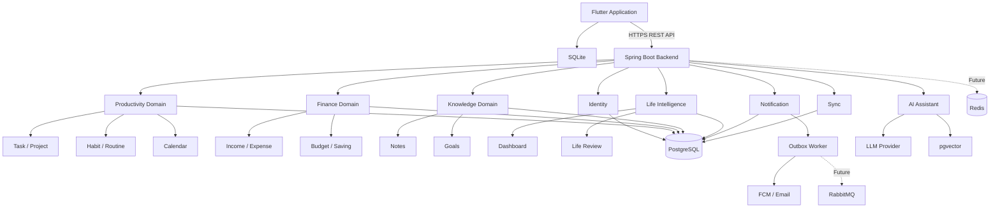
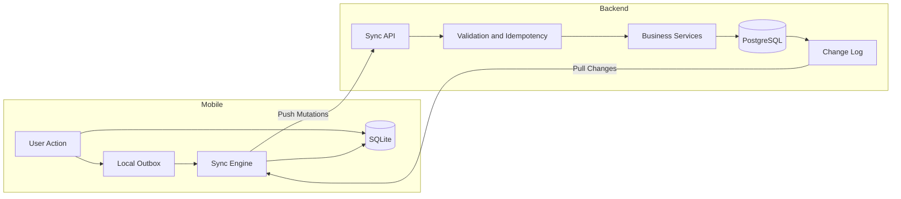
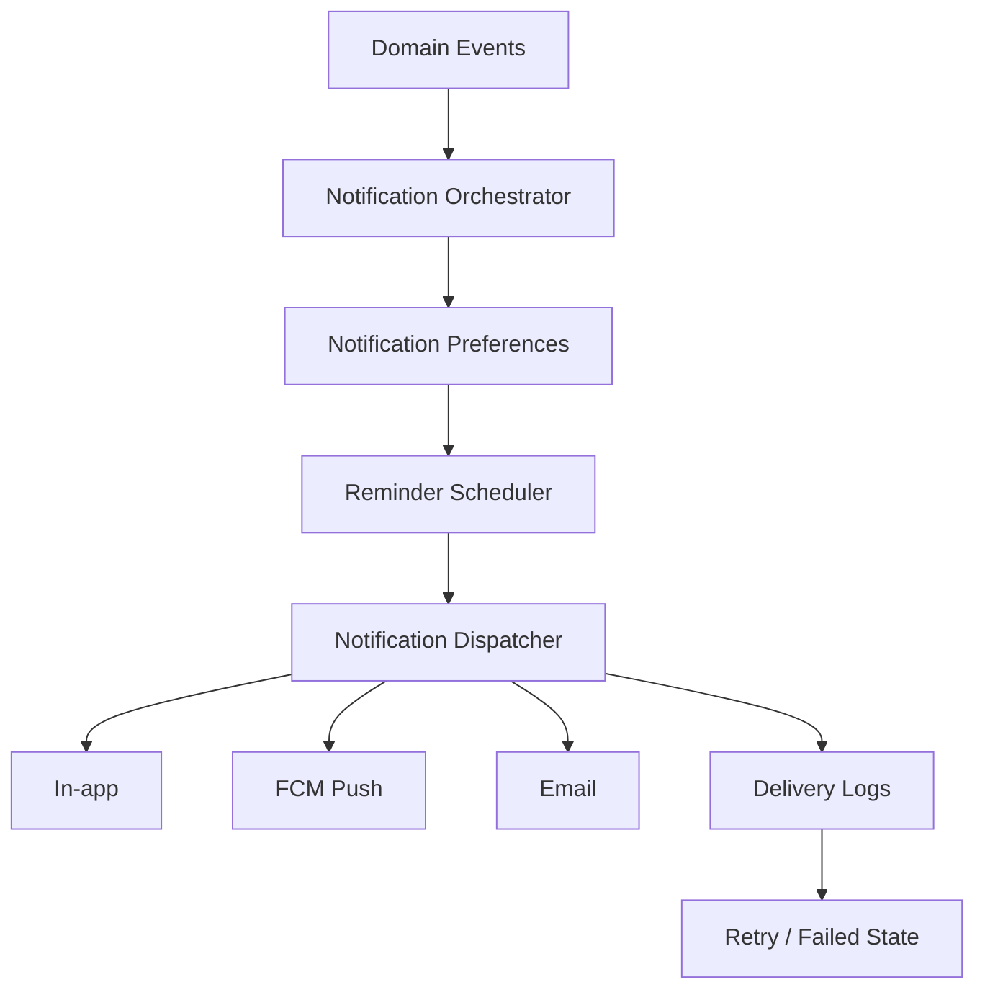

# LIFEOS – PRODUCT CONTEXT & ARCHITECTURE BASELINE

**Document Type:** Product Context / Architecture Baseline  
**Product Name:** LifeOS  
**Product Category:** Personal Life Management & AI Personal Assistant  
**Status:** Product Direction Confirmed – Ready for Product Requirements  
**Primary Goal:** Build a real-world personal life management application with strong Backend Engineering depth.

---

# 1. PRODUCT VISION

## 1.1. Product Overview

LifeOS (Personal Life Operating System) là một nền tảng quản lý cuộc sống cá nhân, giúp người dùng quản lý và kết nối các khía cạnh quan trọng trong cuộc sống tại một hệ thống duy nhất.

LifeOS không đơn thuần là một Todo List hoặc Task Management Application.

Sản phẩm hướng đến việc trở thành một **Personal Life Assistant** – trợ lý cá nhân hỗ trợ người dùng:

- Quản lý công việc và dự án.
- Quản lý thời gian và lịch trình.
- Xây dựng, duy trì thói quen.
- Quản lý thu nhập, chi tiêu và ngân sách.
- Quản lý ghi chú và kiến thức cá nhân.
- Theo dõi mục tiêu và sự phát triển bản thân.
- Nhận thông báo và nhắc nhở đúng thời điểm.
- Đánh giá tình hình cuộc sống dựa trên dữ liệu.
- Sử dụng AI để phân tích, lập kế hoạch và đề xuất hành động.

## 1.2. Product Mission

Giúp người dùng hiểu rõ tình hình cuộc sống, quản lý các hoạt động hằng ngày và đưa ra quyết định tốt hơn thông qua một nền tảng tập trung, thông minh và có khả năng hoạt động offline.

## 1.3. Product Vision Statement

"One place to manage your time, work, money, knowledge and personal growth."

LifeOS cần trả lời được những câu hỏi:

- Hôm nay tôi cần làm gì?
- Công việc nào quan trọng nhất?
- Tôi đang sử dụng thời gian như thế nào?
- Tôi có duy trì được những thói quen tốt không?
- Thu nhập và chi tiêu của tôi đang ra sao?
- Tôi có đang đi đúng hướng với mục tiêu của mình không?
- Những việc quan trọng nào sắp đến hạn?
- Tôi nên ưu tiên điều gì tiếp theo?
- Dựa trên dữ liệu cuộc sống, tôi có thể cải thiện điều gì?

---

# 2. PRODUCT PRINCIPLES

Các nguyên tắc định hướng sản phẩm:

### 2.1. Personal-first

- Thiết kế cho cá nhân sử dụng.
- Không tập trung vào team collaboration hoặc enterprise management.
- Không xây dựng hệ thống phân quyền tổ chức phức tạp.
- Dữ liệu của mỗi người dùng phải được cô lập an toàn.

### 2.2. Offline-first

- Người dùng có thể sử dụng các chức năng cốt lõi khi không có Internet.
- Dữ liệu được lưu trữ local trên thiết bị.
- Thay đổi offline được đưa vào hàng đợi đồng bộ.
- Khi online, dữ liệu được đồng bộ với Backend.
- Hỗ trợ nhiều thiết bị và xử lý xung đột dữ liệu.

### 2.3. One Source of Truth

- PostgreSQL là nguồn dữ liệu trung tâm sau khi đồng bộ.
- SQLite là local persistence của Flutter.
- Backend chịu trách nhiệm kiểm tra business rules và tính nhất quán.
- Không để client tự quyết định tính hợp lệ của dữ liệu nghiệp vụ.

### 2.4. Low Friction

- Người dùng có thể nhanh chóng ghi nhận công việc, chi tiêu, ý tưởng và hoạt động.
- Dashboard tập trung vào những thông tin cần thiết.
- Hạn chế các thao tác không cần thiết.

### 2.5. AI-assisted, Human-controlled

- AI hỗ trợ phân tích, lập kế hoạch và đề xuất.
- AI không được tự ý ghi dữ liệu hoặc thực hiện hành động nhạy cảm.
- Backend phải validate các hành động do AI đề xuất.
- Người dùng phải có quyền phê duyệt trước khi thực thi.

### 2.6. Backend Engineering First

Dự án đồng thời là môi trường thực hành Backend Engineering thực tế.

Ưu tiên các năng lực:

- Domain modeling.
- Database design.
- Transaction management.
- Concurrency control.
- Offline synchronization.
- Idempotency.
- Event-driven processing.
- Scheduling and background jobs.
- Caching.
- Observability.
- AI integration and RAG.

Không thêm công nghệ chỉ để làm kiến trúc phức tạp.

---

# 3. TARGET USERS & ACTORS

## 3.1. Primary Actor

**Personal User**

Người dùng cá nhân đã đăng ký tài khoản LifeOS.

Có thể thực hiện:

- Quản lý công việc.
- Quản lý thói quen.
- Quản lý lịch.
- Quản lý tài chính.
- Quản lý ghi chú.
- Quản lý mục tiêu.
- Theo dõi dữ liệu và báo cáo.
- Cấu hình thông báo.
- Sử dụng AI Assistant.
- Quản lý các thiết bị đăng nhập.

## 3.2. Supporting Actors / External Systems

- AI Provider: cung cấp khả năng xử lý ngôn ngữ và sinh nội dung.
- Firebase Cloud Messaging: gửi push notification.
- Email Provider: gửi email thông báo.
- Operating System Notification Service: local notification trên thiết bị.
- Scheduler / Background Worker: xử lý các công việc định kỳ.

Hiện tại không xác định Admin, Staff hoặc Organization User là actor nghiệp vụ của MVP.

---

# 4. PRODUCT MODULES

LifeOS được chia thành 13 nhóm chức năng chính.

## Module 01 – Identity & Account Management

Quản lý tài khoản và thiết bị.

Các chức năng:

- Register Account.
- Verify Email.
- Resend Verification Email.
- Login.
- Logout.
- Refresh Token.
- Forgot Password.
- Reset Password.
- View Profile.
- Update Profile.
- Change Password.
- Manage Devices.
- Register Device.
- Revoke Device.
- Delete Account.

## Module 02 – Task & Project Management

Quản lý công việc và dự án cá nhân.

Các chức năng Task:

- Create Task.
- View Task.
- Update Task.
- Delete Task.
- Complete Task.
- Reopen Task.
- Assign Priority.
- Set Due Date.
- Categorize Task.
- Filter Tasks.
- Search Tasks.
- Sort Tasks.
- Reschedule Task.
- Bulk Update Tasks.
- View Task History.

Các chức năng Project:

- Create Project.
- View Project.
- Update Project.
- Archive Project.
- Delete Project.
- Link Task to Project.
- View Project Progress.

Task là đơn vị công việc cơ bản. Project dùng để nhóm các Task có liên quan.

## Module 03 – Habit Management

Quản lý thói quen và theo dõi quá trình thực hiện.

Các chức năng:

- Create Habit.
- View Habit.
- Update Habit.
- Archive Habit.
- Delete Habit.
- Configure Frequency.
- Check-in Habit.
- Undo Check-in.
- Skip Habit.
- View Habit History.
- View Habit Streak.
- View Habit Statistics.

Habit cần hỗ trợ lịch thực hiện linh hoạt, không chỉ giới hạn mỗi ngày.

## Module 04 – Routine Management

Quản lý chuỗi hoạt động theo lịch trình cá nhân.

Các chức năng:

- Create Daily Routine.
- Create Weekly Routine.
- Configure Routine Steps.
- Update Routine.
- Start Routine.
- Complete Routine Step.
- Skip Routine Step.
- View Routine History.
- Track Routine Completion.

Ví dụ:

Morning Routine:
- Wake up.
- Exercise.
- Breakfast.
- Read.
- Prepare for work.

Routine và Habit là hai khái niệm khác nhau:

- Habit theo dõi một hành vi lặp lại.
- Routine là một chuỗi hoạt động có trình tự.

## Module 05 – Calendar & Time Management

Quản lý thời gian và lịch trình.

Các chức năng:

- View Calendar.
- Create Event.
- Update Event.
- Delete Event.
- Create Time Block.
- Update Time Block.
- Delete Time Block.
- Detect Schedule Conflict.
- Reschedule Event.
- View Daily Timeline.
- Configure Reminder.
- Manage Reminder.

Calendar hỗ trợ xem theo ngày, tuần và tháng.

Time Block cho phép phân bổ một khoảng thời gian cụ thể cho Task hoặc hoạt động.

## Module 06 – Personal Finance Management

Quản lý thu nhập, chi tiêu và dòng tiền cá nhân.

Các chức năng:

**Financial Account**
- Create Financial Account.
- View Financial Accounts.
- Update Financial Account.
- Archive Financial Account.

**Income**
- Create Income.
- View Income.
- Update Income.
- Delete Income.

**Expense**
- Create Expense.
- View Expense.
- Update Expense.
- Delete Expense.

**Transfer**
- Transfer Between Accounts.
- View Transfer History.

**Category**
- Manage Income Categories.
- Manage Expense Categories.

**Budget**
- Create Budget.
- Update Budget.
- Track Budget Usage.
- View Budget History.

**Recurring Transactions**
- Create Recurring Transaction.
- Update Recurring Transaction.
- Pause Recurring Transaction.
- Resume Recurring Transaction.
- Delete Recurring Transaction.

**Saving Goals**
- Create Saving Goal.
- Update Saving Goal.
- Add Saving Contribution.
- View Saving Progress.

**Financial Analytics**
- View Cash Flow.
- View Monthly Financial Report.
- View Financial History.
- Search & Filter Transactions.

Các nguồn thu nhập có thể bao gồm:
- Salary.
- Freelance.
- Bonus.
- Investment income.
- Other income.

Các loại chi tiêu có thể bao gồm:
- Food.
- Transportation.
- Housing.
- Education.
- Entertainment.
- Shopping.
- Healthcare.
- Other expenses.

Business rules quan trọng:

1. Mỗi giao dịch thu/chi phải thuộc một Financial Account.
2. Transfer giữa hai tài khoản không được tính là Income hoặc Expense.
3. Giao dịch đã xóa không được tiếp tục xuất hiện trong báo cáo.
4. Recurring Transaction phải tránh tạo giao dịch trùng khi retry.
5. Budget có chu kỳ xác định.
6. Hỗ trợ currency code, không mặc định toàn bộ tiền tệ là VND.
7. Số tiền dùng NUMERIC/DECIMAL, không dùng FLOAT hoặc DOUBLE.
8. Phải có cơ chế đối soát số dư với lịch sử giao dịch.

## Module 07 – Notes & Knowledge Management

Quản lý thông tin và kiến thức cá nhân.

Các chức năng:

- Create Note.
- View Note.
- Update Note.
- Delete Note.
- Archive Note.
- Create Tag.
- Assign Tag.
- Search Notes.
- Link Note to Task.
- Link Note to Goal.
- View Note History.
- Pin Note.

Có thể phát triển thêm full-text search và semantic search trong các phase sau.

## Module 08 – Goal & Personal Growth Management

Quản lý mục tiêu và quá trình phát triển bản thân.

Các chức năng:

- Create Goal.
- View Goal.
- Update Goal.
- Delete Goal.
- Archive Goal.
- Create Milestone.
- Update Milestone.
- Complete Milestone.
- Link Task to Goal.
- Link Habit to Goal.
- Track Goal Progress.
- View Goal Statistics.
- Review Goal.

Goal có thể thuộc các nhóm:
- Career.
- Learning.
- Finance.
- Health/Fitness.
- Personal Development.
- Other.

## Module 09 – Dashboard & Analytics

Cung cấp góc nhìn tổng hợp về cuộc sống.

Các chức năng:

- View Daily Dashboard.
- View Weekly Dashboard.
- View Monthly Dashboard.
- View Task Statistics.
- View Habit Statistics.
- View Goal Progress.
- View Productivity Trends.
- View Financial Overview.
- View Activity History.

Dashboard cần tổng hợp dữ liệu từ các module khác, tránh để Flutter phải tự gọi quá nhiều API độc lập.

## Module 10 – Offline & Synchronization

Đảm bảo hoạt động liên tục khi mất mạng và đồng bộ dữ liệu nhiều thiết bị.

Các chức năng:

- View Offline Data.
- Create Data Offline.
- Update Data Offline.
- Delete Data Offline.
- Queue Pending Changes.
- Push Local Changes.
- Pull Remote Changes.
- Retry Failed Sync.
- Detect Sync Conflict.
- Resolve Sync Conflict.
- View Sync Status.
- Force Synchronization.
- Recover Failed Sync.

> Chi tiết kỹ thuật đồng bộ: xem §8.2 và §9.

## Module 11 – Notification Management

Module thông báo dùng chung cho toàn bộ LifeOS.

Các nguồn phát sinh:

- Task deadline.
- Habit reminder.
- Routine reminder.
- Calendar event.
- Financial payment reminder.
- Budget threshold.
- Goal deadline.
- AI-generated review.
- Sync status.
- System notification.

Các chức năng:

- View Notifications.
- View Notification Detail.
- Mark as Read.
- Mark All as Read.
- Delete Notification.
- Clear Notifications.
- Configure Notification Preferences.
- Configure Quiet Hours.
- Configure Reminder.
- Snooze Notification.
- Receive Push Notification.
- Receive In-app Notification.
- View Notification History.
- Retry Failed Notification.
- Register Push Device.
- Revoke Push Device.
- Manage Scheduled Reminders.

Các delivery channels:

1. In-app Notification.
2. Push Notification – Firebase Cloud Messaging.
3. Email Notification – Email Provider.
4. Local Notification – Flutter/Operating System.

Phân biệt:

- Reminder: được lên lịch trước.
- Event Notification: phát sinh khi có sự kiện nghiệp vụ.

Notification architecture:

- NotificationController.
- NotificationService.
- NotificationOrchestrator.
- ReminderScheduler.
- NotificationDispatcher.
- PushNotificationService.
- EmailNotificationService.
- NotificationPreferenceService.
- NotificationRetryService.
- DeviceTokenService.

> Bảng dữ liệu: xem §8.1 (Notification, Calendar, Identity).

> Nguyên tắc xử lý tin cậy (Outbox, retry, delivery log, idempotency, quiet hours): xem §10.2.

Offline behavior:

- Flutter sử dụng local notification để nhắc việc khi không có Internet.
- Backend quản lý lịch reminder trung tâm.
- Reminder tạo offline được đồng bộ khi có mạng.
- Khi dữ liệu thay đổi, Flutter cập nhật lịch local notification.

## Module 12 – Life Review & Personal Analytics

Đánh giá và nhìn lại hoạt động cuộc sống.

Các chức năng:

- Generate Daily Review.
- Generate Weekly Review.
- Generate Monthly Review.
- Review Task Completion.
- Review Habit Consistency.
- Review Financial Activity.
- Review Goal Progress.
- Add Personal Reflection.

Module này tổng hợp dữ liệu từ Task, Habit, Finance, Calendar và Goal.

Mục tiêu không chỉ hiển thị thống kê mà còn giúp người dùng hiểu xu hướng và nhìn nhận tiến độ của bản thân.

## Module 13 – AI Personal Assistant

AI là lớp thông minh bổ sung cho LifeOS.

AI không thay thế business logic và không được tự ý thực hiện hành động nhạy cảm.

Các chức năng:

**AI Conversation**
- Chat with AI Assistant.
- View Conversation History.
- Manage AI Context.

**AI Productivity**
- Generate Daily Plan.
- Generate Weekly Plan.
- Suggest Task Priority.
- Break Down Task.
- Suggest Schedule.

**AI Habit & Growth**
- Analyze Habit Patterns.
- Recommend Goals.
- Explain Productivity Trends.

**AI Finance**
- Analyze Income and Expenses.
- Generate Financial Insights.
- Explain Budget Usage.
- Suggest Saving Improvements.

AI Finance chỉ cung cấp phân tích và gợi ý dựa trên dữ liệu người dùng cho phép, không tự thực hiện giao dịch tài chính.

**AI Knowledge**
- Summarize Notes.
- Semantic Search.
- Ask Personal Knowledge.

> AI hỗ trợ sinh Weekly/Monthly Review: xem Module 12.

**AI Actions**
- Propose Actions.
- Validate AI Actions.
- Approve AI Actions.
- Execute Approved Actions.

**AI Usage**
- View AI Usage History.
- Track Token Usage.
- Track AI Request Latency and Cost.

AI action flow:

1. User sends a request.
2. Backend authenticates the user.
3. Context Builder retrieves authorized user data.
4. LLM processes the request.
5. LLM returns structured output.
6. Backend validates the proposed action.
7. User reviews and approves.
8. Business Service executes the action.
9. Backend records the result.

---

# 5. CROSS-MODULE USER EXPERIENCE

LifeOS không nên chỉ là tập hợp các module CRUD độc lập.

Các trải nghiệm quan trọng cần kết nối nhiều module:

## 5.1. My Day

Tổng hợp:
- Tasks.
- Calendar.
- Habits.
- Routines.
- Reminders.
- Daily Goals.

Người dùng mở ứng dụng và thấy những gì cần làm trong ngày.

## 5.2. My Finance

Tổng hợp:
- Income.
- Expenses.
- Accounts.
- Budgets.
- Saving Goals.
- Upcoming Payments.

Giúp người dùng hiểu dòng tiền và tình hình tài chính.

## 5.3. My Life Review

Tổng hợp:
- Task completion.
- Habit consistency.
- Time usage.
- Financial activities.
- Goal progress.
- Personal reflection.

## 5.4. Ask LifeOS

Người dùng sử dụng ngôn ngữ tự nhiên để hỏi về dữ liệu cá nhân đã cấp quyền.

Ví dụ:

"Tuần này tôi đã sử dụng thời gian như thế nào?"

"Tháng này tôi có thể tiết kiệm được bao nhiêu?"

"Hãy lập kế hoạch học Backend cho tuần tới."

"Tại sao tuần vừa rồi tôi hoàn thành ít Task hơn?"

AI phân tích dữ liệu và đưa ra đề xuất, người dùng quyết định có thực hiện hay không.

---

# 6. TECHNOLOGY STACK

| Layer | Technology | Responsibility |
|---|---|---|
| Mobile | Flutter | Main client |
| Local Storage | SQLite | Offline persistence |
| Backend | Java + Spring Boot | Business logic, APIs |
| Architecture | Modular Monolith | Domain separation |
| Primary Database | PostgreSQL | Persistent data |
| Cache | Redis | Dashboard/statistics caching |
| Async Processing | RabbitMQ | Background processing |
| Event Reliability | Transactional Outbox | Reliable event publishing |
| Push Notification | Firebase Cloud Messaging | Push delivery |
| Email | Email Provider | Email delivery |
| AI Framework | Spring AI | LLM integration |
| Vector Search | PostgreSQL + pgvector | Semantic search/RAG |
| Deployment | Docker Compose | Initial deployment |
| Monitoring | Spring Boot Actuator + Prometheus + Grafana | Observability |

Technology adoption principles:

- PostgreSQL và SQLite là nền tảng từ đầu.
- Redis chỉ được bổ sung khi có nhu cầu cache.
- RabbitMQ không bắt buộc trong MVP.
- Transactional Outbox được sử dụng khi triển khai reliable asynchronous processing.
- Không sử dụng Microservices ở giai đoạn đầu.
- AI Provider phải được abstraction qua interface.
- Không để API key của AI Provider trong Flutter.

---

# 7. BACKEND ARCHITECTURE

## 7.1. Architecture Decision

**Spring Boot Modular Monolith**

Không triển khai Microservices ngay từ đầu vì:

- Sản phẩm chủ yếu phục vụ cá nhân.
- Quy mô nghiệp vụ ban đầu chưa cần distributed deployment.
- Một developer có thể quản lý và phát triển dễ dàng hơn.
- Giảm độ phức tạp của transaction, deployment và monitoring.
- Vẫn đảm bảo domain boundary để mở rộng sau này.

## 7.2. Proposed Package Structure

```text
com.lifeos
├── common
│   ├── config
│   ├── exception
│   ├── security
│   ├── response
│   └── util
│
├── identity
├── task
├── project
├── habit
├── routine
├── calendar
├── finance
├── note
├── goal
├── dashboard
├── lifereview
├── notification
├── sync
└── ai
```

Mỗi module có thể chia theo:

```text
module/
├── controller/
├── service/
├── repository/
├── entity/
├── dto/
└── mapper/
```

Module khác không nên truy cập trực tiếp repository nội bộ. Giao tiếp thông qua public application service hoặc query interface.

## 7.3. High-Level Architecture



Productivity Domain, Finance Domain, Knowledge Domain và Life Intelligence là nhóm logic, không phải các microservices riêng.

---

# 8. DATABASE DESIGN DIRECTION

## 8.1. Core Tables

Identity:
- users.
- user_settings.
- devices.

Task & Project:
- tasks.
- projects.
- categories.
- task_history.

Habit & Routine:
- habits.
- habit_checkins.
- routines.
- routine_steps.
- routine_logs.

Calendar:
- calendar_events.
- time_blocks.

Finance:
- financial_accounts.
- financial_categories.
- financial_transactions.
- account_transfers.
- budgets.
- recurring_transactions.
- saving_goals.
- saving_contributions.

Notes & Knowledge:
- notes.
- tags.
- note_tags.

Goals:
- goals.
- milestones.

Notification:
- notifications.
- notification_preferences.
- notification_deliveries.
- notification_templates.
- reminders.
- device_push_tokens.

Sync:
- sync_mutations.
- change_logs.
- user_sync_state.
- outbox_events.

AI:
- ai_conversations.
- ai_messages.
- ai_usage_logs.
- ai_user_preferences.
- ai_action_proposals.
- ai_documents.
- ai_embeddings.

Đây là danh sách định hướng, không phải schema cuối cùng. Product Requirements và ERD sẽ quyết định chính xác bảng, quan hệ, constraints và indexes.

## 8.2. Database Design Principles

- UUID cho entity IDs, hỗ trợ tạo dữ liệu offline.
- Dữ liệu cá nhân gắn với user_id.
- Foreign keys và unique constraints được thiết kế rõ ràng.
- Soft Delete/Tombstone cho dữ liệu cần đồng bộ.
- Version cho optimistic locking.
- TIMESTAMPTZ cho thời điểm cụ thể.
- DATE cho ngày nghiệp vụ như Habit Check-in.
- NUMERIC/DECIMAL cho dữ liệu tài chính.
- Index theo query pattern thực tế.
- Không tạo cache thay thế nguồn dữ liệu gốc.

---

# 9. OFFLINE-FIRST SYNCHRONIZATION DESIGN

## 9.1. Core Architecture



## 9.2. Push Flow

Client gửi các mutations chưa đồng bộ.

Mỗi mutation bao gồm:
- mutationId.
- entityType.
- entityId.
- operation.
- baseVersion.
- payload.

Backend:
1. Authenticate user.
2. Authorize entity ownership.
3. Check idempotency.
4. Validate baseVersion.
5. Validate business rules.
6. Execute mutation.
7. Increase entity version.
8. Save mutation result and change log in a consistent transaction.
9. Return result.

## 9.3. Pull Flow

Client gửi cursor.

Backend trả:
- Changes.
- Operation.
- Entity ID.
- Entity version.
- Next cursor.
- Has more.

Cursor được quản lý phía server, không dựa trên timestamp do client cung cấp.

## 9.4. Conflict Resolution

Chiến lược dự kiến:

| Data | Strategy |
|---|---|
| Task | Optimistic locking, user-assisted conflict resolution |
| Habit Check-in | Idempotent upsert + unique constraint |
| Notes | Conflict copy để tránh mất nội dung |
| Calendar Event | Optimistic locking + overlap validation |
| Goal | Optimistic locking |
| Finance Transaction | Không tự động ghi đè; yêu cầu xử lý conflict an toàn |

Không áp dụng Last Write Wins cho mọi entity.

---

# 10. NOTIFICATION ARCHITECTURE

## 10.1. Notification Flow



## 10.2. Reliable Processing

- Domain transaction ghi dữ liệu nghiệp vụ và outbox event.
- Outbox worker đọc event chưa xử lý.
- Notification Dispatcher thực hiện delivery.
- Delivery status được lưu riêng theo channel.
- Retry cho lỗi tạm thời.
- Có idempotency để giảm nguy cơ gửi trùng.
- Có lịch sử xử lý và khả năng phục hồi.

## 10.3. Offline Notification

Flutter local notification hỗ trợ nhắc việc khi mất mạng.

Backend notification hỗ trợ:
- Cross-device notification.
- Scheduled reminder trung tâm.
- Event-driven notification.
- Email và push delivery.

---

# 11. AI ARCHITECTURE

## 11.1. AI Backend Design

```text
ai/
├── controller/
│   ├── AIChatController
│   ├── AIPlanController
│   └── AIKnowledgeController
│
├── service/
│   ├── AIOrchestratorService
│   ├── ContextBuilderService
│   ├── PromptService
│   ├── AIProviderService
│   ├── RAGService
│   └── AIActionService
│
├── provider/
│   ├── LLMProvider
│   └── OpenAIProvider
│
├── tool/
│   ├── TaskTool
│   ├── CalendarTool
│   ├── HabitTool
│   ├── FinanceTool
│   └── GoalTool
│
├── entity/
├── repository/
└── dto/
```

AI request phải đi qua Spring Boot.

Không để Flutter trực tiếp gọi LLM Provider với API key bí mật.

## 11.2. AI Data

> Các bảng AI: xem §8.1.

## 11.3. AI Safety & Privacy

- Context phải được giới hạn theo user và quyền truy cập.
- Không gửi dữ liệu không cần thiết đến AI Provider.
- Người dùng kiểm soát dữ liệu được phép sử dụng.
- Finance data cần có quyền truy cập riêng.
- Không tự động thực hiện giao dịch tài chính.
- AI action cần được backend validate.
- Hành động ghi dữ liệu cần user approval.
- Lưu usage logs để theo dõi chi phí và hiệu năng.

---

# 12. DEVELOPMENT ROADMAP

Thứ tự phát triển chính thức:

## Phase 1 – Foundation & Task Management

- Spring Boot foundation.
- Authentication.
- User and Device.
- PostgreSQL.
- Flutter + SQLite.
- CRUD Task.
- Project and Category.
- Offline local persistence.
- Basic local notification.
- Sync push/pull tối thiểu theo đúng giao thức (mutationId, baseVersion, cursor seq theo user, tombstone).
- Cột đồng bộ chuẩn và change_logs ngay từ schema đầu.

Deliverable: Quản lý Task online/offline.

## Phase 2 – Habit & Routine Management

- Habit.
- Habit Check-in.
- Streak.
- Routine.
- Daily Dashboard.
- Habit Statistics.

Deliverable: Quản lý công việc và thói quen hằng ngày.

> **MVP kết thúc ở Phase 2** (đã chốt). Phase 3 trở đi là sau-MVP.

## Phase 3 – Personal Finance

- Income.
- Expense.
- Financial Account.
- Transfer.
- Category.
- Budget.
- Recurring Transaction.
- Saving Goal.
- Financial Reports.

Deliverable: Quản lý tài chính cá nhân.

## Phase 4 – Calendar & Notification System

- Calendar Event.
- Time Block.
- Reminder Scheduler.
- Notification Module.
- In-app Notification.
- FCM.
- Email.
- Notification Preferences.
- Quiet Hours.
- Outbox.
- Retry and Delivery Logs.

Deliverable: LifeOS có khả năng chủ động nhắc nhở.

## Phase 5 – Offline Synchronization

- Push/Pull.
- Cursor-based synchronization.
- Idempotency.
- Optimistic Locking.
- Conflict Resolution.
- Tombstone.
- Multi-device sync.

Deliverable: Đồng bộ dữ liệu ổn định giữa nhiều thiết bị.

Lưu ý: Offline local CRUD, local notification và sync push/pull tối thiểu đã có từ Phase 1. Phase 5 nâng cấp: conflict UI, multi-device, recovery, full resync, Finance conflict handling.

## Phase 6 – Knowledge & Personal Growth

- Notes.
- Tags.
- Search.
- Goals.
- Milestones.
- Task/Habit to Goal linking.

Deliverable: Quản lý kiến thức và mục tiêu cá nhân.

## Phase 7 – Life Intelligence & Analytics

- Daily Review.
- Weekly Review.
- Monthly Review.
- Productivity Analytics.
- Financial Analytics.
- Habit Trends.
- Cross-domain Dashboard.
- Redis.
- Monitoring.
- SQL Optimization.

Deliverable: Hiểu tình hình cuộc sống qua dữ liệu.

## Phase 8 – AI Personal Assistant

- AI Chat.
- Daily/Weekly Planning.
- Task Breakdown.
- Priority Suggestion.
- Schedule Suggestion.
- Habit Analysis.
- Financial Insights.
- Note Summarization.
- RAG.
- Semantic Search.
- AI Tool Calling.
- User-approved Actions.

Deliverable: LifeOS trở thành trợ lý cá nhân có khả năng hiểu và hỗ trợ quyết định.

---

# 13. NON-FUNCTIONAL REQUIREMENTS – INITIAL DIRECTION

| Area | Initial Direction |
|---|---|
| Offline | CRUD cốt lõi không cần Internet |
| Sync | Retry và conflict handling |
| Security | JWT, ownership validation |
| Data isolation | Per-user data isolation |
| Reliability | Idempotent processing |
| Performance | API p95 target dưới 300ms trong môi trường thử nghiệm đối với CRUD thông thường |
| Maintainability | Modular Monolith |
| Observability | Logs, metrics, tracing |
| Backup | PostgreSQL backup and restore |
| Privacy | Explicit AI context permissions |
| Notification | Delivery tracking and retry |
| Financial accuracy | Decimal-based money calculations |

Các mục tiêu hiệu năng cần được xác nhận bằng benchmark và workload thực tế.

---

# 14. PRODUCT SCOPE BOUNDARIES

## In Scope

- Personal life management.
- Task and project management.
- Habit and routine tracking.
- Calendar and time management.
- Personal income and expense tracking.
- Budget and saving goals.
- Notes and knowledge management.
- Personal goals and growth.
- Notifications.
- Offline-first synchronization.
- Cross-domain dashboard and life review.
- AI personal assistant.

## Out of Scope – Initial Versions

- Team collaboration.
- Enterprise workspace.
- Social network.
- Public content sharing.
- Payment gateway.
- Bank account integration/Open Banking.
- Automatic financial transactions.
- Full accounting system.
- Investment trading.
- AI autonomous actions without approval.
- Microservices architecture at initial stage.

Các tính năng ngoài scope có thể được đánh giá lại trong tương lai, nhưng không phải yêu cầu hiện tại.

---

# 15. KEY ARCHITECTURE DECISIONS

> Đã gộp vào §6 (Technology Stack), §7 (Architecture), §9 (Sync) để tránh trùng lặp.

---

# 16. ITEMS TO DEFINE DURING PRODUCT REQUIREMENTS

Các mục dưới đây chưa được chốt chi tiết. PRD/SRS cần làm rõ trước khi implementation.

## Product & User Experience

- Main navigation và information architecture.
- Dashboard layout.
- Onboarding flow.
- User settings.
- Quick capture experience.
- Search experience.
- Data export and account deletion behavior.

## Task & Productivity

- Task status lifecycle.
- Task dependencies.
- Subtasks.
- Recurrence rules.
- Project structure.
- Task estimation.
- Routine and Habit relationship.

## Finance

- Multi-currency conversion policy.
- Opening balance.
- Account reconciliation.
- Refunds.
- Debt and lending.
- Budget calculation.
- Recurring transaction generation policy.
- Financial report formulas.
- Data import/export.

## Notification

- Notification priority.
- Quiet hours behavior.
- Timezone handling.
- Retry policy.
- Push token lifecycle.
- Email notification rules.
- Notification retention.
- Duplicate prevention.

## Offline Sync

- Batch size.
- Conflict UI.
- Tombstone retention.
- Cursor retention.
- Full resynchronization.
- Device recovery.
- Data encryption at rest.
- Offline account deletion behavior.

## AI

- AI provider selection.
- Model selection.
- Usage limits.
- Context permissions.
- Conversation retention.
- RAG document indexing.
- AI action approval UX.
- AI data deletion.
- Cost controls.

## Security & Operations

- Access token and refresh token lifetime.
- Backup frequency.
- Restore procedure.
- Rate limits.
- Audit logging.
- Monitoring thresholds.
- Deployment and CI/CD.

---

# 17. PRODUCT SUCCESS CRITERIA

LifeOS cần được đánh giá theo giá trị sử dụng thật, không chỉ theo số lượng chức năng.

Initial success criteria:

1. Người dùng có thể quản lý công việc và thói quen hằng ngày.
2. Người dùng có thể quản lý thu nhập, chi tiêu và ngân sách.
3. Người dùng có thể xem tổng quan cuộc sống trên một dashboard.
4. Người dùng nhận được reminder đúng thời điểm.
5. Ứng dụng vẫn hoạt động khi offline.
6. Dữ liệu được đồng bộ an toàn giữa nhiều thiết bị.
7. Không mất dữ liệu đã được server xác nhận.
8. AI có thể phân tích dữ liệu được cấp quyền và đưa ra đề xuất hữu ích.
9. Người dùng có quyền kiểm soát mọi hành động ghi dữ liệu của AI.

---

# 18. FINAL PRODUCT STATEMENT

**Core philosophy:**

"LifeOS does not just help users manage tasks. It helps users understand and manage their lives."

---

# 19. ĐIỂM CÒN THIẾU & KHÔNG NHẤT QUÁN (cần bổ sung/chốt)

> Mục này được thêm khi rà soát. Chưa phải quyết định; cần người dùng chốt.

## 19.1. Còn thiếu

1. ~~Định nghĩa MVP~~ → **Đã chốt:** MVP = Phase 1–2 (Task, Project, Habit, Routine, Daily Dashboard, offline local, local notification cơ bản).
2. ~~Nền tảng và ngôn ngữ~~ → **Đã chốt:** Android + iOS; giao diện chỉ tiếng Việt nhưng chuỗi nằm trong file localization (sẵn i18n để thêm tiếng Anh sau); tiền tệ mặc định VND. Còn mở: phiên bản OS tối thiểu.
3. ~~Phạm vi xác thực~~ → **Đã chốt (MVP):** email + mật khẩu, có xác minh email, kèm forgot/reset password. Không có đăng nhập mạng xã hội. Cần Email Provider ngay từ Phase 1. Token: access 15 phút, refresh 30 ngày xoay vòng; có bảng `refresh_tokens`, `email_verification_tokens`, `password_reset_tokens`. Còn mở: rate limit, chính sách mật khẩu, khóa tài khoản, thời hạn token xác minh/reset.
4. ~~User settings~~ → **Đã chốt:** bảng `user_settings` (module identity) gồm `timezone` (IANA), `locale`, `default_currency` (mặc định VND), `week_start_day`.
5. **Bảng dữ liệu chưa có trong §8.1:** `refresh_tokens`, `password_reset_tokens`, trạng thái sync theo thiết bị (cursor), `audit_logs`, quyền dùng dữ liệu cho AI (consent), lịch sử ghi chú (cho "View Note History"), bảng liên kết Goal–Task/Habit và Note–Task/Goal, `budget_categories`.
6. **Quy mô dự kiến:** số người dùng, khối lượng dữ liệu; cần để kiểm chứng mục tiêu p95 < 300ms.
7. **Dữ liệu và quyền riêng tư:** retention, export dữ liệu, xóa tài khoản (cascade), backup (RPO/RTO) mới chỉ nằm ở danh sách cần định nghĩa.
8. **Quy ước API:** versioning, định dạng lỗi, phân trang.
9. **Chiến lược test và CI/CD:** chỉ được nhắc ở §16, chưa có định hướng.
10. **Rủi ro và giả định:** một developer, thời gian, phụ thuộc nhà cung cấp AI/FCM.
11. **Bảng thuật ngữ:** Event vs Time Block vs Reminder vs Notification; Habit vs Routine đã có.

## 19.2. Không nhất quán / mơ hồ

1. ~~Reminder ở hai module~~ → **Đã chốt:** module `notification` sở hữu bảng `reminders` và lịch nhắc; Calendar/Task chỉ tham chiếu (entityType, entityId).
2. ~~Device / push token~~ → **Đã chốt:** `identity` sở hữu `devices`; `notification` sở hữu `device_push_tokens` (tham chiếu `device_id`).
3. **Habit Statistics** có ở Module 03 và Module 09; **Weekly/Monthly Review** có ở Module 12 và Module 13.
4. **"Daily Goals"** trong §5.1 My Day không được định nghĩa ở Module 08.
5. ~~Tên package `life_review`~~ → **Đã chốt:** `lifereview`.
6. **Thứ tự phase:** Finance (Phase 3) làm trước Sync (Phase 5) trong khi Finance có quy tắc conflict riêng; cần thiết kế sẵn `version`, tombstone, UUID từ Phase 1.
